# Jetson-SO100-OAK-ROS2

Robotic manipulation cell: **two SO-100 arms** (six Feetech servos each, 7.5 V supply) + an **OAK-D POE camera (USB-C)** + **two USB RGB webcams on the wrists, manually focused at 10-15 cm** (ADR-0022), governed by a **Jetson Xavier NX 16 GB** (Ubuntu 20.04, JetPack 5.1.5) running **ROS2 Humble in Docker containers**. Arm 1 keeps the topics it always had (`/joint_states`, `/joint_targets`, `/gripper/…`, frames `base…gripper`); **arm 2 lives under `/arm2/…` with the TF prefix `arm2_`, 30 cm from arm 1** (the plans and risks are in [§3.5](#35-a-second-arm--what-usb-can-and-cannot-take) and [§3.6](#36-two-arm-integration--the-risks-explained)).

A Windows 11 Home PC on the same LAN provides visualization (noVNC in Chromium), GraspGen inference, policy training (MuJoCo / Isaac Sim) and teleoperation with a Logitech F710.


**Legend:** solid green = implemented and verified on the hardware; amber = code written but
the hardware or the capture is still pending (arm 2 calibration / the second wrist camera); dashed grey = missing. The picture
is generated by `tools/make_architecture_flow.py` from the same facts as [§2](#2-status-and-what-is-next), so it is regenerated
rather than redrawn, and the band at the bottom lists what is still to build.

## Abbreviations used in this document

| Term | Means |
|---|---|
| **ROS 2 / Humble** | the robotics middleware the stack runs on; *Humble* is the ROS 2 LTS release used here, paired 1:1 with this distro's Ubuntu 20.04 |
| **ADR** | Architecture Decision Record — a short note that records a decision and why it was taken (`docs/ADR-*.md`) |
| **URDF** | Unified Robot Description Format — the XML describing the arm's links, joints and 3-D meshes |
| **MJCF** | the MuJoCo XML format — the same robot described for the MuJoCo simulator |
| **FK / IK** | Forward / Inverse Kinematics — from joint angles to the hand's pose, or back from a pose to angles |
| **DDS / ROS_DOMAIN_ID** | the network layer ROS 2 ships over; the *domain id* is a number that mutes the network, so two robot cells on one LAN do not hear each other |
| **QoS** | Quality of Service — how a ROS topic is delivered (reliable vs. best-effort, and how long old messages survive for late subscribers) |
| **TF / TF2** | the topic carrying where each frame (arm `Base`, cameras, …) is relative to the others |
| **RViz / RViz2** | the 3-D viewer that draws the robot model and its sensors |
| **rqt_graph** | the tool that draws which ROS node publishes to which topic |
| **OAK / OAK-D** | the scene camera — a DepthAI stereo camera (IMX378 colour + two OV9282 mono) from which the depth is made |
| **DepthAI** | the SDK/library that talks to the OAK's silicon (it runs on the Xavier) |
| **USB 3 / Gb/s** | USB speed; the OAK must use a real USB 3 data cable (5 Gb/s, `5000M` in `lsusb -t`), not a charge-only one |
| **MJPEG** | Motion JPEG — a stream of JPEG stills; how the camera tabs push video to the browser with no plugin |
| **JPEG / CompressedImage** | a compressed image; in ROS it is the `sensor_msgs/CompressedImage` message (e.g. `/gripper/image/compressed`) |
| **WebSocket / rosbridge** | a persistent TCP connection a browser can speak; *rosbridge* turns those into ROS topics (used by the MuJoCo twin and the pad) |
| **ttyd** | the tiny web server in `so100-web` that exposes the Terminal Xavier NX tab (a shell on the host, in the browser) |
| **noVNC / websockify / VNC** | browser-friendly virtual screens: *Xvfb* fakes a monitor, *x11vnc* shares it, *websockify* lets a browser view it |
| **X11 / X server / Qt** | the Linux graphical system (X11); Qt is the toolkit RViz2 is built on |
| **llvmpipe** | the software 3-D renderer used here because this board has no GPU path for Qt — it costs CPU |
| **MuJoCo** | the physics simulator used for the twin and for training data |
| **F710** | the Logitech Wireless Gamepad F710 used for teleop |
| **ChArUco** | a printed calibration board (chessboard fused with ArUco markers) used to locate the camera in the world |
| **IP / LAN** | Internet Protocol / Local Area Network — the home network the Xavier, the PC and the browser share |
| **Hz / fps** | hertz / frames per second — how often something happens per second (a topic at 50 Hz = 50 messages/s) |

## Contents

- **[Abbreviations used in this document](#abbreviations-used-in-this-document)**
- **[1. The joints — one name for every layer](#1-the-joints--one-name-for-every-layer)**
- **[2. Status and what is next](#2-status-and-what-is-next)**
  - [2.1 Phases](#21-phases)
  - [2.2 Implemented on the hardware](#22-implemented-on-the-hardware)
  - [2.3 Next](#23-next)
- **[3. Prerequisites](#3-prerequisites)**
  - [3.1 Hardware](#31-hardware)
  - [3.2 Host software](#32-host-software)
  - [3.3 Access, groups, network](#33-access-groups-network)
  - [3.4 What you need from the repository](#34-what-you-need-from-the-repository)
  - [3.5 A second arm — what USB can and cannot take](#35-a-second-arm--what-usb-can-and-cannot-take)
  - [3.6 Two-arm integration — the risks, explained](#36-two-arm-integration--the-risks-explained)
- **[4. Arm bring-up — uv + LeRobot SDK (arm)](#4-arm-bring-up--uv--lerobot-sdk-arm)**
  - [4.1 Re-calibrating the arm (with pose pictures)](#41-re-calibrating-the-arm-with-pose-pictures)
- **[5. Camera bring-up — depthai on the Xavier](#5-camera-bring-up--depthai-on-the-xavier)**
- **[6. Container stack — how the Xavier runs the robot](#6-container-stack--how-the-xavier-runs-the-robot)**
  - [6.1 Deploying and creating the containers](#61-deploying-and-creating-the-containers)
- **[7. Verifying the data flow](#7-verifying-the-data-flow)**
  - [7.1 Containers, ports, topics, transforms](#71-containers-ports-topics-transforms)
  - [7.2 The arm in RViz — model, URDF and the QoS/view config](#72-the-arm-in-rviz--model-urdf-and-the-qosview-config)
- **[8. Web interface — Terminal · Stereo & Depth · Cloud · Graph · RViz](#8-web-interface--terminal--stereo--depth--cloud--graph--rviz)**
  - [8.1 Day-to-day: from cold to moving the arm](#81-day-to-day-from-cold-to-moving-the-arm)
  - [8.2 Torque switch — the red button](#82-torque-switch--the-red-button)
  - [8.3 What runs inside `so100-web`](#83-what-runs-inside-so100-web)
  - [8.4 The image: the **desktop** dusty image, no compiling](#84-the-image-the-desktop-dusty-image-no-compiling)
  - [8.5 `entry.sh` — the container's whole startup](#85-entrysh--the-containers-whole-startup)
- **[9. Operator PC — teleop + visualization](#9-operator-pc--teleop--visualization)**
  - [9.1 MuJoCo model check (ADR-0016)](#91-mujoco-model-check-adr-0016)
  - [9.2 MuJoCo twin — live mirror of the real arm (rosbridge WebSocket, ADR-0019)](#92-mujoco-twin--live-mirror-of-the-real-arm-rosbridge-websocket-adr-0019)
  - [9.3 F710 teleop — the pad (ADR-0017, amended by ADR-0020)](#93-f710-teleop--the-pad-adr-0017-amended-by-adr-0020)
  - [9.4 Nothing on the PC needs ROS2 — or a firewall rule](#94-nothing-on-the-pc-needs-ros2--or-a-firewall-rule)
- **[10. Perception — what the cloud sees, and its calibration](#10-perception--what-the-cloud-sees-and-its-calibration)**
  - [10.1 Depth: range, texture and what the cloud can and cannot see](#101-depth-range-texture-and-what-the-cloud-can-and-cannot-see)
  - [10.2 Cost: what the streams actually spend on the Xavier](#102-cost-what-the-streams-actually-spend-on-the-xavier)
  - [10.3 Hand-eye — where the camera sits in the arm's frame](#103-hand-eye--where-the-camera-sits-in-the-arms-frame)
  - [10.4 Depth scale, and colour to depth registration](#104-depth-scale-and-colour-to-depth-registration)
  - [10.5 The gripper camera — is it in focus at 10-15 cm?](#105-the-gripper-camera--is-it-in-focus-at-10-15-cm)
  - [10.6 The cloud in the colour frame, coloured](#106-the-cloud-in-the-colour-frame-coloured)
  - [10.7 Static transforms — and the wrist camera's](#107-static-transforms--and-the-wrist-cameras)
- **[11. Node and topic reference](#11-node-and-topic-reference)**
  - [11.1 so100-arm — the arm](#111-so100-arm--the-arm)
  - [11.2 so100-cams — the cameras](#112-so100-cams--the-cameras)
  - [11.3 so100-web — the browser](#113-so100-web--the-browser)
  - [11.4 so100-rosbridge — the WebSocket bridge (MuJoCo twin, ADR-0019)](#114-so100-rosbridge--the-websocket-bridge-mujoco-twin-adr-0019)
  - [11.5 so100-control — the IK node (ADR-0009)](#115-so100-control--the-ik-node-adr-0009)
- **[12. Troubleshooting](#12-troubleshooting)**
  - [12.1 The tabs](#121-the-tabs)
  - [12.2 Everything else](#122-everything-else)
- **[13. How we work](#13-how-we-work)**
- **[14. Documentation](#14-documentation)**

## 1. The joints — one name for every layer

All six joints keep **the same name in every layer** — LeRobot bus, joint server, `arm_bridge`,
`/joint_states`, URDF, MJCF, RViz, the MuJoCo twin and the F710 client. What differs is the motor
number, the array index, the unit (degrees in the driver, radians in the model) and the limits
(the model's per-joint ranges against the driver's coarse ±170° clamp). The figure below is the
reference for all of it; it is generated by `tools/make_joint_names_figure.py` from the same MJCF
the URDF comes from, so it cannot drift.


## 2. Status and what is next

What is planned, what has actually been verified on the bench, and what is still
missing. The phase list is the plan as written down; **2.2** is the part that has been
seen working on this hardware, so trust it over the plan when they disagree.

### 2.1 Phases

- [x] Phase 0: repo + engineering prompt (`docs/PROMPT.md`)
- [x] Phase 1: ROS2 Humble in containers, FastDDS, domain 42 (ADR-0001, ADR-0002)
- [x] Phase 2: Docker — per-domain containers, zero-copy, `--ipc=host` (ADR-0003…0005)
- [x] Phase 3: drivers — LeRobot (arm), depthai-core (scene OAK-D; the wrist camera is a plain UVC webcam, ADR-0022) (ADR-0006…0008, ADR-0022)
- [ ] Phase 4: control — joint-space API and camera mounting done; hand-eye at 29 mm, and the IK node, episode recording and GraspGen still to build (ADR-0009…0013)
- [x] Phase 5: RViz — headless RViz2 + noVNC (ADR-0014)
- [x] Phase 6: Windows — noVNC in Chromium, MuJoCo twin, F710 teleop over rosbridge (ADR-0015…0017, amended by ADR-0020)
- [x] Phase 7: web interface — noVNC tabs + ttyd (ADR-0018)
- [x] Phase 8: architecture doc + diagram, v0.1 tag
- [ ] Implementation on the hardware (see `docs/architecture.md` → open items)

### 2.2 Implemented on the hardware

- [x] Arm: LeRobot SDK (`~/lerobot/.venv`, py3.12) + calibration on the Xavier; all 6 motors verified over the bus (ADR-0006 amended — no adapter flash needed)
- [x] The arm is physically an **SO-100** (Feetech servos, 7.5 V supply) and the **models in use are the SO-101**: the URDF is generated from `robotstudio_so101/so101.xml`, RViz draws that robot and FK matches the MuJoCo twin to the millimetre (ADR-0021). Regenerating both models from the SO-100 MJCF is still open ([§2.3](#23-next))
- [x] depthai-core from source on the NX (ADR-0007) — core v2.33.0 + bindings installed on the Xavier
- [x] Compose file + provisioning script for the **six** services (five cell domains + rosbridge)
- [x] MuJoCo twin live: rosbridge container on ws://:9090 (jammy image, ADR-0019); Windows twin mirrors /joint_states at 50 Hz — verified end-to-end 2026-11-08 (398 msgs / 8 s from a LAN PC)
- [x] Web interface: **six tabs live** — Terminal Xavier NX, Stereo Cams & Depth OAK-D, Point Cloud OAK-D, Gripper Cams, Temp Xavier NX, Graph, RViz — plus the torque switch (ADR-0014/0015/0018)
- [x] F710 teleop over rosbridge from the Windows PC (ADR-0020): all six joints and the gripper, torque on/off by holding B for 5 s
- [x] Point cloud: unprojected with the depth camera's own intrinsics, extended disparity (range from ~0.65 m down to ~0.33 m), left/right check; scale measured at 0.315 m against PnP geometry — depth reads **+3.0%**, spread ±1% over 100k board pixels
- [x] Colour ↔ depth **registration**: homography from the board, 48 correspondences, 0.69 px rms — `docs/calibration/color_to_depth.yaml`

- [x] **Point cloud in the colour frame, coloured** — `/oak/scene/points` carries `x, y, z, rgb` in `scene_color_optical_frame`, built from the device's depth→colour extrinsic and the colour intrinsics ([§10.6](#106-the-cloud-in-the-colour-frame-coloured)). Verified on the bench 2026-11-11: 56k points at ~2 Hz, colours on the objects. Unblocks object segmentation in 3D, GraspGen targets and VLM pointing

- [x] **IK node (ADR-0009)** — `so100-control` runs `ik`: a pose on `/ik/target` (in `base`) becomes joint angles on `/ik/solution`, and on `/joint_targets` only when `IK_APPLY=1`. Damped least squares with the geometric Jacobian and the URDF limits, ~30 ms per solve. Verified 2026-11-11: round trip over 200 random poses — median **0.00 mm**, p95 **0.46 mm**, worst 0.49 mm; a 2 m target is correctly refused; live test returns the arm's own pose in 1 iteration. The jaw is held, never solved

### 2.3 Next

- [ ] **Depth scale, second distance** — repeat the PnP-vs-depth check at ~0.40 m to tell a proportional error from a fixed offset, then decide whether `OAK_SCENE_DEPTH_SCALE` becomes 0.971 or stays 1.0
- [ ] **Episode recording + LeRobot export (ADR-0012)** — rosbag2 of the synchronised topics and an offline converter to the dataset format
- [ ] **Hand-eye extrinsic — needs a new capture** — the 2026-11-09 dataset does not close: the board lands 694 mm from the jaw with a 300 mm spread, so the poses and the frames are not from the same instants ([§10.3](#103-hand-eye--where-the-camera-sits-in-the-arms-frame)). Bolt the board to the jaw, read the pose at the shot, and run `tools/handeye_bundle.py`, which reports the leave-one-out error instead of a spread that looks small on bad data. Until then no node consumes an extrinsic, which is the safe state
- [ ] **Gripper camera focus (ADR-0022)** — the USB RGB webcam is **mounted on the moving jaw** and streams at 10 Hz; what is still missing is the *measured* focus at 10-15 cm, with the procedure and the CSV in [§10.5](#105-the-gripper-camera--is-it-in-focus-at-10-15-cm) (`tools/camfocus.py`)
- [ ] **SO-100 models** — the arm on the bench is an **SO-100** and both models (URDF and MJCF) are the SO-101 (ADR-0021). Regenerate them from the SO-100 description and re-check FK against the arm and against the twin: until then RViz and MuJoCo show the right *shape* with SO-101 link geometry
- [ ] **GraspGen (ADR-0013)** and **policy training (ADR-0016)** — need the IK node and the recorder first

## 3. Prerequisites

Everything in this chapter must be true *before* the bring-up starts. If a line here fails, stop:
the later chapters assume it, and the failure they produce points somewhere else entirely.

### 3.1 Hardware

| Item | Detail | What it becomes |
|---|---|---|
| Arm | **SO-100** follower, six Feetech servos, **7.5 V** supply — the URDF/MJCF in use are the SO-101 | `/dev/so100_arm` on the Xavier — a udev symlink, because the CH9102 adapter (VID `1a86`) re-enumerates; inside the container it is still `/dev/ttyACM0` |
| Scene camera | OAK-D POE (IMX378 colour + 2x OV9282 mono, 7.5 cm baseline) over USB-C | opened by the cams container |
| **USB 3 cable for the OAK** | a **USB 3 (5 Gb/s) data** cable, not a charge-only one — this is the one cable the cell cannot work around | the OAK's link must show `5000M` in `lsusb -t` ([§5](#5-camera-bring-up--depthai-on-the-xavier), step 6) |
| Wrist camera | USB RGB webcam, manual focus set at 10-15 cm | mounted on the moving jaw, streaming at 10 Hz; the focus requirement and how it is proven are in [§10.5](#105-the-gripper-camera--is-it-in-focus-at-10-15-cm) (ADR-0022) |
| Host | Jetson Xavier NX 16 GB, JetPack 5.1.5 (Ubuntu 20.04) | the six containers |
| Operator PC | Windows 11, or anything with Chromium, on the same LAN | the **browser tabs** of [§7](#7-verifying-the-data-flow) (Terminal Xavier NX, Stereo Cams & Depth OAK-D, Point Cloud OAK-D, Gripper Cams, Temp Xavier NX, Graph, RViz), the MuJoCo twin and the F710 pad |
| Pad | Logitech F710, back switch in **X** mode | `/joint_targets` over rosbridge |
| Board | ChArUco `(5,5)`, 0.018 m squares, 0.0135 m markers, `DICT_4X4_50`, printed at a 100 mm side — a ready-to-print page is [docs/charuco-board.pdf](docs/charuco-board.pdf) | hand-eye and depth-scale runs ([§10](#10-perception--what-the-cloud-sees-and-its-calibration)) |
**The three connections, and the speed each one really negotiates.** These are measured, not assumed
(`lsusb -t` on the Xavier, 2026-11-11) — which is why the data flow in [§2](#2-status-and-what-is-next)
colours each arrow by its bus:

| Device | Port on the Xavier | Negotiated link | What that means in practice |
|---|---|---|---|
| **SO-100 arm** | `/dev/so100_arm` → `ttyACM0` | USB **full speed, 12 Mb/s** (CH9102 USB-serial, `cdc_acm`) | plenty for six servos at 50 Hz; the protocol is small packets, not bandwidth |
| **OAK-D POE** | `usbfs` (libusb) | USB **3, 5 Gb/s** (`5000M`) | the only link that needs a USB 3 cable; on a 480 Mb/s port the colour and depth streams stop keeping up |
| **Wrist webcam** | `/dev/so100_wrist` | USB **full speed, 12 Mb/s** (UVC, `gspca`) | it is a 12 Mb/s device, so this is not a bandwidth problem to solve: 640×480 MJPG at 10 Hz is what it can do, and MJPG is what makes it possible at all |

A USB **full speed** link is not a fault: 12 Mb/s is the old USB 1.1 rate, and cheap serial adapters and
simple webcams still negotiate it. What matters is not mixing them up — the OAK is the one device whose
behaviour changes completely with the cable.

Adding a **second arm and a second wrist camera** changes the arithmetic but not the rules: the port
map, the measured numbers and the udev rules that tell two identical adapters apart are in
[§3.5](#35-a-second-arm--what-usb-can-and-cannot-take).
The **step-by-step integration plan** — phases, the tests that gate each one and the acceptance
criteria (camera selector in the Cams tab, both arms 30 cm apart in RViz and MuJoCo, A-hold to change
arm on the pad) — is in [docs/two-arm-integration-plan.md](docs/two-arm-integration-plan.md).


### 3.2 Host software

- **Docker Engine 20.10+ and compose v2** (`docker compose version`). Compose v1 rejects
  `device_cgroup_rules` with a misleading error; v2 is not optional.
- `curl` and `rsync` on the Xavier, `git` and `rsync` on the PC.
- **No ROS2 on the host.** Every ROS process lives in a container. Installing Humble on the
  Xavier as well is how you get a topic list that half-works: a host-side Humble brings its own
  `ros2 daemon` and its own DDS participant, the daemon answers `ros2 topic list` from a *cache*
  while the containers keep their own discovery, and the result is a list that mixes what the host
  saw at some point with what the containers see now — so `ros2 topic echo` hangs on topics that
  were listed but no longer have a publisher. One ROS, inside the containers; the host only runs
  Docker.
- If compose v2 is missing, `scripts/provision-jetson.sh` installs it into the user (no sudo).

### 3.3 Access, groups, network

- SSH to the Xavier; the deploy directory is `~/so100` and it is **not** a git clone: it is a
  *copy* pushed from the PC with `rsync` ([§6.1](#61-deploying-and-creating-the-containers)), so there is no `.git` folder there and
  `git pull` on the Xavier fails — you re-run the rsync instead.
- The arm's port is `root:dialout` 0660, so your user must be in **`dialout`**.
- The OAK needs its udev rule ([§5](#5-camera-bring-up--depthai-on-the-xavier), step 1) — without it a device that enumerates in bootloader
  state cannot be opened.
- A wired LAN is best. The page derives the host from its own URL, so DHCP is fine; the examples
  below all use `192.168.1.50`.
- Ports on the Xavier, all of them: **80** tabs page, **6080** RViz, **6081** rqt_graph,
  **7681** terminal, **8090** MJPEG/stereo/depth, **8091** cloud, **8092** torque proxy, **8093** wrist focus test,
  **8099** power + RViz control, **9090** rosbridge. **8002** is loopback only (joint server).

### 3.4 What you need from the repository

- **On the Xavier**: the `docker/` and `scripts/` folders ([§6.1](#61-deploying-and-creating-the-containers) copies them over).
- **On the PC**: `windows/`, for the MuJoCo twin and the F710 client — so a `git clone` /
  `git pull` there, separate from the deploy directory.

### 3.5 A second arm — what USB can and cannot take

The cell is being extended with a **second SO-100 and its own wrist webcam**, on the same Xavier.
The binding constraint is not CPU — two arm bridges at 50 Hz and two 10 Hz webcams are noise next to
the OAK — it is **USB topology**. Everything below was measured on the bench on 2026-11-11; the
numbers are from `lsusb -t` and from `tools/two_cam_bandwidth.py`, not from datasheets.

**What each device actually asks of the bus**

| Device | Class | Link it negotiates | Traffic |
|---|---|---|---|
| arm, per unit | USB-serial (CDC-ACM, CH9102) | **12 Mb/s** (full speed) | tiny: six servos at 50 Hz is small packets, well under 0.1 Mb/s |
| wrist webcam | UVC, MJPG | **12 Mb/s** (Labtec 046d:08aa) or **480 Mb/s** (Creative VF0770) — the device sets its ceiling, not the hub | 3-5 Mb/s at 640×480/10, up to ~25 Mb/s at 1280×720/30 |
| OAK-D POE | libusb (`usbfs`) | **5 Gb/s** | the one that needs the SuperSpeed link |

**Measured, all at once, through one 480 Mb/s hub**

| Test | Result |
|---|---|
| two webcams at 640×480, 10 fps | 12.77 fps + 9.42 fps, **0 failed reads** |
| stress: Labtec 640×480@15 + VF0770 1280×720@30 | 12.66 fps + 28.73 fps, **0 failed reads** (≈30 Mb/s of the 480 available, 6 %) |
| both arms, one inside its container and one probed from the host | **6/6 motors** each, positions read |

So the shared hub is not the problem. What is the problem is **which device is which**: the two
adapters are the same chip (`1a86:55d3`) and today `/dev/so100_arm` follows whichever one enumerated
last — it pointed at `ttyACM2` on one boot and at `ttyACM1` on the next. Before the second arm is
mounted, that has to stop being a guess.

**The configuration that works**

1. **One USB 3 port per high-speed camera.** The OAK goes alone, direct, no hub. If a second OAK
   ever arrives it takes the other USB 3 port, on its own — two OAKs on one hub share the 5 Gb/s and
   the depth stream collapses.
2. **Everything that runs at full speed goes through one powered USB 2.0 High-Speed hub**: the two
   arm adapters and the two wrist webcams. Check the hub, do not trust the box: in `lsusb -t` it must
   read **480M** and in `lsusb -v` it must say **Self Powered**. A hub that shows up as `12M` is
   full-speed — with one webcam it survives, with two the frames start dropping.
3. **Name the devices by serial, never by VID:PID.** Both adapters carry a unique serial, so two
   rules — not one — do the job:

```
# /etc/udev/rules.d/81-so100-arm.rules
SUBSYSTEM=="tty", ATTRS{idVendor}=="1a86", ATTRS{idProduct}=="55d3", ATTRS{serial}=="5971081400", SYMLINK+="arm1_tty"
SUBSYSTEM=="tty", ATTRS{idVendor}=="1a86", ATTRS{idProduct}=="55d3", ATTRS{serial}=="5A46085595", SYMLINK+="arm2_tty"
```

   The webcams are the harder half: a Logitech/Labtec often reports no serial, so the rule falls back
   to the physical port (`KERNELS=="1-2.2.2"`) — which means **each camera stays in its own port
   forever**, and the cables get labelled. Today `/dev/so100_wrist` points at the Labtec
   (`046d:08aa`, 12 Mb/s, fixed focus); if the VF0770 is the camera that should sit on a jaw, its
   VID:PID replaces it in the rule.
4. **Software: one job per container, as always.** A `so100-arm2` container (same image, its joint
   server on **:8003** instead of 8002) and, if the second wrist camera is driven by ROS, a
   `so100-cams2`, or a second node in the existing cams container publishing
   `/arm2/gripper/image/compressed`. Both arms share domain 42, so **namespaces and frame prefixes
   are what keep them apart**: `/arm2/joint_states`, `/arm2/joint_targets`, and a
   `robot_state_publisher` with `frame_prefix: arm2_` so the two TF trees can coexist in one graph.
   The IK node gets one instance per arm, each with its own base frame.
5. **Calibration is per arm and per id.** `--robot.id` is the profile name (`so100_cell` today);
   the second arm needs its own, or the two will overwrite the same JSON.

**What not to do**

- Two OAKs behind one hub: they split 5 Gb/s and the depth rate falls off a cliff.
- A USB 3 hub for the arms and webcams "because it is better": they still run at 12 Mb/s and you
  burn the port the next camera will need.
- An unpowered hub: two cameras plus two adapters draw more than a single downstream port budgets,
  and the symptom is the one this cell already knows — a device that re-enumerates mid-run.


### 3.6 Two-arm integration — the risks, explained

The integration plan ([docs/two-arm-integration-plan.md](docs/two-arm-integration-plan.md)) rests on a
few decisions — the `/arm2` namespace + `arm2_` frame prefix, the 30 cm as one static transform, and
the F710 A-hold. Each carries a risk that can *look like an unrelated fault*. This section explains
them one by one, and ends with two alternative ways the same cell could be built.

**R1 — Two identical USB adapters.** Both arms use the same chip (`1a86:55d3`), so `VID:PID` cannot
tell them apart; only the serial can. The confirmed wrong key is "whichever enumerated last" —
`/dev/so100_arm` pointed at `ttyACM2` one boot and `ttyACM1` the next. If a udev rule is wrong or
missing, the arm 2 container talks to arm 1's servos and vice-versa, and the *symptom is a dead
motor*: the wrong arm answers the wrong bus, reads time out, and the log says "motor not responding"
when the real fault is identity. That is the failure that burns the most debug time, which is why
Phase 0 exists to make the names stable and is gated by a reboot test — not "it looks fine".

**R2 — TF collisions.** The two arms share one TF graph and one RViz. A single frame without the
`arm2_` prefix (or a namespace applied to topics but not to frames) *silently merges the two trees*:
RViz draws one arm's shoulder attached to the other arm's base, and neither `tf2_echo` nor RViz
reports an error — it just looks wrong in a way that is hard to state precisely. The prefix has to be
applied at the second `robot_state_publisher` (`frame_prefix: arm2_`), not hoped to hold in each URDF.

**R3 — The 30 cm separation.** Where the two arms sit is **one number**, published once as the static
transform `base → arm2_base = (0, 0.30, 0)`. If that number and the MuJoCo twin's placement drift
apart, the comparison between sim and bench is meaningless — and nothing errors, both just move. The
number must live in exactly one place and both the TF2 static publisher and the twin must read it from
there, not each hardcode it.

**R4 — Teleop safety at the switch.** The dangerous moment is the transition arm 1 → arm 2: stop
publishing to the old topic, re-seed the targets from the *new* arm's real pose so there is no jump,
clamp the first delta, and — critically — refuse the switch if the far arm does not answer within 1 s
(else you switch onto stale feedback and it jumps). The A-hold is a 5 s edge detector precisely so a
short tap (which already means "replay") can never switch by accident.

**R5 — The Xavier's stability.** It dropped three times in an hour on 2026-11-11/13 with the board at
50 °C. No software in this plan fixes that; a second arm only adds load. The temperatures tab exists
to watch it with two arms, and the regression phase (T8.4) records the delta vs one arm as the new
normal.

#### Two alternative ways the cell could be built

**Alt 1 — symmetric namespaces for both arms (`/arm1` and `/arm2`) + a thin compatibility bridge.**
Instead of arm 1 keeping the bare topics and arm 2 living under `/arm2`, rename *both* arms so every
frame and topic is prefixed (`arm1_`/`arm2_`, `/arm1/*`/`/arm2/*`), and add a small re-publisher that
copies arm 1's messages onto the bare topics (`/joint_states`, `/joint_targets`) the released 1.0
surface already uses. This removes **R2 by construction** — no unprefixed frame exists anywhere to
collide — and makes the two arms symmetric in code, docs and the Graph tab. Its cost is a one-time
churn (a new prefix for the existing arm plus the bridge) that touches the web page, the twin and the
pad exactly once. Risk trade-off: Alt 1 replaces the whole class of "bare frame collides" bugs with
one small, well-tested compatibility bridge as a new moving part.

**Alt 2 — physical-port naming (udev `KERNELS=`) and one generated geometry file.** Key the udev
rules for the two arms on the physical hub port (`KERNELS=="1-…"`) instead of the serial, and generate
every geometric number (the 30 cm and both wrist-camera TFs) from a single config that the TF2 static
publisher and the MuJoCo twin both load. Physical-port naming is the fallback the plan already uses
for the serial-less webcams, and it needs no serial that could be reflashed; its weakness is that
moving a cable changes the identity, so the cables stay labelled and fixed (Phase 0 already demands
that). The one-source geometry removes **R3** — there is no second literal to go out of sync. Risk
trade-off: Alt 2 is more robust to a spoofed/reflashed serial and to geometry drift, at the cost of
pinning both arms to two fixed ports forever (a cable change means a redeploy).

The plan keeps serial-based naming (R1) and the single static transform + A-hold as the default — the
least-churn path. Alt 1 and Alt 2 are the fallbacks if the risks that actually bite turn out to be TF
collisions (R2) or geometry/identity drift (R3).

## 4. Arm bring-up — uv + LeRobot SDK (arm)
Exact commands to install and use the LeRobot stack for the arm on the Xavier NX (ADR-0006) — **SO-100 hardware, SO-101 models** (see [§2.3](#23-next)). Verified working; doubles as the record of the Jetson's current state.

**1. Install uv**

```bash
curl -LsSf https://astral.sh/uv/install.sh | sh
```

Lands in `~/.local/bin/uv`. The installer script needs `curl`, which the full JetPack 5.1.5 image ships.

**2. Python 3.12 venv**

```bash
uv venv ~/lerobot/.venv --python 3.12
```

uv fetches a managed CPython 3.12 build — the system Python 3.8 on Ubuntu 20.04 is too old for LeRobot (needs ≥3.10).

**3. LeRobot + Feetech SDK**

```bash
uv pip install --python ~/lerobot/.venv/bin/python "lerobot[feetech]"
```

Pulls `lerobot` with `torch` (CPU aarch64 wheel — multi-GB download), `rustypot` (serial motor bus), `feetech-servo-sdk` and `opencv-python-headless`. If `/tmp` is tight, `export TMPDIR=~/tmp` first so pip unpacks on disk.

Note: `uv venv` creates no `pip` binary — always install through `uv pip install --python <venv>/bin/python`, never `<venv>/bin/pip`.

**4. Serial access to the arm**

The arm's bus adapter enumerates as `/dev/ttyACM0` (VID `1a86`, CH9102). Default udev rules create `ttyACM*` as `root:dialout` with mode 0660 — membership in the `dialout` group is all that's needed; no custom udev rule.

**5. Verify the bus**

```bash
~/lerobot/.venv/bin/python tools/lerobot_bus_probe.py /dev/ttyACM0
```

Expected output: one line per motor with its ID and raw position, then `OK 6/6`. Exit code 0 means the whole chain (wiring, 12 V supply, baudrate, motor IDs) is healthy.

The one-time `lerobot-setup-motors` step (writes unique IDs 1–6 + 1 M baud into each servo's EEPROM) is only needed when IDs don't match; this arm came with them already set.

**6. Calibration (physical, once per arm)**

```bash
~/lerobot/.venv/bin/lerobot-calibrate \
    --robot.type=so100_follower \
    --robot.port=/dev/ttyACM0 \
    --robot.id=so100_cell
```

Two interactive steps with torque off — the operator must hold the arm:
1. pose every joint mid-range, Enter;
2. sweep every joint through its full range, Enter.

The result is written to `~/.cache/huggingface/lerobot/calibration/robots/so_follower/so100_cell.json`. Without it, normalized reads raise `has no calibration registered` (raw reads with `normalize=False` still work).

### 4.1 Re-calibrating the arm (with pose pictures)

1. **Free the serial port** — only if the stack is already running ([§6](#6-container-stack--how-the-xavier-runs-the-robot)): the arm container holds `/dev/ttyACM0`, so stop it first (`docker stop so100-arm`). RViz keeps running; it simply stops updating.
2. **Run the calibration on the Xavier host** (not inside a container — the container is
   stopped, the port is free). One line, three things to get right:
   `~/lerobot/.venv/bin/lerobot-calibrate --robot.type=so100_follower --robot.port=/dev/ttyACM0 --robot.id=so100_cell`
   - `--robot.type=so100_follower` — the LeRobot driver class. The **SO-100 and SO-101 share it**;
     it is the same Feetech bus and the same six motors, so the name stays `so100_follower` even
     though the URDF in use is the SO-101 (see [§2.1](#21-phases)).
   - `--robot.port=/dev/ttyACM0` — the serial adapter. On the host this is the raw device; the
     `so100_arm` symlink (`/dev/so100_arm`) exists for the *container*, which is why the command
     above uses the plain node ([§11.2](#112-so100-cams--the-cameras)). If in doubt, `ls -l /dev/ttyACM*` must show exactly one.
   - `--robot.id=so100_cell` — the calibration profile name. It writes
     `~/.cache/huggingface/lerobot/calibration/robots/so_follower/so100_cell.json`, and the arm
     container reads **that** file on start, so the id must match what the container asks for.
   The tool then talks to the bus: if the motors do not answer you get a timeout per joint
   (`Operation timed out, 'shoulder_pan' (motor ID 1)`) rather than a calibration screen — that is
   a power or bus problem ([§11.2](#112-so100-cams--the-cameras) retry list), not a wrong command.
3. **Step 1 — mid-range pose** (first panel of the picture): torque is off, hold the arm so it cannot fall; put every joint near the middle of its travel (arm half-bent, gripper ~50 %) and press Enter.

<table>
<tr>
<td width="50%"><br><em>Side view: base centred, upper arm ~25–30° back from vertical, elbow ~60°, wrist ~35°, gripper half open. The cables must have slack — the USB link dropped mid-calibration once when it was pulled.</em></td>
<td width="50%"><br><em>Gripper close-up: jaws half open, wrist roll at a comfortable middle so the sweep does not start against a stop.</em></td>
</tr>
</table>
4. **Step 2 — sweep each joint** slowly through its full range, one joint at a time, returning to mid before the next (panels B1–B6 show the direction for each). A hard stop is a mechanical limit — stop pushing.
5. **Bring the arm back**: `docker start so100-arm`. The joint server reads the new JSON on start; `/joint_states`, TF and the RViz model follow immediately.

The calibration file is overwritten in place, so keep a copy if you want to compare runs.

**`wrist_roll` always calibrates to `0…4095`** — that is correct, not a bug: it is a *continuous* joint (no hard stops), so its sweep covers the whole encoder turn. The only visible consequence is that its reported angle flips sign when it crosses the 0/4095 boundary; at teleop speeds that is invisible. Do not try to "fix" it by re-posing the wrist mid-range — re-homing shifts the value but the full-turn range comes back.

**Current state on the Xavier:** uv 0.13.7 in `~/.local/bin`; venv `~/lerobot/.venv` (CPython 3.12.16, lerobot 0.7.0, torch 2.15.0+cu132); arm calibrated as `so100_cell` (2026-11-07).

## 5. Camera bring-up — depthai on the Xavier

**State:** scene OAK-D-POE (IMX378 colour + two OV9282 mono, 7.5 cm baseline) on a **USB3**
cable, capturing colour 1920x1080 and depth 1280x720, with the two mono views published as well so
the stereo pair can be inspected from the browser. It needs the **USB 3 (5 Gb/s) cable** listed in
[§3.1](#31-hardware) to reach that rate: on a USB 2 link it still works, but the frame rate collapses and the depth
streams fall behind the colour one. The wrist camera is a plain USB RGB webcam, not an OAK (ADR-0022), mounted on the moving jaw and streaming at 10 Hz — the RViz panel shows the jaws and the object between them. `depthai-core` v2.33.0 built from source and installed at `~/depthai`; `depthai-python` bindings built against it and installed into `~/oak/.venv` (version string `2.33.0.0.dev0+<commit>` — the source build, not the wheel).

1. **udev rule (once):** `/etc/udev/rules.d/80-oak.rules` → `SUBSYSTEM=="usb", ATTRS{idVendor}=="03e7", MODE="0666"`, then `udevadm control --reload-rules && udevadm trigger --subsystem-match=usb`. Without it, a bootloader-state device can't be opened by non-root.
2. **Fallback venv (works today):** `uv venv ~/oak/.venv --python 3.12` + `uv pip install --python ~/oak/.venv/bin/python "depthai<3" opencv-python-headless` (wheel 2.33.0.0 — same API as the source build).
3. **Verify:** `~/oak/.venv/bin/python tools/oak_cams_probe.py` — lists every device (MXID, USB protocol) and captures color+depth per device into `~/oak_caps/`.
4. **depthai-core from source:** clone `--recurse-submodules --branch v2.33.0`, cmake with `-DCMAKE_POSITION_INDEPENDENT_CODE=ON -DDEPTHAI_BUILD_EXAMPLES=OFF -DDEPTHAI_BUILD_TESTS=OFF -DDEPTHAI_ENABLE_BACKWARD=OFF`, install to `~/depthai` — restores headers + `depthaiConfig.cmake` (the pip wheel ships neither), unblocking C++ nodes later.
5. **Bindings from source:** `depthai-python` tag v2.33.0.0, default add_subdirectory mode, with its PIC toolchain line changed to `set(CMAKE_POSITION_INDEPENDENT_CODE ON CACHE BOOL "" FORCE)` (the plain `set()` never reaches Hunter's external projects), Python pointed at the uv 3.12 headers, and a clean `~/.hunter` before configuring. **Install:** copy the built `depthai.cpython-312-aarch64-linux-gnu.so` over the wheel's module in `site-packages/`. The module statically links depthai-core (self-contained) and only needs libusb at runtime via rpath into `~/.hunter` — keep that tree on the host.
6. **USB3 check:** the OAK must sit under a **5000M** hub in `lsusb -t`. Under `480M` it is
   running on USB 2 — replace the cable with the USB 3 one of [§3.1](#31-hardware) before drawing conclusions
   about frame rate or latency.

## 6. Container stack — how the Xavier runs the robot
The Xavier runs the whole cell as **six Docker containers, one per job** (ADR-0003, ADR-0019). A container is a little boxed Linux with exactly what its job needs — nothing more. All six are started by docker compose, they share the Xavier's network and memory with the host (host network + `ipc: host`), and they talk to each other in ROS2 on domain 42 with FastDDS.

**Two scripts with almost the same name, one inside the image and one from this repository:**

- **`/ros_entrypoint.sh`** ships *inside* the ROS images (it comes from the `dustynv/ros:*` base
  images, so it is not in this repository). Its only job is to enter the ROS installation:
  `source /opt/ros/humble/install/setup.bash` and then `exec "$@"` — the arguments it receives. In
  other words it is the boot preamble every ROS container gets for free; the `setup.bash` it sources
  is what defines `ros2`, `rclpy` and the environment for everything that runs afterwards.
- **`entry.sh`** is **ours**, one per container, and it is the container's actual **command**
  (`command: ["bash", "/opt/ws/control/entry.sh"]` in compose, or `CMD ["/entry.sh"]` in the
  Dockerfile). It is what starts the processes of that job, in order, and keeps them alive:
  `docker/ws/arm/entry.sh` (joint server → torque proxy → arm bridge → deg2rad →
  robot_state_publisher → the wrist camera's static transform), `docker/ws/cams/entry.sh` (the four
  viewers and the two camera nodes), `docker/ws/control/entry.sh` (the IK node) and
  `docker/web/entry.sh` (two Xvfb displays, x11vnc + websockify, ttyd, the tabs page, the shutdown
  and focus servers, rqt_graph). When `entry.sh` exits, the container exits — that is the whole
  supervision model: `restart: unless-stopped` and the script waiting on its children.

**What each container publishes, and on which port.** Two kinds of port live on the Xavier: the
**tab ports** (plain HTTP, for the browser) and the **service ports** the cell uses internally. All
of them are on the host network, so there is no port mapping in compose and a port can only be used
by one container.

| Container | Job | What's inside |
|---|---|---|
| `so100-arm` | talks to the arm | the LeRobot SDK (shared read-only from the host venv) + the arm's USB port (`/dev/ttyACM0`) + its calibration file |
| `so100-cams` | reads the OAK-D POE scene camera and the wrist webcam | its own depthai SDK (wheel, py3.12) + the computer's USB ports, so it can open the cameras |
| `so100-perception` | will turn images into grasp requests | plain ROS2 Humble image + a shared workspace folder |
| `so100-control` | will run the joint API + episode recording | plain ROS2 Humble image + the same shared workspace |
| `so100-web` | the browser tabs (RViz, graph, terminal) | desktop ROS2 image (rviz2 + rqt prebuilt) + noVNC at :6080/:6081 + ttyd (7681) + tabs page (port 80) |
| `so100-rosbridge` | WebSocket bridge for the MuJoCo twin | Ubuntu 22.04 ROS2 Humble image with rosbridge_suite (binary packages) at ws://:9090 — it needs Python ≥3.9, which the focal images don't have (ADR-0019) |

**Every port on the Xavier, and who serves it.** Nothing is mapped: `network_mode: host` means these
are real ports on the host, so two containers cannot share one.

| Port | Serves | Container | Used by |
|---|---|---|---|
| **80** | the tabs page (`index.html`) and the RViz/URDF assets | `so100-web` | the browser: http://<xavier>/ |
| **6080** | noVNC of display **:10** — RViz2 | `so100-web` | the **RViz** tab |
| **6081** | noVNC of display **:11** — rqt_graph | `so100-web` | the **Graph** tab |
| **7681** | ttyd: an SSH shell into the **Xavier host** (`maju@127.0.0.1`) | `so100-web` | the **Terminal Xavier NX** tab |
| **8090** | MJPEG relé of the scene camera: `/`, `/stereo`, `/<view>/stream` | `so100-cams` | the **Stereo Cams & Depth OAK-D** tab |
| **8091** | the three.js point-cloud viewer | `so100-cams` | the **Point Cloud OAK-D** tab |
| **8093** | the wristcam focus test (on demand: `/start`, `/stop`) | `so100-web` | the **Wristcam focus test** tab |
| **8094** | board temperatures from `/sys/class/thermal`, once a second | `so100-web` | the **Temp Xavier NX** tab |
| **8092** | torque switch proxy → the loopback joint server | `so100-arm` | the `Arm torque` button |
| **8099** | power-off endpoint, and RViz `/rviz/start`, `/rviz/stop`, `/rviz/state` | `so100-web` | the power button and the RViz tab |
| **9090** | rosbridge WebSocket | `so100-rosbridge` | the MuJoCo twin, the F710 client, anything on the LAN |
| **8002** | the LeRobot joint server (**loopback only**, `127.0.0.1`) | `so100-arm` | the `:8092` proxy, host scripts |

**The Terminal Xavier NX tab is a shell on the Xavier host, not inside `so100-web`.** It is ttyd running in
`so100-web` on :7681, but its command SSHes to `maju@127.0.0.1` (the container shares the host's
network namespace), so `docker ps` and everything else on the host works there. It needs `maju`'s
password, which the entrypoint reads from a 600-permission file on the host
(`/home/maju/.terminal-secret`, created by `provision-jetson.sh` from `TERMINAL_SECRET` and never
committed) and passes to `sshpass`. If that secret is missing the tab falls back to a shell inside
the container with a notice. Deliberately, `/var/run/docker.sock` is still **not** mounted into the
container — the shell reaches the host over SSH with `maju`'s own rights, nothing more.

### 6.1 Deploying and creating the containers

**Step 0 — put the repository on the Xavier.** The deploy directory is *not* a git
clone; it is a copy, so the arm container can bind-mount the workspace and the web container can
serve its files:

`rsync -az --exclude .git --exclude __pycache__ ./ maju@192.168.1.50:~/so100/`

That copies the whole tree — `docker/`, `scripts/`, `docs/` **and `tools/`** — which is what you
want: the tools are meant to run *on the Xavier*, against its venv and its USB ports, and having
them there is what makes the machine debuggable without a laptop in the loop. The ones worth
keeping in sync:

| Tool | Why it has to be on the Xavier |
|---|---|
| `tools/lerobot_bus_probe.py` | talks to the servos directly: `~/lerobot/.venv/bin/python tools/lerobot_bus_probe.py /dev/ttyACM0` lists every motor, its id and whether it answers — the first thing to run when the arm is silent |
| `tools/oak_cams_probe.py` | enumerates the OAK (MXID, USB protocol) and captures colour and depth to `~/oak_caps/` |
| `tools/camfocus.py` | the bench focus tool; on the Xavier it measures the *wrist* webcam through `/dev/so100_wrist` |
| `tools/handeye_bundle.py`, `tools/ik_selftest.py` | consume `docs/calibration/` and the URDF, which is why those folders travel too |

What does **not** belong there: the Windows-side clients (`windows/`), and nothing that needs a
screen — the Xavier is driven over SSH.

**The short way — the provisioning script (recommended).** Copy the `docker/` and `scripts/` folders onto the Xavier (e.g. into `~/so100/`), then run:

```bash
SUDO_PASSWORD=<your password> bash scripts/provision-jetson.sh
```

The script is safe to run again and again. It: installs the compose v2 plugin if missing (into your user, no sudo), makes sure the camera udev rule exists, builds the custom images (cams, web, rosbridge) and starts all six containers. When it finishes `docker ps` shows them, and the tabs page is at http://192.168.1.50/ (port 80) — the page derives the host from its own URL, so there is nothing to fill in.

**The manual way — one container at a time.** From the `docker/` folder on the Xavier:

1. `so100-arm` — ready-made image, nothing to build:
   ```bash
   docker compose up -d arm
   ```
2. `so100-cams` — builds its own image first (installs uv + the depthai wheel, a few minutes), then starts it:
   ```bash
   docker compose up -d --build cams
   ```
3. `so100-perception` — ready-made image:
   ```bash
   docker compose up -d perception
   ```
4. `so100-control` — ready-made image:
   ```bash
   docker compose up -d control
   ```
5. `so100-web` — builds its own image (installs noVNC + ttyd, a few minutes), then starts it:
   ```bash
   docker compose up -d --build web
   ```
6. `so100-rosbridge` — builds its own image (pulls the Ubuntu 22.04 ROS2 image + installs rosbridge, a few minutes), then starts it:
   ```bash
   docker compose up -d --build rosbridge
   ```

**Day-to-day:** `docker ps` shows the six `so100-*` containers; the containers come back up by themselves after a Xavier reboot (`restart: unless-stopped`). Open a shell inside one with `docker exec -it so100-arm bash`. To use ROS2 commands inside a shell, source the ROS environment first: `bash -c "source /opt/ros/humble/install/setup.bash && ros2 topic list"`.

Verified 2026-11-10: five tabs live (Stereo Cam and Point Cloud added), F710 torque on/off by holding B, cloud on the device's own intrinsics, colour↔depth homography solved at 0.69 px. Verified 2026-11-09: shutdown button (:8099) and Terminal tab (:7681) confirmed working by the operator; six containers up — `so100-arm` (bus 6/6, `/joint_states` at 50 Hz), `so100-cams` (OAK capture 1/1), `so100-control`, `so100-perception`, `so100-web` (tabs page + RViz2 arm + rqt_graph + ttyd live), `so100-rosbridge` (:9090 serving `/joint_states` to a LAN PC at 50 Hz).

Notes (traps we hit — read before changing the stack):
- Compose v2 is required — v1 rejects `device_cgroup_rules` with a misleading error.
- dusty images ship an expired ROS apt key: `rm /etc/apt/sources.list.d/*ros*` before `apt-get update` in new Dockerfiles.
- Docker auto-creates missing bind-mount folders root-owned — pre-create them (the provision script does).

## 7. Verifying the data flow

The stack can be "up" and still be useless: a container that discovers topics but receives no
data, an arm bridge with no calibration, a URDF that parses to nothing. This chapter is the
shortest path from `docker ps` to "the numbers are real", and nothing after it should be trusted
until it passes.

### 7.1 Containers, ports, topics, transforms

1. **Six containers, none of them restarting in a loop:**
   `docker ps --format '{{.Names}} {{.Status}}' | grep so100`
2. **The web ports answer:**
   `ss -tln | grep -E ':80 |:6080|:6081|:7681|:8090|:8091|:8093|:9090'`
3. **Both GUIs exist inside the web container:**
   `docker exec so100-web bash -c 'command -v rviz2; command -v rqt_graph'`
4. **The arm publishes at 50 Hz**, six joints in degrees:
   `docker exec so100-web bash -c 'source /opt/ros/humble/install/setup.bash && ros2 topic hz /joint_states'`
5. **The transform chain reaches the gripper** — root link `base`, tip link
   `moving_jaw_so101_v1`:
   `docker exec so100-web bash -c 'source /opt/ros/humble/install/setup.bash && ros2 run tf2_ros tf2_echo base moving_jaw_so101_v1'`
   A missing transform is an arm-side problem (calibration, `/joint_states`), not an RViz one.
6. **The cameras publish**: `/oak/scene/color/compressed` (~10 fps),
   `/oak/scene/depth` (5 Hz), `/oak/scene/points` (2-3 Hz). Barely one frame per second means the
   USB link fell back to High Speed — check `lsusb -t` for a 5000M hub ([§5](#5-camera-bring-up--depthai-on-the-xavier), step 6).

If 4 and 5 answer, the arm half of the cell is healthy and [§7.2](#72-the-arm-in-rviz--model-urdf-and-the-qosview-config) explains the model RViz draws.
If 6 answers, the perception half is alive and [§10](#10-perception--what-the-cloud-sees-and-its-calibration) tells you what it can and cannot see.

### 7.2 The arm in RViz — model, URDF and the QoS/view config

The pose comes from the arm side: `arm_bridge` publishes `/joint_states` at 50 Hz → `robot_state_publisher` publishes `/tf` and the latched `/robot_description` → RViz draws the model at those transforms.

The model is **the SO-101** (the arm itself is an SO-100 — [§2.3](#23-next)), generated straight
from the MJCF the twin loads
(`robotstudio_so101/so101.xml`) by `tools/mjcf_so101_to_urdf.py` — ADR-0021. It is not the
SO-100: the two share joint names but not frames or axes, and using the SO-100 URDF drew a
different robot and silently broke the hand-eye solve. FK from the generated URDF matches the
twin to the millimetre:

| Piece | Path | Notes |
|---|---|---|
| URDF | `docker/ws/arm/urdf/so101.urdf` | generated from the MJCF; meshes at `file:///srv/web/so101/meshes/*.obj`; joint names are LeRobot's |
| Meshes | `docker/web/so101/meshes/*.obj` | 17 STL converted to OBJ (RViz's STL loader fails silently on these files; OBJ loads fine) |
| Config | `docker/web/rviz.rviz` | Fixed Frame **base** (the URDF root link), Grid + TF + RobotModel + Image (compressed) displays, explicit Orbit view |

Three config details that are easy to get wrong:

- **RobotModel must subscribe with `Durability Policy: Transient Local`** — `/robot_description` is latched; a default (volatile) subscription created after the publisher never receives it.
- **The view must live under `Views → Current:`**. A `Current View:` key is silently ignored and RViz falls back to its defaults.
- **Degrees → radians is the trap that looks like a broken model.** `/joint_states` carries
  **degrees** (LeRobot's convention, and what the teleop and the twin use), while every ROS
  consumer (`robot_state_publisher`, RViz, `tf2`) interprets joint positions in **radians**
  (REP-103). Feeding degrees straight in multiplies every angle by 57.3: the arm renders
  twisted, with meshes cutting through each other, and no error is printed anywhere. The arm
  container runs `deg2rad.py`, which republishes `/joint_states` as `/joint_states_rad`, and
  `robot_state_publisher` is launched with `-r joint_states:=/joint_states_rad`. The MuJoCo
  twin always looked right because it converts degrees to radians explicitly.
- **Mesh paths must be explicit `file://` URIs.** Bare or relative paths (`assets/Base.stl`) are handed to the URL loader and fail with the misleading *"Could not resolve host: assets"*.

And the one trap that cost the most time: **a URDF that `urdfdom` rejects renders nothing, silently.** Our first hand-rolled URDF contained empty `<joint>` stubs; RViz showed the display as **"Status: Ok" with zero links**, no error anywhere, and painted only the grid and TF. A ten-line test URDF with a single box proved the renderer itself was fine (single link draws, the arm did not) — that is the fastest way to tell a config problem from a model problem. The canonical phosphobot model parses cleanly.

## 8. Web interface — Terminal · Stereo & Depth · Cloud · Graph · RViz

One page at **http://<xavier-ip>/** with six tabs, served by the `so100-web` container. The examples below use the generic address `192.168.1.50` — substitute your own Xavier's LAN address everywhere it appears.

| Tab | URL (direct) | What you see |
|---|---|---|
| **Terminal Xavier NX** | http://192.168.1.50:7681 | a writable shell on the **Xavier host**: `so100-web`'s ttyd SSHes to `maju@127.0.0.1`, so `docker ps` and every host command work here ([§6.1](#61-deploying-and-creating-the-containers)); falls back to the container shell if the secret is missing — the first tab, because it is the cheap one |
| **Stereo Cams & Depth OAK-D** | http://192.168.1.50:8090/stereo | four panels, each labelled on the image: **Stereo L** and **Stereo R** (the rectified pair the depth is computed from), **Depth** (0–2 m, turbo colormap) and **Confidence** (the device's per-pixel certainty, mono). Each carries its own resolution and rate |
| **Point Cloud OAK-D** | http://192.168.1.50:8091/ | the `/oak/scene/points` cloud in 3D (three.js): opens as a **zenithal view of the arm and the bench** — straight down the camera's optical axis — then drag to orbit, wheel to zoom, **each point in the colour the camera saw there** |
| **Gripper Cams** | http://192.168.1.50:8093/ | the wrist camera live with its **sharpness score**, and buttons that write the median of the last scores at 10 / 12.5 / 15 cm to `docker/state/wristcam-focus.csv` on the Xavier. It reads `/gripper/image/compressed` (it does **not** open the device — `so100-cams` owns it), and it **runs only while the tab is open**: `/start` on entry, `/stop` on leaving, plus a 45 s idle watchdog ([§10.5](#105-the-gripper-camera--is-it-in-focus-at-10-15-cm)) |
| **Temp Xavier NX** | http://192.168.1.50:8094/ | every thermal zone the kernel exposes (`CPU-therm`, `GPU-therm`, `SOC0-2`, `tj-therm`, the board sensors), hottest first, with its peak and a four-minute trace of the three hottest. Green below 60 °C, amber from 60, red from 80 — the NX starts throttling near 95. Thirteen sysfs reads a second, so it always runs |
| **Graph** | http://192.168.1.50:6081/vnc.html | rqt_graph: every node/topic in the cell and how they connect |
| **RViz** | http://192.168.1.50:6080/vnc.html | RViz2: the arm at its live pose, drawn with the **SO-101 model** (the hardware is an SO-100, [§2.3](#23-next)), the grid, TF, the scene **Colour camera** and the **Wrist camera** (the gripper webcam, ADR-0022). **Started on demand** — see below |

What each tab actually looks like, captured on the bench (2026-11-10, **one arm**). The
two-arm captures — both models in RViz, both wrist cameras in the Cams tab — land here once
arm 2 is calibrated (`so100_cell_b`) and `so100-arm2` is running; the tab list already shows
the renamed **Gripper Cams** tab and its Arm 1 / Arm 2 selector for the single-arm case.

| | |
|---|---|
| 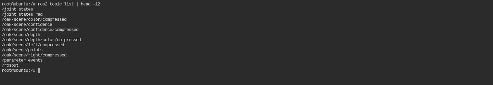 | 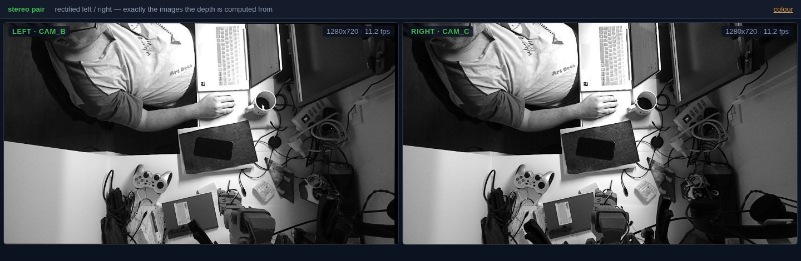 |
| **Terminal Xavier NX** — a shell on the **Xavier host**: `docker ps` shows the cell's containers | **Stereo Cams & Depth OAK-D** — four panels: the rectified pair, the depth map and its confidence (the mono views blurred here) |
| 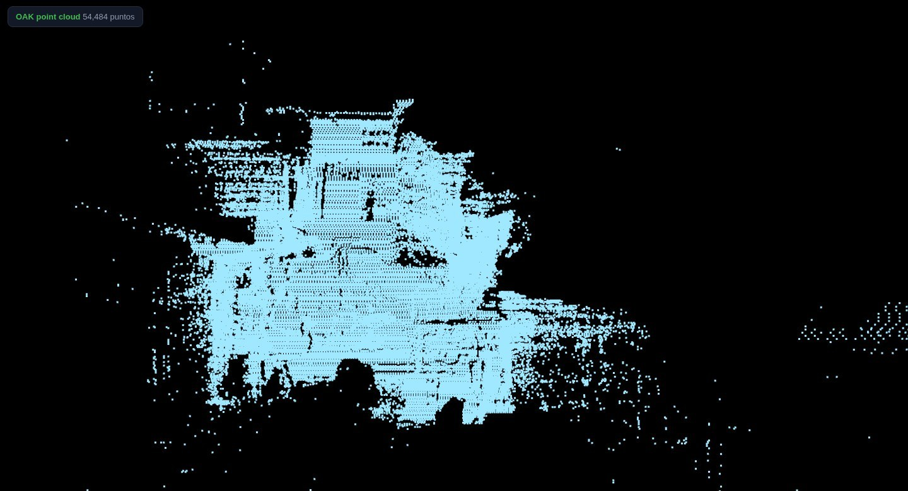 | 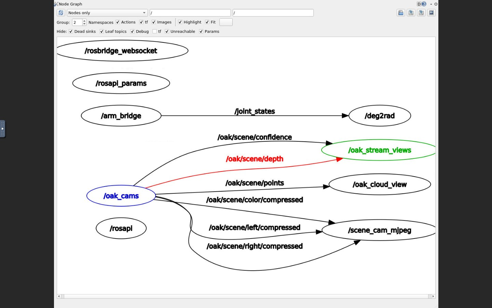 |
| **Point Cloud OAK-D** — the cloud in 3D, opening top-down on the bench; drag to orbit | **Graph** — rqt_graph: who publishes what to whom |
| 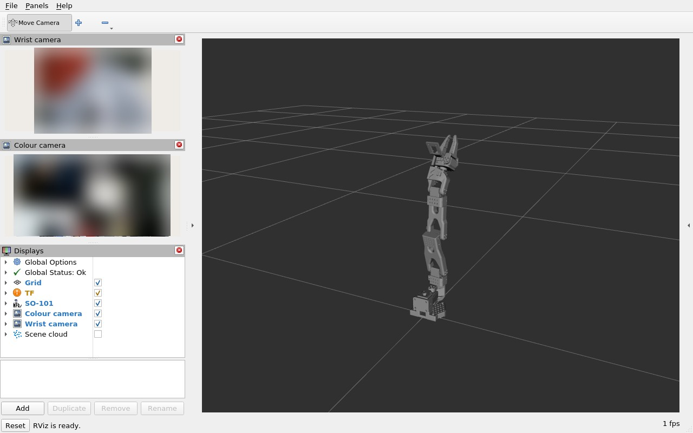 | |
| **RViz** — the arm at its live pose (SO-101 model), the scene colour camera and the wrist camera (both blurred here) | |

**Depth and confidence are not in RViz — they are in the Stereo tab.** This board has no GPU path
for Qt, so RViz draws with *llvmpipe*, a software renderer that uses the CPU. Every image panel
RViz renders competes with the 3-D view for that same slow renderer: with more than two panels the
arm silently stops being drawn (the frame counter drops to ~9 fps and the grid goes empty), and even
with exactly two it crawls at 2 fps. So the depth and confidence maps live in the Stereo tab — four
cheap, labelled panels on one plain-MJPEG page with no renderer cost — and RViz keeps only two:
the scene colour camera and the **wrist camera**. If one of them shows `No Image`, it is the same
contention; restarting RViz usually clears it.

**RViz only runs while its tab is on screen.** It is the most expensive thing in the cell:
software GL (`LIBGL_ALWAYS_SOFTWARE=1`, there is no GPU path for Qt here) keeps **~155 % of a
core** busy just redrawing the arm. So `entry.sh` no longer starts it; the page POSTs
`:8099/rviz/start` when the tab is opened, `/rviz/stop` when another tab is chosen, and stops it
again on `pagehide`. The X display and its VNC front-end stay up, so switching back is a window
appearing in ~10 s, not a container restart. The web container idles at **2 %** CPU instead of
180 %.

Plus a red **Shutdown Xavier NX** button on the right (it POSTs to the container's :8099 endpoint, which SSHes to the host and powers it off; the password lives only in a 600 file on the host, mounted read-only as a secret).

The page derives the Xavier's address from its own URL (`location.hostname`), so it works from any IP without editing anything, and it loads the first tab (Terminal Xavier NX) on page open.

### 8.1 Day-to-day: from cold to moving the arm

The cell is meant to be switched on and used, not rebuilt. In order:

1. **Power the Xavier.** The six containers come back by themselves (`restart: unless-stopped`),
   about two minutes after the sockets are up. Nothing has to be typed on the host.
2. **Open http://<xavier-ip>/.** The Terminal tab loads first — it is the cheap one, and if it
   answers, ttyd and the page are alive.
3. **Check the cell from that terminal**: `ros2 topic hz /joint_states` (50 Hz) and
   `/oak/scene/color/compressed` (~10 fps). Both already have the ROS environment sourced.
4. **Press `Arm torque`** (red -> orange) before any teleop. The arm boots with torque off and
   `/write` answers 409 until the button is used ([§8.2](#82-torque-switch--the-red-button)).
5. **Start the pad on the PC**: `python windows\f710_teleop_ws.py --host <xavier-ip>`; optionally
   the twin as well (`windows\mujoco_twin.py`, [§9.2](#92-mujoco-twin--live-mirror-of-the-real-arm-rosbridge-websocket-adr-0019)).
6. **Open RViz only when you need it** — it costs ~155 % of a core. The tab starts and stops it.
7. **Shut down from the red button** at the top right, not by pulling power: that path stops the
   containers first, which closes the arm's serial port.

### 8.2 Torque switch — the red button

The first control in the bar, left of the tabs, is the arm's torque switch: **red** `Arm torque`
means the servos are free and the arm can be moved by hand, **orange** `Arm torque free` means they are
energised and the arm holds its pose. It turns orange once pressed and back to red when pressed again.

The arm always boots with **torque off**, and that is enforced twice: the joint server calls
`disable_torque()` on its own startup and `/write` answers **409** with
`torque is off — press 'Arm torque' in the web page` until the button is used. So nothing can
energise the arm behind the operator's back — not a teleop client left running, not a stale target.

The browser talks to `:8092`, a four-line proxy in the arm container (`docker/ws/arm/torque_api.py`)
that forwards only `/torque` to the loopback joint server on `:8002`. The page cannot move the arm,
it can only switch the servos on and off.

### 8.3 What runs inside `so100-web`

```
Xvfb :10 1280x800  ──► rviz2 ──► x11vnc :5900 ──► websockify :6080 ──┐
Xvfb :11 1280x800  ──► rqt_graph ─► x11vnc :5901 ─► websockify :6081 ─┼──► browser tabs
ttyd :7681 (shell in the container) ────────────────────────────────┤
python -m http.server :80 (tabs page + URDF + meshes, from /srv/web) ┘
shutdown_server.py :8099 (button endpoint)
wrist_focus.py :8093 (focus tab, on demand) · xavier_temp.py :8094 (temperatures)
```

Each piece, and why it is there:

- **Xvfb** — a virtual X screen, because there is no monitor. Two of them: `:10` for RViz, `:11` for rqt.
- **rviz2 / rqt_graph** — run headless on those displays. Both come **prebuilt in the image** (see below).
- **x11vnc** — exports each virtual screen as a VNC server (`:5900`, `:5901`).
- **websockify + noVNC** — turns VNC into WebSocket/HTTP so a browser can show it (`:6080`, `:6081`).
- **ttyd** (`-W`, writable) — a terminal over WebSocket (`:7681`). Without `-W` it silently starts read-only.
- **`http.server :80`** — the tabs page itself, plus the URDF and the STL meshes that RViz reads from `/srv/web/...` (that directory is the repository's `docker/web/`, bind-mounted read-only).

### 8.4 The image: the **desktop** dusty image, no compiling

`docker/web.Dockerfile` is ~25 lines: it starts from `dustynv/ros:humble-desktop-l4t-r35.4.1` (which ships `rviz2` and `rqt_graph` prebuilt), installs the X/VNC layer (`xvfb x11vnc x11-utils xauth websockify novnc xdotool imagemagick`), the SSH client for the shutdown endpoint, `libignition-math6-dev` (RViz2 needs it at runtime), downloads the static `ttyd` binary, and copies `entry.sh` + `shutdown_server.py`.

The base matters enormously: the dusty **desktop** flavour carries `rviz2` and `rqt_graph` already compiled, while the **ros-base** flavour does not — and Ubuntu 20.04 has no ROS2 Humble binary packages, so with ros-base RViz2 had to be compiled from source (OGRE alone ~2 h; a whole prebuilt-workspace mechanism was invented for it). Switching the base to *desktop* deleted that entire problem. If you ever wonder "why is this image only apt?" — that is why. The old recipe survives in the git history.

### 8.5 `entry.sh` — the container's whole startup

`entry.sh` brings the whole container up. In plain order, top to bottom:

1. **Clear stale X locks** — a previous restart can leave a lock that makes Xvfb refuse to start.
2. **Start the two virtual displays**, `Xvfb :10` (for RViz) and `:11` (for rqt_graph) — headless screens with no monitor attached.
3. **Wait until X accepts connections**, polling with `xdpyinfo` instead of a fixed `sleep`, so start-up is as fast as the box allows.
4. **Start the two screen sharers** — `x11vnc` on `:10`/`:11` with explicit `-rfbport 5910`/`5911`, and their browser fronts `websockify` on `:6080`/`:6081` (this is how the RViz and Graph tabs see the virtual screens).
5. **ttyd** — the Terminal tab (which now shells into the Xavier host, §6.1).
6. **The shutdown server** (`:8099`) and **the tabs page** (`:80`).
7. **Ready ROS and the software renderer** — source the ROS environment and set `LIBGL_ALWAYS_SOFTWARE=1` so Qt can draw without a GPU.
8. **Start rqt_graph on `:11`**, then a loop stretches its window to full screen because it opens tiny. (RViz is *not* started here: it is the most expensive thing in the cell, so the page starts it on demand — §8.)

Two rules learned the hard way:

1. **Never use displays `:0`/`:1` in the container.** The Xavier's own desktop runs Xorg on `:0`; with `--network host` the X11 abstract socket namespace is shared, so a container Xvfb on `:0` dies with *"server already running"* while everything else looks healthy (and rviz2 then fails with `qt.qpa.xcb: could not connect to display`).
2. **Clear `/tmp/.X10-lock` and `/tmp/.X11-unix/X10` on start.** A container restart can leave them behind and Xvfb refuses to start.

## 9. Operator PC — teleop + visualization

Visualization needs nothing but a browser (ADR-0015): open http://192.168.1.50/ — six tabs (Terminal Xavier NX, Stereo Cams & Depth OAK-D, Point Cloud OAK-D, Gripper Cams, Temp Xavier NX, Graph, RViz) and the torque switch. The RViz stream alone is at http://192.168.1.50:6080/vnc.html?autoconnect=true. Teleoperation with the F710 needs **no ROS on Windows**: the Python client talks to the rosbridge WebSocket (ADR-0020).

### 9.1 MuJoCo model check (ADR-0016)

MuJoCo is already installed on the Windows PC. To verify the SO-101 model chain before any training, in a cmd/PowerShell:

1. Install MuJoCo for Python (if not already):
   pip install mujoco
2. Get the SO-ARM100 model from MuJoCo Menagerie (clone or download zip):
   git clone https://github.com/google-deepmind/mujoco_menagerie
3. Run the repo's check script against the model:
   python windows\mujoco_check.py C:\path\to\mujoco_menagerie\robotstudio_so101\scene.xml

   That command hands the script the path to the arm's `scene.xml` — the MuJoCo description of the
   SO-101 from Google DeepMind's `mujoco_menagerie` model zoo. The script loads the file, counts the
   six joints, advances the simulator **200 time steps** to make sure the model actually *runs* (not
   just parses), and prints `OK - model loaded, 6 joints, simulated 200 steps`. Anything else means
   the path is wrong or the model file is broken.

Expected output: `"OK - model loaded, 6 joints, simulated 200 steps"`. That proves the sim can run
the arm — the base for imitation-learning sessions later (Isaac Sim deferred for now by user decision).

### 9.2 MuJoCo twin — live mirror of the real arm (rosbridge WebSocket, ADR-0019)

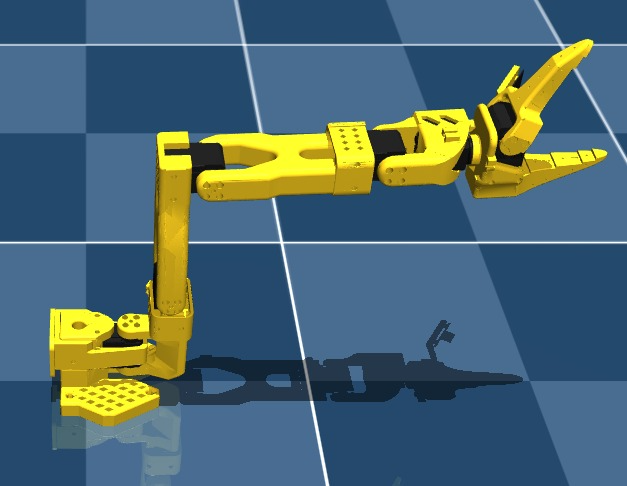

*The twin on the Windows PC: the same `robotstudio_so101` MJCF that generates the URDF, driven by
`/joint_states` over rosbridge — the pose you see here is the pose the real arm is in.*

The Xavier's `so100-rosbridge` container serves a WebSocket at ws://192.168.1.50:9090 that forwards any ROS2 topic as JSON. The Windows PC mirrors the arm's /joint_states into MuJoCo:

1. Install the two Python libraries — **mind the versions** (MuJoCo 4.x moved the classic viewer into MuJoCo Studio; the twin uses the 3.x viewer):
   ```
   pip install roslibpy "mujoco>=3,<4"
   ```
2. Run the twin — this arm is the **SO-101**, so load `robotstudio_so101` (`trs_so_arm100` is the SO-100 and will map joints to the wrong frames):
   ```
   python windows\mujoco_twin.py C:\path\to\mujoco_menagerie\robotstudio_so101\scene.xml
   ```

A MuJoCo window opens and the simulated arm follows the real one live. Internals, each of which cost debugging time on 2026-11-08:

- **Kinematic mirror**: the script uses `viewer.launch_passive` (NOT `viewer.launch`, which blocks the main thread and steps its own physics — the model's position servos then hold the arm frozen at the initial pose). Each frame the script writes qpos from the latest message, runs `mj_forward` (kinematics only) and `sync`s the viewer. No physics, no fighting the real arm.
- **Degrees → radians**: /joint_states publishes degrees (LeRobot convention); MuJoCo qpos is radians.
- **Joint-name mapping**: Menagerie names its joints Rotation, Pitch, Elbow, Wrist_Pitch, Wrist_Roll, Jaw — not the LeRobot names. The script has an alias table plus a positional fallback, and prints the mapping (`qpos[0] <- shoulder_pan ...`) and the first received message so problems are visible in the console.
- **Viewer import**: `from mujoco import viewer` must be explicit — in the 3.x line `import mujoco` alone does not expose it.

The rosbridge server itself: rosbridge_suite humble needs Python >=3.9, which the focal cell images don't have — hence its own Ubuntu 22.04 container (docker/rosbridge.Dockerfile, official binary packages). It starts with `docker compose up -d rosbridge` and its health check is `ros2 topic echo /joint_states --once` inside the container. It needs `ipc: host` like the rest of the stack: FastDDS shared-memory transport carries the data over /dev/shm, and without the host IPC namespace the container discovers topics but receives nothing.

Verified 2026-11-08 from a LAN PC: 398 /joint_states messages in 8 s (~50 Hz) through the WebSocket.

Twin troubleshooting:

| Symptom | Cause | Fix |
|---|---|---|
| `RosTimeoutError: Failed to connect` | rosbridge down on the Xavier | `docker compose up -d rosbridge`; check `ss -tln \| grep 9090` on the Xavier |
| window opens, arm never moves | old script or `viewer.launch` (blocking) | `git pull` — the current script uses `launch_passive` |
| `mujoco ... has no viewer module` | MuJoCo 4.x installed | `pip install "mujoco>=3,<4"` |
| `mapped 0/6 joints` warning | unknown model joint names | use `robotstudio_so101` — it is this robot; the alias table covers the rest |
| a joint moves backwards | sign convention differs between model and arm | report it — a per-joint sign flip in the script fixes it |

### 9.3 F710 teleop — the pad (ADR-0017, amended by ADR-0020)

**Recommended path — Python over rosbridge (no ROS2 on Windows).** Two pip packages, same WebSocket the MuJoCo twin already uses:

```
pip install pygame roslibpy
python windows\f710_teleop_ws.py --host 192.168.1.50
```

The pad must be in **X mode** (switch on its back). It waits for `/joint_states`, seeds the targets at the arm's real pose and then starts publishing `/joint_targets` (degrees, 6 values).

**Press `Arm torque` in the web page first** — the arm boots with torque off and `/write` refuses until the servos are energised, so the pad will look dead otherwise. Publishing stops whenever the pad is idle, so a lost controller cannot drive the arm.

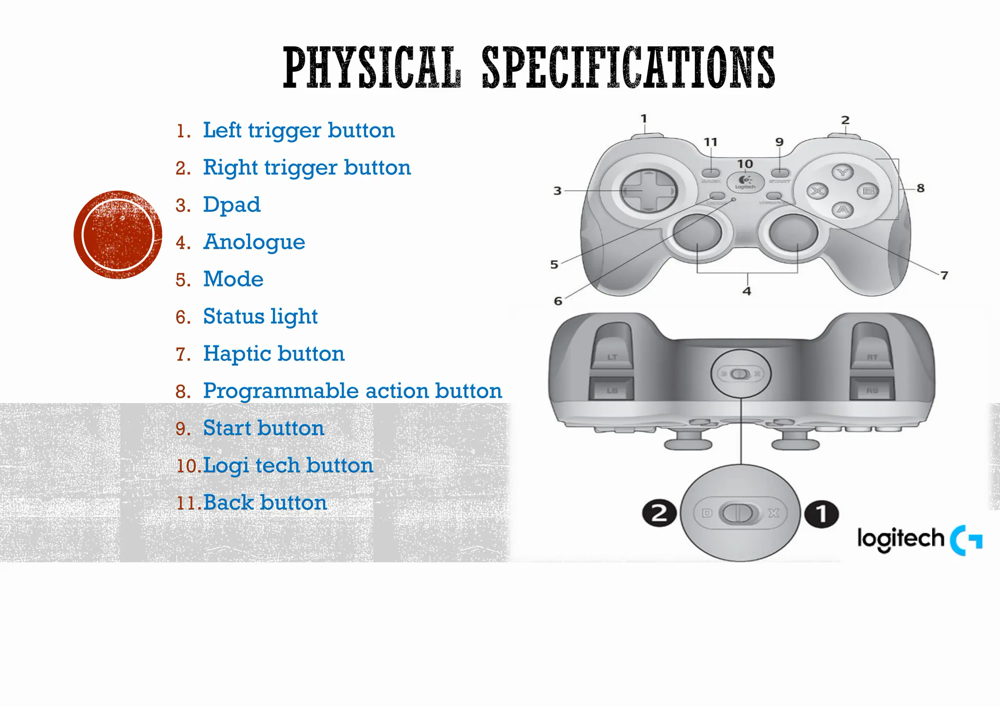

*The F710, from the user manual. These are the physical controls called by name below (D-pad, the two sticks, LB/RB on the shoulders, the triggers, and START/B/X on the face).*

**Controls**:

- **joint-step** (default): D-pad L/R picks joint 0–5, left stick Y moves it, LB/RB close/open the gripper.
- **cartesian-feel**: START toggles — left stick = pan/lift, right stick X = elbow, right stick Y = wrist_roll, **LB + right stick Y = wrist_flex**, triggers = gripper.
- **record / replay**: X starts/stops recording the targets, B replays them.
- **torque**: hold **B for 5 s** to switch the servos on or off, same as the red button in the web page — the state is read from the arm before flipping, so it cannot get out of sync. A short tap still replays.

#### joint-step, the default mode

It moves **one joint at a time**: the D-pad chooses which, and only the left stick's vertical
axis drives it. The client starts in this mode; START switches to cartesian-feel and back.

| Control | What it does |
| :--- | :--- |
| D-pad ← → | walks the selection through `shoulder_pan → shoulder_lift → elbow_flex → wrist_flex → wrist_roll → gripper` and prints the name |
| left stick ↑↓ | moves **only** the selected joint |
| LB / RB | close / open the gripper while held |

Speed is **1° per tick at 50 Hz = 50 °/s** at full deflection, on a quadratic curve with a 15 %
dead zone, so half stick is about 12 °/s and the centre gives fine control. Every value is clamped
to ±170° for the five joints and 0–100 for the gripper, and nothing is published while the pad is
idle (0.5 s after the last input the stream stops, so a lost controller cannot keep driving).

The D-pad is read **edge-triggered**, one hop per push. Reading it every tick made a short tap jump
three or four joints, which looked like the D-pad doing nothing.

Why bother, when cartesian-feel is nicer? Because one joint at a time is the safe way to explore the
workspace — you see exactly which axis responds and by how much, with no coupling — and it is the
mode to record in: the targets stay clean and replay identically. Use joint-step to learn the arm
and to capture episodes, cartesian-feel to work quickly by eye.

**Safety**: `/joint_targets` is only sent after feedback arrives; per-tick deltas and the joint ranges are clamped, and the Jetson bridge enforces the real limits regardless.

Transport verified 2026-11-09: a target vector published through rosbridge reached the arm bridge, and sending the current pose produced zero movement.

**GPU check (Isaac Sim viability):** run windows/check-gpu.cmd — needs an NVIDIA RTX-class GPU and driver ≥ 535 for Isaac Sim.

### 9.4 Nothing on the PC needs ROS2 — or a firewall rule

Everything the PC runs is either plain HTTP or the rosbridge WebSocket:

| What you use on the PC | Transport | ROS2 on Windows? |
|---|---|---|
| the tabs — Terminal Xavier NX, Stereo Cams & Depth OAK-D, Point Cloud OAK-D, Gripper Cams, Temp Xavier NX, Graph, RViz | HTTP + noVNC | no |
| MuJoCo twin | roslibpy → `ws://<xavier>:9090` | no |
| F710 teleop, Python client | roslibpy → `ws://<xavier>:9090` | no |

So there is **no ROS2 install on Windows and no DDS firewall rule**: FastDDS never leaves the
Xavier, and nothing on the LAN speaks it. The C++ teleop client that used to justify the stack
(rclcpp + SDL2 over DDS, hence the VS Build Tools and the UDP 7400-7450 rule) has been **dropped**
— it was never compiled, and the Python client already reaches the arm's full rate: 398
`/joint_states` messages in 8 s (~50 Hz) through the WebSocket.

The one thing that would bring the stack back is GraspGen (ADR-0013), which runs on the PC. Over
HTTP it stays ROS-free; as a ROS node on domain 42 it would need the whole install. That gets
decided when the grasp pipeline is written, not before.

## 10. Perception — what the cloud sees, and its calibration

The cell sees the world through one stereo camera mounted over the bench. This chapter is what
that camera can and cannot see, what its streams cost, and the two calibrations that turn pixels
into millimetres in the arm's own frame. Read it before believing a cloud coordinate.

### 10.1 Depth: range, texture and what the cloud can and cannot see

Two settings matter more than they look, and both are now on in `build_pipeline()`
(`docker/ws/cams/oak_ros_node.py`):

- **`setExtendedDisparity(True)`** — with the 7.5 cm baseline and the default disparity
  range the stereo stops at about **0.65 m**, which is exactly where this cell works: the
  arm, the gripper and anything on the bench in front of the camera fell inside the blind
  band and came back invalid. Extended disparity halves the minimum range to ~0.33 m.
- **`setLeftRightCheck(True)`** — kills the speckle that otherwise fills the cloud with
  phantom points behind every edge.

Measured on the bench (2026-11-10, `OAK-D-POE`, USB **High Speed** — that is why the
streams run at 1–1.5 fps): the depth map's nearest valid pixels went from ~0.96 m to
~0.56 m once extended disparity was enabled.

**The cloud cannot see blank surfaces.** A printed ChArUco board held at 0.54 m — measured
independently at 0.540 m by PnP on the colour image with 48 corners at 0.33 px — does not
show up in the depth map at all: white paper under the lamp has no texture for the stereo
matcher, so those pixels are invalid or fall back to the background. Expect the same with
any white or glossy object, which matters for grasping: texture, edges or the left/right
check are what produce depth, not brightness.

**Nor can it see the robot itself.** The SO-101's black plastic absorbs the pattern: the arm
comes back as a hole, so in the Point Cloud tab it reads as a silhouette at the near edge
rather than as a body. Nothing to tune — it is the same "texture or edges, not brightness"
rule, applied to the arm. The fix is physical: the arm gets repainted in a colour that returns
the stereo pattern, which is far cheaper than projecting the URDF through a hand-eye transform
that is still at 29 mm.

### 10.2 Cost: what the streams actually spend on the Xavier

Measured on the bench (2026-11-10, Xavier NX, six cores). Two things dominate, and both are
cheap to get wrong:

- **The rclpy `uint8[]` setter walks the payload.** Assigning `bytes` to `msg.data` validates
  and converts element by element, at roughly 300 ns per byte: a 2 MB `PointCloud2` cost
  **650 ms**, a 300 KB JPEG **83 ms**. `array.array('B', ...)` is the fast path the setter
  stores as-is — 61 ms and 0.3 ms. Before that fix the cams node published 1.2 fps and the
  tick was 800 ms, of which 587 ms were the cloud's `msg.data` assignment alone.
- **Ask the sensor for the rate you can publish.** The cameras ran at their default 30 fps and
  two thirds of the frames were thrown away in `getCvFrame()`. `CAMERA_FPS = 10` cut that,
  `DEPTH_HZ = 5` stops republishing the raw depth (2.7 MB per frame) faster than anything
  consumes it, and `PCL_HZ = 3` throttles the cloud.

Steady state with SuperSpeed USB, colour at 10 fps, stereo views at 11 fps, cloud at 2.6 fps:
**cams ~215 % of a core, web ~2 % with RViz off (~160 % with it on)**. Docker reports CPU as a
percentage of **one** core, so 215 % means "two cores and a bit" out of six.

### 10.3 Hand-eye — where the camera sits in the arm's frame

The cell is **eye-to-hand**: the scene camera is bolted to the bench and does not move with the
arm, so a single fixed extrinsic maps the `base` link to the camera frame. Everything downstream
needs it — a grasp target, a VLM pointing at an object, the cloud in `base` — while today the
cloud is still published in the camera frame and `/tf_static` still carries the OAK's nominal
offsets.

**Board.** `CharucoBoard((5,5), 0.018, 0.0135, DICT_4X4_50)` from `tools/gen_charuco.py`, printed
at a 100 mm side and measured again after printing. Hide any second copy: a PDF of the same board
on a monitor makes detection ambiguous, and `handeye_grab.py` now aborts with "the board appears
TWICE in the image" instead of silently averaging two boards.

**Capture.** The operator moves the arm by hand and says "ok" per pose; nothing commands the
joints during a run, and **joint 6 is never commanded** — targets go out as five values, the
gripper stays where it is. `tools/handeye_grab.py` accepts a pose only if the board is fully
visible and stable, the tilt is under 55 deg, and the frame is fresh;
`tools/handeye_capture.py` is the guided variant with adaptive prompts. The twelve accepted poses
are kept in `docs/calibration/datasets/2026-11-09-so101/` (`poses.json` + 12 JPGs) so a solver can
be re-run without the hardware present.

**The dataset does not close, and the cause is now measured.** Re-examined 2026-11-11 with
`tools/handeye_bundle.py` (closed form, then a joint bundle adjustment of camera-in-base and
board-on-jaw over every corner, then a leave-one-out test). The stored FK is **exact** — recomputed
from `joints_deg` with the SO-101 URDF it matches to 0.0 mm on all 12 poses — and the relative
rotations of arm and board agree to 2.5° median, so the motion itself is coherent. What does not
hold is the *board-on-jaw* relation: solving for it gives **25° of rotation spread and ~300 mm of
translation spread** across the twelve shots. A board bolted to the jaws cannot do that, whatever
the board size or intrinsics are (checked: 18/13.5, 20/15 and two K sets all give the same spread).

So the poses are right and the board was not rigid with respect to the jaw between shots — the
capture protocol asks the operator to hold it, and holding it is enough.

That also disposes of the old figure: **29.1 mm / 8.7 deg** came from a spread metric that stays
small on inconsistent data, so it was never a measurement of accuracy. The extrinsic in
`docs/calibration/scene_cam_extrinsic.yaml` is marked **not usable** — nobody should consume it.

What a valid capture needs: the board **clamped and not touched** between shots (a bracket or a
printed jaw adapter), with the joint pose read at the instant of the shot. `handeye_bundle.py` is
ready for it and reports the hold-out error — solving on 11 views and predicting the 12th — which is
the number that matters.

FK is read from the URDF the arm bridge publishes, never from a copied kinematic chain.

`tools/handeye_refine.py` (bundle adjustment) is **not trusted**: it reports 46 px where this
dataset should reach ~1 px. It has to be validated against a synthetic dataset before its output
means anything, so the closed-form result stands and the extrinsic is not used by any node yet.

### 10.4 Depth scale, and colour to depth registration

**Scale.** `tools/depth_scale_check.py` measures the same object twice: PnP on the colour image
(metric by construction, given the calibrated intrinsics) and the object's own size in the cloud.
With the calculator centred at 0.315 m, the cloud read 340.0 mm against PnP's 328.7 mm — a ratio of
**1.0301** (p10 1.0227, p90 1.0431), about ±3 mm spread over 102k pixels. Two things follow: the
cloud is good to ~3 % at working range, and one distance cannot separate a proportional error
(0.971) from a fixed +10 mm offset, so `OAK_SCENE_DEPTH_SCALE` stays at 1.0 until the check is
repeated at ~0.40 m ([§2.3](#23-next)).

**Registration.** Colour and depth sensors are 37 mm apart, so a pixel is not a pixel. The
homography from the board — 48 correspondences, 0.69 px rms — lives in
`docs/calibration/color_to_depth.yaml`. It stays the right tool for 2D overlays (drawing a depth
contour on the colour image); the cloud itself is coloured by a different, exact route — [§10.6](#106-the-cloud-in-the-colour-frame-coloured).

### 10.5 The gripper camera — is it in focus at 10-15 cm?

ADR-0008 puts a camera on the wrist so the jaws and the object can be seen at **10-15 cm**. Cheap
USB cameras are *fixed focus*, and "fixed focus" says nothing about where the plane actually is:
two units at the same price can sit at opposite ends of the range. So the first step is not
mounting, it is measuring.

**The tool** — `tools/camfocus.py`, bench only, no ROS, any UVC camera. It serves the device as
MJPEG, scores the sharpness of the newest frame about twice a second, and writes the score at
10 / 12.5 / 15 cm to a CSV when the buttons are pressed:

```
python3 tools/camfocus.py /dev/video2 --size 1280x720        # --size omitted: largest MJPG size
python3 tools/camfocus.py --follow "VF0770" --csv ~/vf.csv   # track the camera by card name
chromium --user-data-dir=/tmp/chrome-cam --app=http://127.0.0.1:8190/
```

<table>
<tr>
<td width="62%">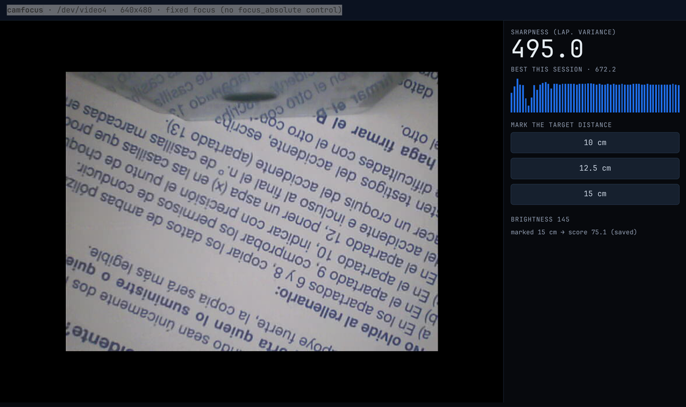<br><em>The tool on a printed page at 10 cm: sharpness 495, best 672, brightness 145 — and the last mark it wrote.</em></td>
<td width="38%">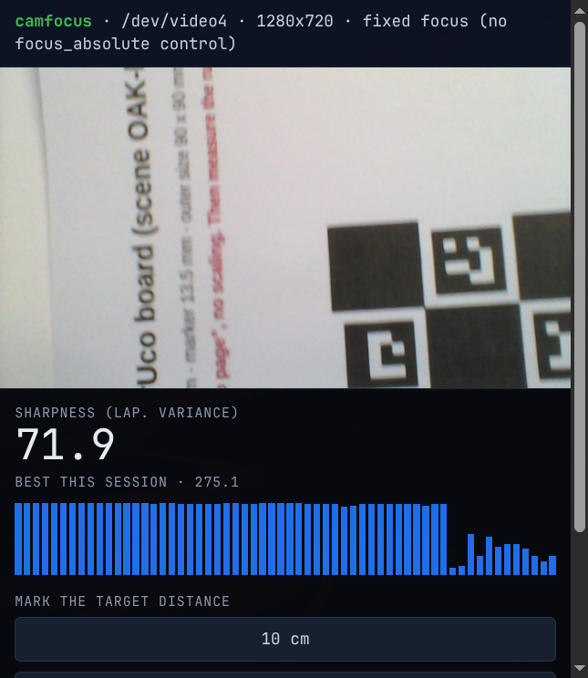<br><em>The same tool on the Creative VF0770, pointed at the printed ChArUco board used for the measurements.</em></td>
</tr>
</table>

**Procedure**

1. **Device and capability.** `v4l2-ctl --list-devices` gives the card name and its `/dev/videoN`;
   `v4l2-ctl -d /dev/videoN --list-ctrls | grep focus` tells you whether there is a `focus_absolute`
   at all. Without it the camera is fixed focus and the only variable you control is the mounting
   distance. (Note that one physical camera often registers two nodes — use the one that exposes the
   capture format, usually the lower number.)
2. **Target.** The printed ChArUco board, or a page of text: flat, perpendicular, filling at least
   half the frame. The metric needs edges — a blank surface scores low even in perfect focus.
3. **Check the exposure.** The page shows brightness next to the score. Keep it between roughly
   60 and 180; a mean near 1 is a lens cap, not a focus problem, and auto-exposure swinging during
   the run invalidates the comparison.
4. **Mark the three distances.** Target at 10 cm, press `10 cm`; then 12.5 and 15. Each press writes
   `time, card, device, resolution, distance_cm, sharpness, brightness, focus` to the CSV, so rows
   from different cameras and resolutions can never be confused afterwards.
5. **Read the peak — and keep going.** The distance with the highest score is the focus plane; if the
   score is still rising at the last distance you tested, the plane is beyond it and the next marks
   (20, 25 cm) decide where the camera can actually work.

**The number** is the variance of the Laplacian on the grey frame, downscaled to 720 px. It is a
relative measure: compare only within one camera, one resolution, one target and one lamp. On a
1280x720 frame, sharp text sits around **300**, slightly soft around **20**, visibly blurred around
**3**, and a black or flat frame around **1**.

**Result** (2026-11-11, one lamp, the same board, nothing moved but the target). Raw rows in
`docs/calibration/focus/`, figure generated by `tools/make_focus_chart.py`:

| distance | Labtec V-UAM38 (640x480) | Creative Live! Cam Sync HD VF0770 (1280x720) |
|---|---|---|
| 10 cm | **444** | 268 |
| 12.5 cm | 281 | 349 |
| 15 cm | 75 | **408** |

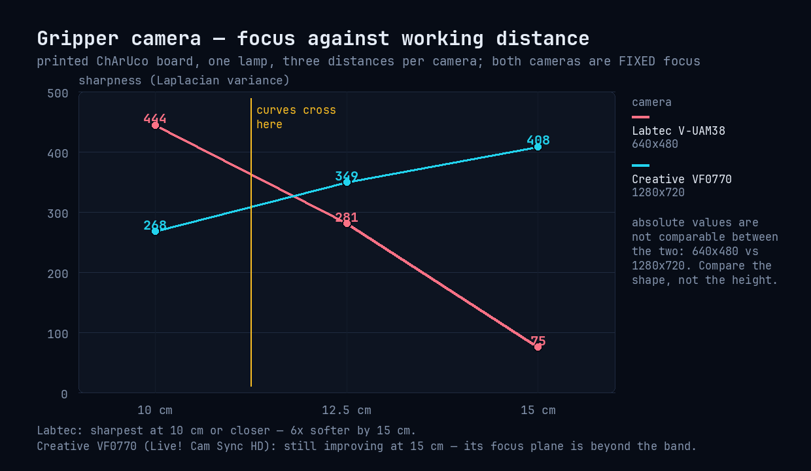

Two clean monotonic curves pointing in **opposite directions**: the Labtec is sharpest at 10 cm or
closer (six times softer by 15 cm), the VF0770 is still improving at 15 cm, so its plane is beyond
the band. They cross between 10 and 12.5 cm. Brightness stayed within a few counts in each set
(126 ±1 and 125-133), which is what makes the comparison valid: the score moved because of focus,
not because the exposure changed.

**What this means for the wrist camera**

- Neither of these two serves 10-15 cm as it stands. With fixed focus the plane is a property of the
  lens: you mount the camera *at* its plane, or you change the camera.
- If the cell has to look at the jaws from ~10 cm, the Labtec is the one that was sharp there; if the
  mount ends up beyond 15 cm, the VF0770 is, but its plane still has to be located with more marks.
- The cleanest answer is a camera whose focus can be **set**: the 5M WebCam on this bench exposes
  `focus_absolute` 0-1023, so it can be focused at the real working distance and locked there
  (`curl 'http://127.0.0.1:8190/focus?v=350'` while pointing `camfocus` at it).
- **The node side is live**: `wrist_cam` publishes `/gripper/image/compressed` at 10 Hz from
  `/dev/so100_wrist` ([§11.2](#112-so100-cams--the-cameras)), and the browser can see it at `:8090/gripper/stream`. It is mounted on
  the moving jaw, its frame is in the TF tree, and what is left is the *measured* focus — run the
  procedure below and keep the CSV — plus replacing the nominal transform with the measured one.
- The wrist camera is settled: a USB RGB webcam with manual focus, set at ≈12.5 cm and locked
  (ADR-0022 supersedes ADR-0008's OAK-D Lite, whose lens and stereo range both sit far beyond the
  wrist distance). That is why the 10-15 cm requirement is written as a *focus* requirement here,
  not as a depth range — and why `tools/camfocus.py` runs before the camera goes on the arm.

The pose of the camera on the jaw is a **static transform** — what that is, where the numbers
live and how they were checked is in [§10.7](#107-static-transforms--and-the-wrist-cameras).

**Measuring it from the browser.** The **Wristcam focus test** tab (port 8093) does the same job
as the bench tool, from the live ROS topic instead of the device: the score of the newest frame, the
best seen so far, and a button per distance that writes the *median of the last scores* to
`docker/state/wristcam-focus.csv` on the Xavier. It starts when the tab is opened and stops when it
is left, plus a 45 s idle watchdog, so nothing decodes images while the tab is closed. Two things it
cannot fix: the room has to be lit (a dark scene scores ~1.5 whatever the focus), and the distance
still has to change by moving the arm, not the camera.

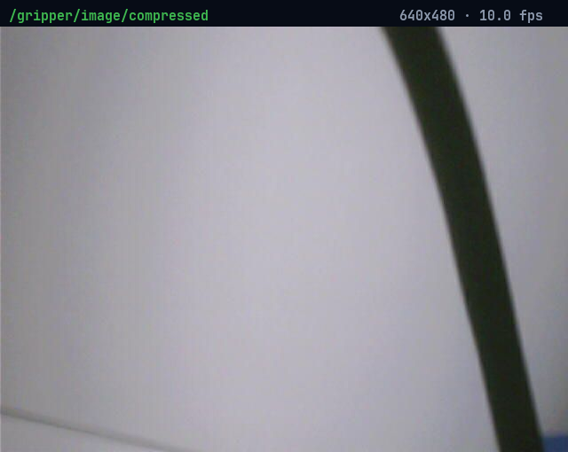

*`/gripper/image/compressed` as it arrives today, with the camera on the moving jaw: 640x480 at
10 Hz, seen at `:8090/gripper/stream`. Blurred on purpose — it is the pipeline, not the final view;
the focus is only proved once the procedure above has been run and its CSV kept.*

### 10.6 The cloud in the colour frame, coloured

`/oak/scene/points` is now published **in the colour camera's optical frame** as `x, y, z, rgb`
(PCL layout, `rgb` packed into a float32 at offset 12). A point and the pixel it came from are the
same thing, which is what a grasp aimed at a segmented object needs.


*The Point Cloud tab: every point carries the colour of the pixel it projects onto in the colour
camera, so the cloud and an ordinary colour frame line up exactly.*

How it is built, and why not with the homography of [§10.4](#104-depth-scale-and-colour-to-depth-registration):

1. The depth map arrives in the **right camera's** geometry, so the point is unprojected with that
   camera's intrinsics (`fx 833.00 …`), exactly as before.
2. The device's own **extrinsic** depth→colour moves it into the colour frame: `t = (37.2, 0.1,
   -3.2) mm` on this unit — the two sensors are that far apart, which is why a pixel is not a pixel
   ([§10.4](#104-depth-scale-and-colour-to-depth-registration)).
3. The colour **intrinsics** at the colour stream's resolution (`fx 1545.36 cx 948.02` at
   1920x1080) project the point to a pixel, and the pixel's BGR is written into `rgb`.

The board homography would also map depth pixels to colour pixels, but only as a plane
approximation: it is exact for something lying on the plane the board was on and drifts for
anything in front of it. The extrinsic + intrinsics route is exact everywhere, so that is what the
cloud uses; the homography stays for 2D work.

**One trap worth writing down**: `calib.getCameraExtrinsics()` in depthai 2.x returns the
translation in **centimetres**, while the cloud is in metres. Used as-is it moved the whole cloud
3.7 m sideways — the log line `depth→colour t=(37.2, 0.1, -3.2) mm` after the ×0.01 is the check.

Points that project **outside** the colour image keep their geometry but are coloured dim grey
(80, 80, 80): dropping them would leave holes exactly where the depth camera sees more than the
colour one, and a grasp is aimed at the shape. On a unit with no usable calibration the node falls
back to the old uncoloured `xyz` cloud in the depth frame rather than colouring it wrongly.

Verified 2026-11-11 on the bench: `frame_id: scene_color_optical_frame`, fields
`x,y,z,rgb` at offsets 0/4/8/12, ~2 Hz, 56k points, median range 1.11 m, and the colours land on
the objects in the Point Cloud tab (counters, sticky notes, the red part on the bench).

### 10.7 Static transforms — and the wrist camera's

TF is the tree of poses ROS uses to place anything in 3D: every edge holds the position and
orientation of one frame relative to another, and with the whole tree a point can be carried from
any frame to any other. It comes in two channels:

- **`/tf`, dynamic** — changes all the time. `robot_state_publisher` recomputes it at 50 Hz from the
  joint angles: `base → shoulder → upper_arm → lower_arm → wrist → gripper → moving_jaw_so101_v1`.
- **`/tf_static`, static** — **published once** and never again, with a *latched* QoS so a node that
  starts an hour later still receives it the moment it subscribes. It is for what is bolted to
  something that moves: a camera, a bracket, an IMU.

A webcam clipped to the jaw does not move relative to the jaw, so its pose belongs in `/tf_static`;
repeating the same six numbers 50 times a second would be noise. Those numbers are the transform
below: **x, y, z** in metres from the `moving_jaw_so101_v1` link origin to the centre of the lens,
then **roll, pitch, yaw** to rotate that link's axes into the *optical* convention (z out of the
lens, x to the right of the image, y down it). It is what puts `gripper_color_optical_frame` — the
frame `wrist_cam` stamps on every image — into the tree. Without it the image arrives tagged with a
frame nobody can find: RViz can only show it unanchored, and nothing can carry a wrist-camera point
into `base`.

The numbers live in `docker/docker-compose.yaml` as `WRIST_TF_X / Y / Z / ROLL / PITCH / YAW`, and
the arm entrypoint hands them to `ros2 run tf2_ros static_transform_publisher` with
`--frame-id moving_jaw_so101_v1 --child-frame-id gripper_color_optical_frame`. The defaults are the
**nominal** bracket values: they put the frame where the print says the lens is. Measure your own
build and replace them — no code changes, one line each:

```
ros2 run tf2_ros tf2_echo moving_jaw_so101_v1 gripper_color_optical_frame   # constant pose = static
ros2 run tf2_ros tf2_echo base gripper_color_optical_frame                  # the whole chain resolves
```

Verified on the cell 2026-11-11: the first answers `[0.000, -0.028, 0.035]`, rpy `[180°, 0, 0]`, the
same on every query; the second resolves `base → … → jaw → lens` at `[0.103, -0.024, 0.478]` m.

**Where these numbers came from, and what is still nominal.** The six values in `docker-compose.yaml`
are the *printed bracket's* offsets: they place the frame where the drawing says the lens is, which
is enough for the frame to be usable and for the image to be anchored to the jaw. They are not a
measurement of this particular build. Take a ruler to the bracket (or read the offsets off the CAD)
and edit the six `WRIST_TF_*` lines — no code, no rebuild. Until then, treat anything that depends on
the camera's exact position (an eye-in-hand grasp, a measured depth of the jaws) as approximate.

## 11. Node and topic reference

Each container is one job and publishes a small, fixed set of topics. This is the reference for
what exists and what it carries — read it after [§7](#7-verifying-the-data-flow), not before.

### 11.1 so100-arm — the arm

Three processes inside the container:

1. **LeRobot joint server** (Python 3.12) — *not* a ROS node. The only process touching the arm's serial port: it reads the 6 motor positions and applies commanded angles, exposed as plain HTTP inside the container (port 8002). It exists because the LeRobot SDK needs Python ≥3.10 while the container's ROS2 libraries are built for Python 3.8 — the two halves talk over HTTP. API: `GET /read` (angles JSON), `GET /status`, `POST /write` (body `{"angles": [...]}`).
   ```bash
   docker exec so100-arm curl -s http://127.0.0.1:8002/read
   ```
2. **arm_bridge** (Python 3.8 + rclpy) — the ROS2 translator around that server.
3. **robot_state_publisher** — computes the arm's 3D skeleton (TF) from the URDF and the joint angles. Humble reads the URDF from the `robot_description` **parameter** (passed at launch), not from the topic.

Topics of this container, by node:

| Topic | Node | Direction | What it carries |
|---|---|---|---|
| /joint_states | /arm_bridge | out, 50 Hz | the arm's real position: 6 joint names + angles in degrees |
| /joint_targets | /arm_bridge | in | desired position: 6 angles — publishing here moves the arm |
| /robot_description | /arm_bridge | out, latched | the arm's URDF (geometry description) |
| /tf | /robot_state_publisher | out, ~17 Hz | the 3D transform of every moving link |
| /tf_static | /robot_state_publisher | out | fixed transforms (offsets that never move) |

**Utility:** this container alone turns the arm into a standard ROS2 device — anyone on domain 42 can see where it is (/joint_states), command it (/joint_targets) and render it in 3D (URDF + /tf), without ever knowing a serial port exists.

### 11.2 so100-cams — the cameras

One node (/oak_cams), one depthai pipeline per device:

| Topic | Direction | What it carries |
|---|---|---|
| /oak/scene/color/compressed | out | scene color as JPEG (CompressedImage) |
| /oak/scene/left/compressed, /oak/scene/right/compressed | out | the two **rectified** mono views the depth is computed from — what the Stereo Cams & Depth OAK-D tab shows |
| /oak/scene/depth | out | scene stereo depth, 16UC1 in millimetres, right-camera frame |
| /oak/scene/confidence | out | stereo confidence map, 8UC1 (per-pixel depth certainty) |
| /oak/scene/color/camera_info, /oak/scene/depth/camera_info | out | intrinsics, straight from the device's own calibration at the resolution each stream runs at |
| /oak/scene/imu | out | accel + gyro + rotation vector — only on units that carry an IMU (this POE unit has none) |
| /oak/scene/points | out | point cloud in the **colour optical frame**, `x, y, z, rgb` (PCL layout): unprojected with the depth camera's own K (`fx 833.00 fy 833.00 cx 639.23 cy 356.87` at 1280x720), moved into the colour frame with the device extrinsic and coloured from the colour pixel it projects onto ([§10.6](#106-the-cloud-in-the-colour-frame-coloured)) |
| /oak/gripper/* | — | **unused**: the node would publish the same set for a second OAK, but the wrist camera is a USB webcam on its own UVC node (ADR-0022) |

The container also runs **`wrist_cam`** (ADR-0022), the plain-UVC driver for the camera on the
gripper:

| Topic | Direction | What it carries |
|---|---|---|
| /gripper/image/compressed | out, 10 Hz | the wrist camera as JPEG (CompressedImage), frame `gripper_color_optical_frame` |
| /gripper/camera_info | out | only once intrinsics exist in `WRIST_CALIB`; a made-up K would be worse than none |

It opens `/dev/so100_wrist` (a udev symlink, so re-enumeration is harmless), asks V4L2 for MJPG at
`WRIST_W`x`WRIST_H` and **logs what the driver actually gave** — the Logitech on this bench answers
640x480 JPEG whatever you ask for. Its frame is in the TF tree: `/tf_static` carries
`moving_jaw_so101_v1 → gripper_color_optical_frame` with the nominal bracket offsets ([§10.5](#105-the-gripper-camera--is-it-in-focus-at-10-15-cm)), so the
feed is already anchored to the moving jaw and can become an eye-in-hand measurement once those six
numbers are measured.

Separately, `/tf_static` also carries the **scene** camera's own offsets (`scene_camera_link` and
friends): those come from the device's built-in extrinsics, not from the hand-eye result, which is
why the cloud is exact in the camera frame and not yet in `base`.

Two plain-HTTP viewers run alongside the node in the same container, so the cameras can be
inspected from any browser without ROS tooling:

| Port | What it serves |
|---|---|
| **:8090** | `/` colour view with the aiming grid · `/stereo` the four labelled panels (Stereo L/R, Depth, Confidence) · `/<name>/stream`, `/<name>/snapshot`, `/<name>/state` for `color`, `left`, `right`, `depth`, `confidence`, **`gripper`** |
| **:8091** | the point cloud in 3D (three.js, `/cloud.bin` as `uint32 count + float32 xyz`, downsampled every 3rd point and clipped to the working volume) + `/state` |

### 11.3 so100-web — the browser

RViz2 (from the desktop image) runs headless on Xvfb :10 and is streamed via noVNC at :6080; rqt_graph on :11 at :6081 (maximized automatically); a ttyd terminal at :7681; tabs page at :80. No nodes of its own — RViz2 consumes /robot_description, /tf, /joint_states and the /oak topics.

### 11.4 so100-rosbridge — the WebSocket bridge (MuJoCo twin, ADR-0019)

| Node | What it does |
|---|---|
| /rosbridge_websocket | the WebSocket server at ws://:9090 — subscribes to any topic on request (e.g. /joint_states) and forwards it as JSON to LAN clients |
| /rosapi | ROS introspection over the same socket (list topics/services) |

Its topics (/client_count, /connected_clients) are bookkeeping only. Any client on the LAN (roslibpy on Windows, a browser, another robot) can now consume the whole cell over one WebSocket.

so100-perception carries no nodes yet (the grasp pipeline comes with GraspGen, ADR-0013).
so100-control runs the **IK node** described next.

### 11.5 so100-control — the IK node (ADR-0009)

The arm speaks joint space (`/joint_targets`, degrees); anything that wants to say "put the
gripper *there*" needs the inverse of FK, and this is it. Nothing else: it does not plan, it does
not touch torque, and it publishes no motion command unless `IK_APPLY=1`.

| Topic | Direction | What it carries |
|---|---|---|
| /ik/target | in | `PoseStamped` of the tool tip, `frame_id: base` (anything else is refused — no extrinsics are applied here) |
| /ik/solution | out | `Float64MultiArray`, the 5 solved joint angles in degrees, always |
| /ik/status | out | `String`: `ok=… pos_err=… ori_err=… iters=… q_deg=[…]` |
| /joint_targets | out | 6 values — only with `IK_APPLY=1`, and only when the solve is within tolerance |

**Method**: damped least squares (Levenberg-style damping, raised when a joint limit eats the
step) on the URDF chain, using the **geometric Jacobian** computed in the same pass as the FK.
Multi-start — the current pose, mid-range, and four lift variants — because a 5-DOF chain has
plenty of local minima; the candidate nearest the seed wins.

**Five degrees of freedom cannot satisfy six constraints**, so orientation is weighted as
metres-per-radian (`ORI_WEIGHT = 0.12`) and the residuals are *reported* rather than glossed over:
`/ik/status` always says how far the answer is from the request. `IK_TOL_MM` / `IK_TOL_DEG`
(default 2 mm / 2°) decide when a solve counts as reached.

**The jaw is never commanded**: the URDF's last revolute joint is held at its current value and the
solution covers the other five — the same rule the calibration tools follow.

Two tests ship with it, both runnable without hardware:

```
docker exec so100-control bash -c "source /opt/ros/humble/install/setup.bash &&     python3 /opt/tools/ik_selftest.py"      # FK parity, 200-pose round trip, unreachable target
docker exec so100-control bash -c "source /opt/ros/humble/install/setup.bash &&     python3 /opt/tools/ik_livetest.py"      # asks the running node for the arm's own pose
```

Measured 2026-11-11: FK at the zero pose puts the jaw at `[316.6, 17.6, 255.5] mm`, **0.7 mm** from
the documented model; round trip over 200 random poses gives **median 0.00 mm / p95 0.46 mm / max
0.49 mm** and 0.01° of orientation error, recovering the original joints to 0.3°; 200 solves take
**6.1 s** (~30 ms each); a target 2 m away is refused with a 1951 mm residual; and the live test
returns `ok=True pos_err=0.0 mm ori_err=0.0 deg iters=1` with the arm's own angles.

## 12. Troubleshooting

Two tables: the browser tabs first, because that is what fails visibly, then everything
the cell has actually tripped over.

### 12.1 The tabs

| Symptom | Cause | Fix |
|---|---|---|
| First tab empty, others work | the page never assigned `src` to the initially active iframe (older page version) | current `index.html` loads the first tab on open; hard-refresh |
| All iframes dead, URLs contain the literal `__HOST__` | tabs page overwritten by a plain `rsync` after provisioning had rewritten it | current page derives the host from its own URL — no `__HOST__` any more |
| RViz tab black, direct `:6080` fine | cached noVNC session in the tab | `Ctrl+Shift+R`, or open `:6080` directly |
| `qt.qpa.xcb: could not connect to display :10` | Xvfb failed (stale lock, or `:0` collision) | check `docker logs so100-web` for the Xvfb fatal error; entry clears locks and uses `:10`/`:11` |
| Terminal tab says `[terminal-secret no montado: caigo al shell de so100-web]` | `/home/maju/.terminal-secret` did not exist when the container was first created, so Docker created a **directory** with that name and mounted that instead of a file — `cat` on it fails, the entry falls back to the container shell | `rm -rf` the directory, `printf '%s\n' <maju password> > /home/maju/.terminal-secret`, `chmod 600`, then `docker compose up -d --force-recreate web`; check with `docker exec so100-web cat /run/secrets/terminal-secret`. The tab should greet with `maju@ubuntu`, not the container's root |
| rqt_graph opens as a tiny window | rqt's default geometry | entry stretches it with `xdotool` once the window exists |
| RViz: "The class rviz_default_plugins/Orbit could not be loaded" | missing `libignition-math6` at runtime | it is in the image now; if you tweak the Dockerfile, keep it |
| RViz arm twisted / meshes interpenetrating | joint positions fed in **degrees** into a radians consumer | run the `deg2rad.py` bridge and remap `joint_states` for `robot_state_publisher` |
| RViz: RobotModel "Ok" but no arm | URDF rejected by urdfdom (e.g. empty `<joint>` stubs) | use the canonical phosphobot model; test with a one-box URDF to isolate |
| RViz: "Could not resolve host: assets" | relative mesh paths treated as URLs | `file://` URIs in the URDF |

**Raw captures, without a browser** (useful when a tab is blank and you need to know whether the
GUI or the browser is at fault):

`docker exec so100-web bash -c 'DISPLAY=:10 import -window root /tmp/rviz.png; DISPLAY=:11 import -window root /tmp/graph.png'`
`docker cp so100-web:/tmp/rviz.png .`

If the raw X11 capture shows the arm and the browser does not, the problem is noVNC or the tab
(hard-refresh with `Ctrl+Shift+R`), not RViz.

### 12.2 Everything else

Traps this project has actually hit, with their fixes — in one place:

| Symptom | Cause | Fix |
|---|---|---|
| arm bridge: `joint server unreachable (HTTP Error 500)`, `/read` answers `I/O error`, `/joint_states` stops | the CH9102 adapter re-enumerated — plugging anything else on the USB tree moved it from `ttyACM0` to `ttyACM1` — and the container keeps the dead node | recreate `so100-arm` against the udev symlink: `devices: /dev/so100_arm:/dev/ttyACM0` (the provision script writes the rule) |
| ROS container: `apt-get update` fails with EXPKEYSIG | dusty images ship an expired ROS key | `rm /etc/apt/sources.list.d/*ros*` before `apt-get update` in new Dockerfiles |
| compose rejects `device_cgroup_rules` with a misleading error | compose v1 | install the compose v2 plugin (user-level, no sudo — the provision script does it) |
| bind-mount folder appears but is unwritable | docker auto-created it root-owned | pre-create `tools/` and `ws/` before `up` (the provision script does) |
| container sees topics (`ros2 topic list`) but receives no data | missing `ipc: host` — FastDDS shared-memory transport needs the host IPC namespace | add `ipc: host` to the container (all six have it) |
| rosbridge: `TypeError: unsupported operand type(s) for \|` | rosbridge_suite humble is Python ≥3.9 code, cell images are py3.8 | run rosbridge in its own Ubuntu 22.04 container (docker/rosbridge.Dockerfile) — never in the focal images |
| rosbridge builds: missing package (rosbridge_test_msgs / rosapi_msgs / ament_cmake_mypy) | the suite's packages depend on each other and on ament_lint | build ALL of the cloned repos (`colcon build` without `--packages-select`) |
| MuJoCo: `module 'mujoco' has no attribute 'viewer'` | 4.x moved the viewer to Studio; 3.x loads it lazily | `pip install "mujoco>=3,<4"` and `from mujoco import viewer` |
| MuJoCo twin: window opens, arm frozen | `viewer.launch` blocks and steps its own physics | `viewer.launch_passive` + own qpos/mj_forward/sync loop |
| MuJoCo twin: `mapped 0/6 joints` | Menagerie joint names differ from LeRobot | alias table + positional fallback in mujoco_twin.py |
| OAK device: `open()` fails in bootloader state | missing udev rule | `SUBSYSTEM=="usb", ATTRS{idVendor}=="03e7", MODE="0666"` (the provision script adds it) |
| depthai link errors about non-PIC libs | Hunter pulled a prebuilt non-PIC dependency | force `CMAKE_POSITION_INDEPENDENT_CODE ON` in the toolchain + clean `~/.hunter` |
| OAK ~2–3 fps at 1080p+720p | USB2 link (480 M) instead of USB3 | check `lsusb -t` for a 5000M hub; move to a blue port |
| `pip install depthai` on the cell image | no cp38 wheels above 2.30.0.0 | pin `depthai==2.30.0.0` in the cams container |
| RViz arm malformed, links crossing through each other | joint positions fed in **degrees** into a radians consumer | run the `deg2rad.py` bridge and remap `joint_states` for `robot_state_publisher` |
| RViz: display "Ok" but nothing renders | URDF rejected by urdfdom, or the meshes failed to load (STL fails silently here) | regenerate with `tools/mjcf_so101_to_urdf.py` and keep the OBJ meshes; check `Global Status` |
| RViz draws the arm as floating pieces | `/robot_description` comes from a *stale* publisher — the arm bridge used to serve its own copy from an old URDF | one URDF path everywhere: `so101.urdf`, in both the bridge and `robot_state_publisher` |
| RViz: "Orbit could not be loaded" popup | missing `libignition-math6` at runtime | install `libignition-math6-dev` in the image |
| RViz: "Could not resolve host: assets" | bare/relative mesh paths are treated as URLs | use `file:///srv/web/...` URIs (encode spaces as %20) |
| RViz: view properties ignored | wrong key — humble expects `Views → Current` | fix the config key (a `Current View` key is silently dropped) |
| Xvfb: "server already running" on :0 | the host desktop owns display :0 under host networking | container displays on :10/:11 + clear stale `/tmp/.X1?-lock` on start |

## 13. How we work

Every architecture decision is proposed with 3 alternatives (pros, cons, recommended), chosen by the user, and recorded as an ADR in `docs/adr/`. The full workflow lives in `docs/PROMPT.md`.

## 14. Documentation

- `docs/PROMPT.md` — engineering prompt and project phases
- `docs/architecture.md` — architecture overview, ADR index, open items
- `docs/adr/` — Architecture Decision Records (0001–0021)
- `docs/architecture-flow.svg` / `.png` — data-flow diagram
