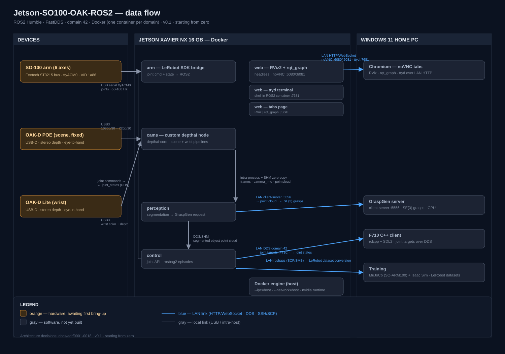

# Jetson-SO100-OAK-ROS2

Robotic manipulation cell: an **SO-100 arm** + **OAK-D POE camera (USB-C)** + an **OAK-D Lite wrist camera**, governed by a **Jetson Xavier NX 16 GB** (Ubuntu 20.04, JetPack 5.1.5) running **ROS2 Humble in Docker containers**.

A Windows 11 Home PC on the same LAN provides visualization (noVNC in Chromium), GraspGen inference, policy training (MuJoCo / Isaac Sim) and teleoperation with a Logitech F710.

## Status

- [x] Phase 0: repo + engineering prompt (`docs/PROMPT.md`)
- [x] Phase 1: ROS2 Humble in containers, FastDDS, domain 42 (ADR-0001, ADR-0002)
- [x] Phase 2: Docker — per-domain containers, zero-copy, `--ipc=host` (ADR-0003…0005)
- [x] Phase 3: drivers — LeRobot (arm), depthai-core (both OAK-Ds) (ADR-0006…0008)
- [x] Phase 4: control — joint-space API, mounting, calibration, recording, GraspGen (ADR-0009…0013)
- [x] Phase 5: RViz — headless RViz2 + noVNC (ADR-0014)
- [x] Phase 6: Windows — noVNC in Chromium, MuJoCo+Isaac Sim, F710 C++ client (ADR-0015…0017)
- [x] Phase 7: web interface — noVNC tabs + ttyd (ADR-0018)
- [x] Phase 8: architecture doc + diagram, v0.1 tag
- [ ] Implementation on the hardware (see `docs/architecture.md` → open items)

## How we work

Every architecture decision is proposed with 3 alternatives (pros, cons, recommended), chosen by the user, and recorded as an ADR in `docs/adr/`. The full workflow lives in `docs/PROMPT.md`.

## Documentation

- `docs/PROMPT.md` — engineering prompt and project phases
- `docs/architecture.md` — architecture overview, ADR index, open items
- `docs/adr/` — Architecture Decision Records (0001–0018)
- `docs/architecture-flow.svg` / `.png` — data-flow diagram
