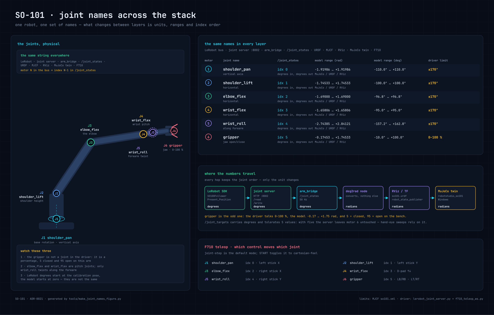
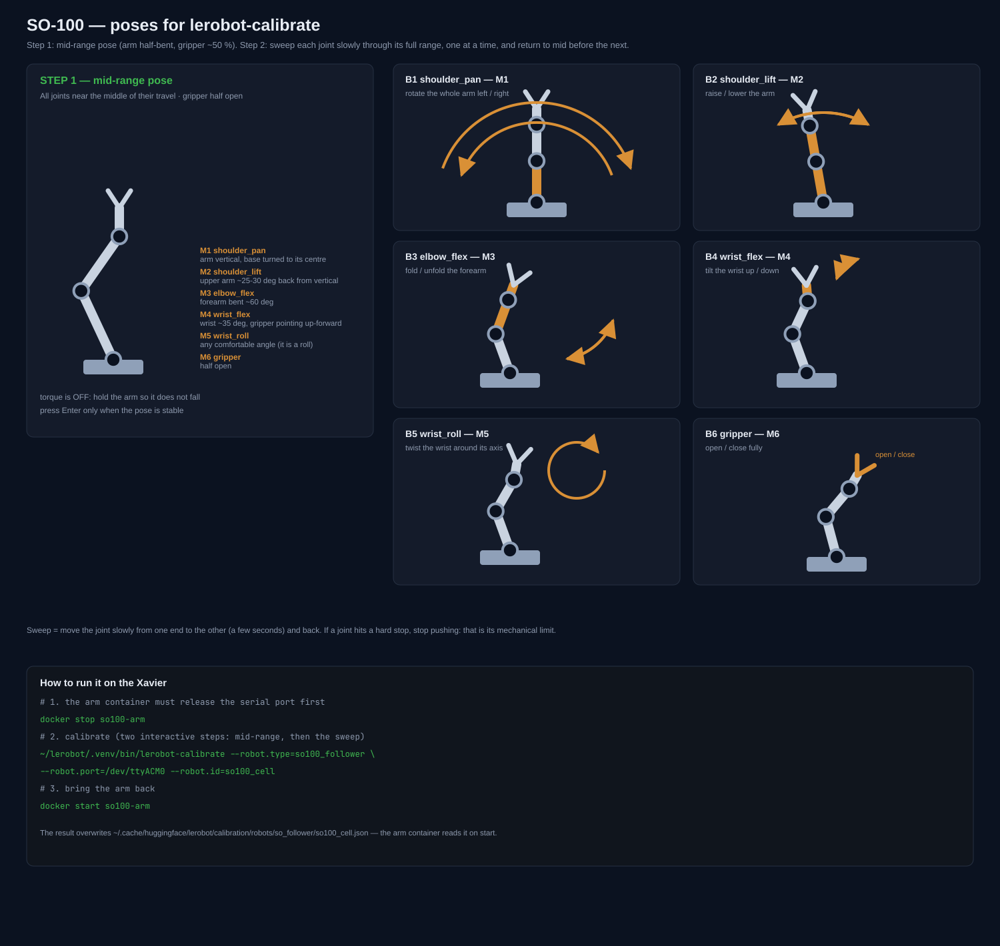
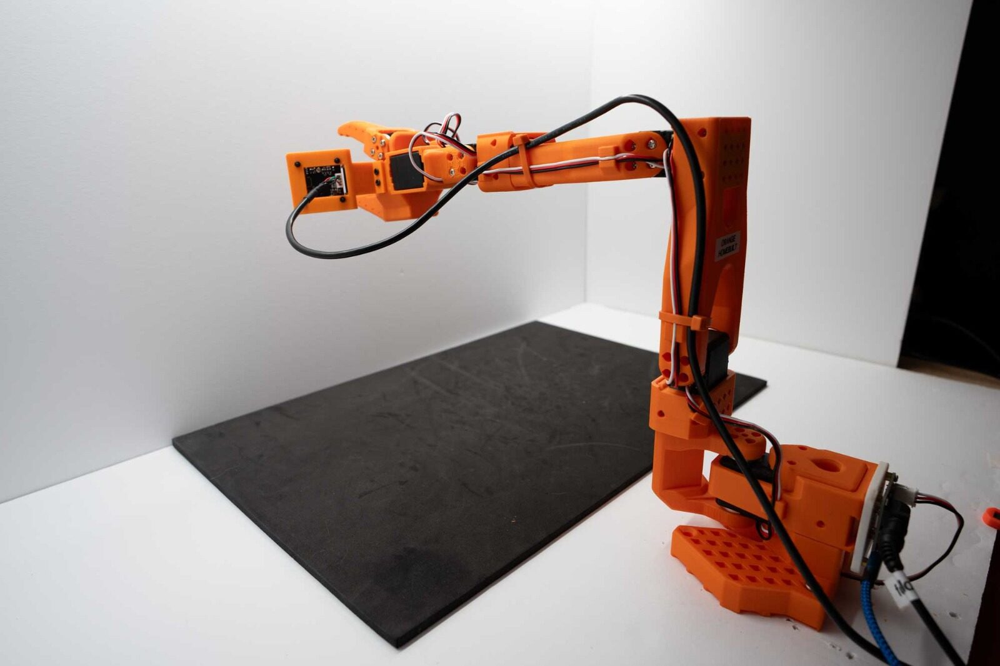
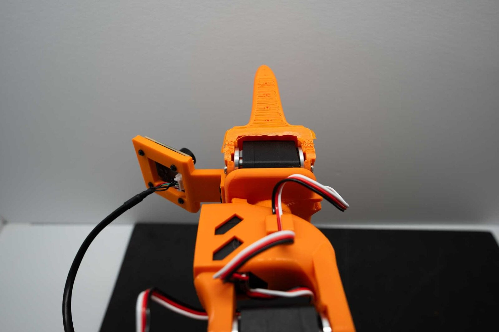

# Jetson-SO100-OAK-ROS2

Robotic manipulation cell: an **SO-101 arm** + **OAK-D POE camera (USB-C)** + an **OAK-D Lite wrist camera**, governed by a **Jetson Xavier NX 16 GB** (Ubuntu 20.04, JetPack 5.1.5) running **ROS2 Humble in Docker containers**.

A Windows 11 Home PC on the same LAN provides visualization (noVNC in Chromium), GraspGen inference, policy training (MuJoCo / Isaac Sim) and teleoperation with a Logitech F710.


**Legend:** solid green = implemented and verified on the Xavier; amber = code written but never run; dashed grey = missing. The bottom band lists the modules still to build (the grasp loop and episode-based training).

### What each joint is called

All six joints keep **the same name in every layer** — LeRobot bus, joint server, `arm_bridge`,
`/joint_states`, URDF, MJCF, RViz, the MuJoCo twin and the F710 client. What differs is the motor
number, the array index, the unit (degrees in the driver, radians in the model) and the limits
(the model's per-joint ranges against the driver's coarse ±170° clamp). The figure below is the
reference for all of it; it is generated by `tools/make_joint_names_figure.py` from the same MJCF
the URDF comes from, so it cannot drift.



## Status

- [x] Phase 0: repo + engineering prompt (`docs/PROMPT.md`)
- [x] Phase 1: ROS2 Humble in containers, FastDDS, domain 42 (ADR-0001, ADR-0002)
- [x] Phase 2: Docker — per-domain containers, zero-copy, `--ipc=host` (ADR-0003…0005)
- [x] Phase 3: drivers — LeRobot (arm), depthai-core (both OAK-Ds) (ADR-0006…0008)
- [x] Phase 4: control — joint-space API, mounting, calibration, recording, GraspGen (ADR-0009…0013)
- [x] Phase 5: RViz — headless RViz2 + noVNC (ADR-0014)
- [x] Phase 6: Windows — noVNC in Chromium, MuJoCo+Isaac Sim, F710 C++ client (ADR-0015…0017)
- [x] Phase 7: web interface — noVNC tabs + ttyd (ADR-0018)
- [x] Phase 8: architecture doc + diagram, v0.1 tag
- [ ] Implementation on the hardware (see `docs/architecture.md` → open items)

## Implementation status

- [x] Arm: LeRobot SDK (`~/lerobot/.venv`, py3.12) + calibration on the Xavier; all 6 motors verified over the bus (ADR-0006 amended — no adapter flash needed)
- [x] depthai-core from source on the NX (ADR-0007) — core v2.33.0 + bindings installed on the Xavier; USB3 + wrist-Lite wiring check pending
- [x] Compose file + provisioning script for the **six** services (five cell domains + rosbridge)
- [x] MuJoCo twin live: rosbridge container on ws://:9090 (jammy image, ADR-0019); Windows twin mirrors /joint_states at 50 Hz — verified end-to-end 2026-11-08 (398 msgs / 8 s from a LAN PC)
- [x] Web interface: **three tabs live** — RViz2 (arm + TF + camera), rqt_graph, terminal — via noVNC + ttyd (see "RViz tab") (ADR-0014/0015/0018)
- [ ] Hand-eye calibration — printable ChArUco board ready (`docs/charuco-board.pdf`); scene OAK-D next, OpenCV solver (ADR-0011 amended: no easy_handeye build)
- [ ] Windows: ROS2 Humble + VS Build Tools + SDL2 + firewall, F710 client, GPU check (ADR-0015…0017)

## Jetson setup — uv + LeRobot SDK (arm)

Exact commands to install and use the LeRobot stack for the SO-100 arm on the Xavier NX (ADR-0006). Verified working; doubles as the record of the Jetson's current state.

**1. Install uv**

```bash
curl -LsSf https://astral.sh/uv/install.sh | sh
```

Lands in `~/.local/bin/uv`. The installer script needs `curl`, which the full JetPack 5.1.5 image ships.

**2. Python 3.12 venv**

```bash
uv venv ~/lerobot/.venv --python 3.12
```

uv fetches a managed CPython 3.12 build — the system Python 3.8 on Ubuntu 20.04 is too old for LeRobot (needs ≥3.10).

**3. LeRobot + Feetech SDK**

```bash
uv pip install --python ~/lerobot/.venv/bin/python "lerobot[feetech]"
```

Pulls `lerobot` with `torch` (CPU aarch64 wheel — multi-GB download), `rustypot` (serial motor bus), `feetech-servo-sdk` and `opencv-python-headless`. If `/tmp` is tight, `export TMPDIR=~/tmp` first so pip unpacks on disk.

Note: `uv venv` creates no `pip` binary — always install through `uv pip install --python <venv>/bin/python`, never `<venv>/bin/pip`.

**4. Serial access to the arm**

The arm's bus adapter enumerates as `/dev/ttyACM0` (VID `1a86`, CH9102). Default udev rules create `ttyACM*` as `root:dialout` with mode 0660 — membership in the `dialout` group is all that's needed; no custom udev rule.

**5. Verify the bus**

```bash
~/lerobot/.venv/bin/python tools/lerobot_bus_probe.py /dev/ttyACM0
```

Expected output: one line per motor with its ID and raw position, then `OK 6/6`. Exit code 0 means the whole chain (wiring, 12 V supply, baudrate, motor IDs) is healthy.

The one-time `lerobot-setup-motors` step (writes unique IDs 1–6 + 1 M baud into each servo's EEPROM) is only needed when IDs don't match; this arm came with them already set.

**6. Calibration (physical, once per arm)**

```bash
~/lerobot/.venv/bin/lerobot-calibrate \
    --robot.type=so100_follower \
    --robot.port=/dev/ttyACM0 \
    --robot.id=so100_cell
```

Two interactive steps with torque off — the operator must hold the arm:
1. pose every joint mid-range, Enter;
2. sweep every joint through its full range, Enter.

The result is written to `~/.cache/huggingface/lerobot/calibration/robots/so_follower/so100_cell.json`. Without it, normalized reads raise `has no calibration registered` (raw reads with `normalize=False` still work).

### Re-calibrating the arm (with pose pictures)



1. **Free the serial port**: the running arm container holds `/dev/ttyACM0`, so stop it first (`docker stop so100-arm`). RViz keeps running — it simply stops updating.
2. **Run the calibration** on the Xavier host: `~/lerobot/.venv/bin/lerobot-calibrate --robot.type=so100_follower --robot.port=/dev/ttyACM0 --robot.id=so100_cell`.
3. **Step 1 — mid-range pose** (first panel of the picture): torque is off, hold the arm so it cannot fall; put every joint near the middle of its travel (arm half-bent, gripper ~50 %) and press Enter.

<table>
<tr>
<td width="50%"><br><em>Side view: base centred, upper arm ~25–30° back from vertical, elbow ~60°, wrist ~35°, gripper half open. The cables must have slack — the USB link dropped mid-calibration once when it was pulled.</em></td>
<td width="50%"><br><em>Gripper close-up: jaws half open, wrist roll at a comfortable middle so the sweep does not start against a stop.</em></td>
</tr>
</table>
4. **Step 2 — sweep each joint** slowly through its full range, one joint at a time, returning to mid before the next (panels B1–B6 show the direction for each). A hard stop is a mechanical limit — stop pushing.
5. **Bring the arm back**: `docker start so100-arm`. The joint server reads the new JSON on start; `/joint_states`, TF and the RViz model follow immediately.

The calibration file is overwritten in place, so keep a copy if you want to compare runs.

**`wrist_roll` always calibrates to `0…4095`** — that is correct, not a bug: it is a *continuous* joint (no hard stops), so its sweep covers the whole encoder turn. The only visible consequence is that its reported angle flips sign when it crosses the 0/4095 boundary; at teleop speeds that is invisible. Do not try to "fix" it by re-posing the wrist mid-range — re-homing shifts the value but the full-turn range comes back.

**Current state on the Xavier:** uv 0.13.7 in `~/.local/bin`; venv `~/lerobot/.venv` (CPython 3.12.16, lerobot + torch 2.15); arm calibrated as `so100_cell` (2026-11-07).

## Camera setup — depthai on the Xavier

**State:** scene OAK-D POE verified capturing color 1080p + depth 720p (on a USB2 link at the time — ~2.3 fps; USB3 wiring pending). Wrist OAK-D Lite pending connection. `depthai-core` v2.33.0 built from source and installed at `~/depthai`; `depthai-python` bindings built against it and installed into `~/oak/.venv` (version string `2.33.0.0.dev0+<commit>` — the source build, not the wheel).

1. **udev rule (once):** `/etc/udev/rules.d/80-oak.rules` → `SUBSYSTEM=="usb", ATTRS{idVendor}=="03e7", MODE="0666"`, then `udevadm control --reload-rules && udevadm trigger --subsystem-match=usb`. Without it, a bootloader-state device can't be opened by non-root.
2. **Fallback venv (works today):** `uv venv ~/oak/.venv --python 3.12` + `uv pip install --python ~/oak/.venv/bin/python "depthai<3" opencv-python-headless` (wheel 2.33.0.0 — same API as the source build).
3. **Verify:** `~/oak/.venv/bin/python tools/oak_cams_probe.py` — lists every device (MXID, USB protocol) and captures color+depth per device into `~/oak_caps/`.
4. **depthai-core from source:** clone `--recurse-submodules --branch v2.33.0`, cmake with `-DCMAKE_POSITION_INDEPENDENT_CODE=ON -DDEPTHAI_BUILD_EXAMPLES=OFF -DDEPTHAI_BUILD_TESTS=OFF -DDEPTHAI_ENABLE_BACKWARD=OFF`, install to `~/depthai` — restores headers + `depthaiConfig.cmake` (the pip wheel ships neither), unblocking C++ nodes later.
5. **Bindings from source:** `depthai-python` tag v2.33.0.0, default add_subdirectory mode, with its PIC toolchain line changed to `set(CMAKE_POSITION_INDEPENDENT_CODE ON CACHE BOOL "" FORCE)` (the plain `set()` never reaches Hunter's external projects), Python pointed at the uv 3.12 headers, and a clean `~/.hunter` before configuring. **Install:** copy the built `depthai.cpython-312-aarch64-linux-gnu.so` over the wheel's module in `site-packages/`. The module statically links depthai-core (self-contained) and only needs libusb at runtime via rpath into `~/.hunter` — keep that tree on the host.
6. **USB3 check:** both OAKs must appear under a 5000M hub in `lsusb -t`; ~2–3 fps at 1080p+720p means the link fell back to USB2.

## Container stack — how the Xavier runs the robot

The Xavier runs the whole cell as **six Docker containers, one per job** (ADR-0003, ADR-0019). A container is a little boxed Linux with exactly what its job needs — nothing more. All six are started by docker compose, they share the Xavier's network and memory with the host (host network + `ipc: host`), and they talk to each other in ROS2 on domain 42 with FastDDS.

| Container | Job | What's inside |
|---|---|---|
| `so100-arm` | talks to the arm | the LeRobot SDK (shared read-only from the host venv) + the arm's USB port (`/dev/ttyACM0`) + its calibration file |
| `so100-cams` | reads both OAK-D cameras | its own depthai SDK (wheel, py3.12) + the computer's USB ports, so it can open the cameras |
| `so100-perception` | will turn images into grasp requests | plain ROS2 Humble image + a shared workspace folder |
| `so100-control` | will run the joint API + episode recording | plain ROS2 Humble image + the same shared workspace |
| `so100-web` | the browser tabs (RViz, graph, terminal) | desktop ROS2 image (rviz2 + rqt prebuilt) + noVNC at :6080/:6081 + ttyd (7681) + tabs page (port 80) |
| `so100-rosbridge` | WebSocket bridge for the MuJoCo twin | Ubuntu 22.04 ROS2 Humble image with rosbridge_suite (binary packages) at ws://:9090 — it needs Python ≥3.9, which the focal images don't have (ADR-0019) |

### How to create the containers

**The short way — the provisioning script (recommended).** Copy the `docker/` and `scripts/` folders onto the Xavier (e.g. into `~/so100/`), then run:

```bash
SUDO_PASSWORD=<your password> bash scripts/provision-jetson.sh
```

The script is safe to run again and again. It: installs the compose v2 plugin if missing (into your user, no sudo), makes sure the camera udev rule exists, builds the custom images (cams, web, rosbridge) and starts all six containers. When it finishes `docker ps` shows them, and the tabs page is at http://192.168.1.50/ (port 80) — the page derives the host from its own URL, so there is nothing to fill in.

**The manual way — one container at a time.** From the `docker/` folder on the Xavier:

1. `so100-arm` — ready-made image, nothing to build:
   ```bash
   docker compose up -d arm
   ```
2. `so100-cams` — builds its own image first (installs uv + the depthai wheel, a few minutes), then starts it:
   ```bash
   docker compose up -d --build cams
   ```
3. `so100-perception` — ready-made image:
   ```bash
   docker compose up -d perception
   ```
4. `so100-control` — ready-made image:
   ```bash
   docker compose up -d control
   ```
5. `so100-web` — builds its own image (installs noVNC + ttyd, a few minutes), then starts it:
   ```bash
   docker compose up -d --build web
   ```
6. `so100-rosbridge` — builds its own image (pulls the Ubuntu 22.04 ROS2 image + installs rosbridge, a few minutes), then starts it:
   ```bash
   docker compose up -d --build rosbridge
   ```

**Day-to-day:** `docker ps` shows the six `so100-*` containers; the containers come back up by themselves after a Xavier reboot (`restart: unless-stopped`). Open a shell inside one with `docker exec -it so100-arm bash`. To use ROS2 commands inside a shell, source the ROS environment first: `bash -c "source /opt/ros/humble/install/setup.bash && ros2 topic list"`.

Verified 2026-11-09: shutdown button (:8099) and Terminal tab (:7681) confirmed working by the operator; six containers up — `so100-arm` (bus 6/6, `/joint_states` at 50 Hz), `so100-cams` (OAK capture 1/1), `so100-control`, `so100-perception`, `so100-web` (tabs page + RViz2 arm + rqt_graph + ttyd live), `so100-rosbridge` (:9090 serving `/joint_states` to a LAN PC at 50 Hz).

Notes (traps we hit — read before changing the stack):
- Compose v2 is required — v1 rejects `device_cgroup_rules` with a misleading error.
- dusty images ship an expired ROS apt key: `rm /etc/apt/sources.list.d/*ros*` before `apt-get update` in new Dockerfiles.
- Docker auto-creates missing bind-mount folders root-owned — pre-create them (the provision script does).

## Web interface — RViz · Stereo · Cloud · Graph · Terminal

One page at **http://<xavier-ip>/** with five tabs, served by the `so100-web` container. The examples below use the generic address `192.168.1.50` — substitute your own Xavier's LAN address everywhere it appears.

| Tab | URL (direct) | What you see |
|---|---|---|
| **RViz** | http://192.168.1.50:6080/vnc.html | RViz2: the SO-101 arm with its live pose, the grid, TF and the OAK-D camera image |
| **Stereo Cam** | http://192.168.1.50:8090/stereo | the two **rectified** mono views (LEFT · CAM_B, RIGHT · CAM_C) — exactly the images the depth map is computed from, with their resolution and fps |
| **Point Cloud** | http://192.168.1.50:8091/ | the `/oak/scene/points` cloud in 3D (three.js): drag to orbit, wheel to zoom, colour = distance from the cloud centre |
| **Graph** | http://192.168.1.50:6081/vnc.html | rqt_graph: every node/topic in the cell and how they connect |
| **Terminal** | http://192.168.1.50:7681 | a writable shell **inside the web container**, with the ROS2 environment sourced |

Plus a red **Shutdown Xavier NX** button on the right (it POSTs to the container's :8099 endpoint, which SSHes to the host and powers it off; the password lives only in a 600 file on the host, mounted read-only as a secret).

The page derives the Xavier's address from its own URL (`location.hostname`), so it works from any IP without editing anything, and it loads the first tab (RViz) on page open.

### Torque switch — the red button

The first control in the bar, left of the tabs, is the arm's torque switch: **red **`Torque brazo`
means the servos are free and the arm can be moved by hand, **orange** `Quitar torque` means they are
energised and the arm holds its pose. It turns orange once pressed and back to red when pressed again.

The arm always boots with **torque off**, and that is enforced twice: the joint server calls
`disable_torque()` on its own startup and `/write` answers **409** with
`torque is off — press 'Torque brazo' in the web page` until the button is used. So nothing can
energise the arm behind the operator's back — not a teleop client left running, not a stale target.

The browser talks to `:8092`, a four-line proxy in the arm container (`docker/ws/arm/torque_api.py`)
that forwards only `/torque` to the loopback joint server on `:8002`. The page cannot move the arm,
it can only switch the servos on and off.

### What runs inside `so100-web`

```
Xvfb :10 1280x800  ──► rviz2 ──► x11vnc :5900 ──► websockify :6080 ──┐
Xvfb :11 1280x800  ──► rqt_graph ─► x11vnc :5901 ─► websockify :6081 ─┼──► browser tabs
ttyd :7681 (shell in the container) ────────────────────────────────┤
python -m http.server :80 (tabs page + URDF + meshes, from /srv/web) ┘
shutdown_server.py :8099 (button endpoint)
```

Each piece, and why it is there:

- **Xvfb** — a virtual X screen, because there is no monitor. Two of them: `:10` for RViz, `:11` for rqt.
- **rviz2 / rqt_graph** — run headless on those displays. Both come **prebuilt in the image** (see below).
- **x11vnc** — exports each virtual screen as a VNC server (`:5900`, `:5901`).
- **websockify + noVNC** — turns VNC into WebSocket/HTTP so a browser can show it (`:6080`, `:6081`).
- **ttyd** (`-W`, writable) — a terminal over WebSocket (`:7681`). Without `-W` it silently starts read-only.
- **`http.server :80`** — the tabs page itself, plus the URDF and the STL meshes that RViz reads from `/srv/web/...` (that directory is the repository's `docker/web/`, bind-mounted read-only).

### The image: the **desktop** dusty image, no compiling

`docker/web.Dockerfile` is ~25 lines: it starts from `dustynv/ros:humble-desktop-l4t-r35.4.1` (which ships `rviz2` and `rqt_graph` prebuilt), installs the X/VNC layer (`xvfb x11vnc x11-utils xauth websockify novnc xdotool imagemagick`), the SSH client for the shutdown endpoint, `libignition-math6-dev` (RViz2 needs it at runtime), downloads the static `ttyd` binary, and copies `entry.sh` + `shutdown_server.py`.

The base matters enormously: the dusty **desktop** flavour carries `rviz2` and `rqt_graph` already compiled, while the **ros-base** flavour does not — and Ubuntu 20.04 has no ROS2 Humble binary packages, so with ros-base RViz2 had to be compiled from source (OGRE alone ~2 h; a whole prebuilt-workspace mechanism was invented for it). Switching the base to *desktop* deleted that entire problem. If you ever wonder "why is this image only apt?" — that is why. The old recipe survives in the git history.

### `entry.sh` — the container's whole startup

In order: clear stale X locks → start `Xvfb :10` and `:11` → **wait until X accepts connections** (`xdpyinfo`, not a fixed `sleep`) → start the two `x11vnc` servers with explicit `-rfbport` → two `websockify` front-ends → `ttyd` → shutdown server → the tabs page → source ROS → `LIBGL_ALWAYS_SOFTWARE=1` → `rviz2 -d /srv/web/rviz.rviz` on `:10` → `rqt_graph` on `:11`, then a loop that stretches the rqt window to full screen (it opens tiny).

Two rules learned the hard way:

1. **Never use displays `:0`/`:1` in the container.** The Xavier's own desktop runs Xorg on `:0`; with `--network host` the X11 abstract socket namespace is shared, so a container Xvfb on `:0` dies with *"server already running"* while everything else looks healthy (and rviz2 then fails with `qt.qpa.xcb: could not connect to display`).
2. **Clear `/tmp/.X10-lock` and `/tmp/.X11-unix/X10` on start.** A container restart can leave them behind and Xvfb refuses to start.

### The arm in RViz — model, URDF and the QoS/view config

The pose comes from the arm side: `arm_bridge` publishes `/joint_states` at 50 Hz → `robot_state_publisher` publishes `/tf` and the latched `/robot_description` → RViz draws the model at those transforms.

The model is **the SO-100 kinematic chain of the MuJoCo Menagerie model**
(`trs_so_arm100`), which is the reference the twin was validated against. Every joint frame
(`<origin xyz rpy>`) and every `<axis>` is copied one-to-one from that MJCF, so RViz and the
MuJoCo twin execute the same mathematics:

| Piece | Path | Notes |
|---|---|---|
| URDF | `docker/ws/arm/urdf/so100.urdf` | Meshes at `file:///srv/web/assets/*.obj`; joint names are LeRobot's |
| Meshes | `docker/web/assets/*.obj` | OBJ conversion of the Menagerie STLs (RViz's STL loader fails silently on these files; OBJ loads fine) |
| Config | `docker/web/rviz.rviz` | Fixed Frame **base** (the URDF root link), Grid + TF + RobotModel + Image (compressed) displays, explicit Orbit view |

Three config details that are easy to get wrong:

- **RobotModel must subscribe with `Durability Policy: Transient Local`** — `/robot_description` is latched; a default (volatile) subscription created after the publisher never receives it.
- **The view must live under `Views → Current:`**. A `Current View:` key is silently ignored and RViz falls back to its defaults.
- **Degrees → radians is the trap that looks like a broken model.** `/joint_states` carries
  **degrees** (LeRobot's convention, and what the teleop and the twin use), while every ROS
  consumer (`robot_state_publisher`, RViz, `tf2`) interprets joint positions in **radians**
  (REP-103). Feeding degrees straight in multiplies every angle by 57.3: the arm renders
  twisted, with meshes cutting through each other, and no error is printed anywhere. The arm
  container runs `deg2rad.py`, which republishes `/joint_states` as `/joint_states_rad`, and
  `robot_state_publisher` is launched with `-r joint_states:=/joint_states_rad`. The MuJoCo
  twin always looked right because it converts degrees to radians explicitly.
- **Mesh paths must be explicit `file://` URIs.** Bare or relative paths (`assets/Base.stl`) are handed to the URL loader and fail with the misleading *"Could not resolve host: assets"*.

And the one trap that cost the most time: **a URDF that `urdfdom` rejects renders nothing, silently.** Our first hand-rolled URDF contained empty `<joint>` stubs; RViz showed the display as **"Status: Ok" with zero links**, no error anywhere, and painted only the grid and TF. A ten-line test URDF with a single box proved the renderer itself was fine (single link draws, the arm did not) — that is the fastest way to tell a config problem from a model problem. The canonical phosphobot model parses cleanly.

### Step by step from a clean Xavier

1. **Deploy the repository** (the deploy directory is not a git clone; `rsync` it):
   ```bash
   rsync -az --exclude .git --exclude __pycache__ ./ maju@192.168.1.50:~/so100/
   ```
2. **Build and start the stack:**
   ```bash
   cd ~/so100/docker
   docker compose up -d --build          # or: SUDO_PASSWORD=... bash ../scripts/provision-jetson.sh
   ```
   The web image pulls `dustynv/ros:humble-desktop-l4t-r35.4.1` (several GB, once) and then builds in minutes.
3. **Check the container and its ports:**
   ```bash
   docker ps --format '{{.Names}} {{.Status}}' | grep so100-web
   ss -tln | grep -E ':80 |:6080|:6081|:7681'
   ```
4. **Check that both GUIs are actually running inside it:**
   ```bash
   docker exec so100-web bash -c 'command -v rviz2; command -v rqt_graph; ps aux | grep -E "rviz2|rqt_graph" | grep -v grep'
   ```
5. **Check the data reaching RViz** (joint feedback + the full transform chain):
   ```bash
   docker exec so100-web bash -c 'source /opt/ros/humble/install/setup.bash && ros2 topic hz /joint_states'
   docker exec so100-web bash -c 'source /opt/ros/humble/install/setup.bash && ros2 run tf2_ros tf2_echo Base jaw'
   ```
   `Base` is the URDF root; `Moving Jaw` is the gripper link. A missing transform means the arm side, not RViz.
6. **Open the page:** http://192.168.1.50/ — RViz tab first, then Graph, then Terminal.
7. **Raw captures without a browser** (useful when a tab is blank):
   ```bash
   docker exec so100-web bash -c 'DISPLAY=:10 import -window root /tmp/rviz.png; DISPLAY=:11 import -window root /tmp/graph.png'
   docker cp so100-web:/tmp/rviz.png .
   ```
   If the raw X11 capture shows the arm but the browser does not, the problem is noVNC/the browser tab (hard-refresh, `Ctrl+Shift+R`), not RViz.

### Troubleshooting the tabs

| Symptom | Cause | Fix |
|---|---|---|
| First tab empty, others work | the page never assigned `src` to the initially active iframe (older page version) | current `index.html` loads the first tab on open; hard-refresh |
| All iframes dead, URLs contain the literal `__HOST__` | tabs page overwritten by a plain `rsync` after provisioning had rewritten it | current page derives the host from its own URL — no `__HOST__` any more |
| RViz tab black, direct `:6080` fine | cached noVNC session in the tab | `Ctrl+Shift+R`, or open `:6080` directly |
| `qt.qpa.xcb: could not connect to display :10` | Xvfb failed (stale lock, or `:0` collision) | check `docker logs so100-web` for the Xvfb fatal error; entry clears locks and uses `:10`/`:11` |
| rqt_graph opens as a tiny window | rqt's default geometry | entry stretches it with `xdotool` once the window exists |
| RViz: "The class rviz_default_plugins/Orbit could not be loaded" | missing `libignition-math6` at runtime | it is in the image now; if you tweak the Dockerfile, keep it |
| RViz arm twisted / meshes interpenetrating | joint positions fed in **degrees** into a radians consumer | run the `deg2rad.py` bridge and remap `joint_states` for `robot_state_publisher` |
| RViz: RobotModel "Ok" but no arm | URDF rejected by urdfdom (e.g. empty `<joint>` stubs) | use the canonical phosphobot model; test with a one-box URDF to isolate |
| RViz: "Could not resolve host: assets" | relative mesh paths treated as URLs | `file://` URIs in the URDF |

## Windows PC setup — teleop + visualization

Visualization needs nothing but a browser (ADR-0015): open http://192.168.1.50/ — tabs are RViz (headless RViz2 via noVNC) and a Terminal (ttyd); the RViz stream alone is at http://192.168.1.50:6080/vnc.html?autoconnect=true. Teleoperation with the F710 needs the native client (ADR-0017).

### MuJoCo (training, ADR-0016) — first milestone

MuJoCo is already installed on the Windows PC. To verify the SO-100 model chain before any training, in a cmd/PowerShell:

1. Install MuJoCo for Python (if not already):
   pip install mujoco
2. Get the SO-ARM100 model from MuJoCo Menagerie (clone or download zip):
   git clone https://github.com/google-deepmind/mujoco_menagerie
3. Run the repo's check script against the model:
   python windows\mujoco_check.py C:\path\to\mujoco_menagerie\trs_so_arm100\scene.xml

Expected output: "OK - model loaded, 6 joints, simulated 200 steps". That proves the sim can run the arm — the base for imitation-learning sessions later (Isaac Sim deferred for now by user decision).

### MuJoCo twin — live mirror of the real arm (rosbridge WebSocket, ADR-0019)

The Xavier's `so100-rosbridge` container serves a WebSocket at ws://192.168.1.50:9090 that forwards any ROS2 topic as JSON. The Windows PC mirrors the arm's /joint_states into MuJoCo:

1. Install the two Python libraries — **mind the versions** (MuJoCo 4.x moved the classic viewer into MuJoCo Studio; the twin uses the 3.x viewer):
   ```
   pip install roslibpy "mujoco>=3,<4"
   ```
2. Run the twin (any Menagerie SO-100-family model works; `trs_so_arm100` is the exact SO-100, `robotstudio_so101` the SO-101):
   ```
   python windows\mujoco_twin.py C:\path\to\mujoco_menagerie\trs_so_arm100\scene.xml
   ```

A MuJoCo window opens and the simulated arm follows the real one live. Internals, each of which cost debugging time on 2026-11-08:

- **Kinematic mirror**: the script uses `viewer.launch_passive` (NOT `viewer.launch`, which blocks the main thread and steps its own physics — the model's position servos then hold the arm frozen at the initial pose). Each frame the script writes qpos from the latest message, runs `mj_forward` (kinematics only) and `sync`s the viewer. No physics, no fighting the real arm.
- **Degrees → radians**: /joint_states publishes degrees (LeRobot convention); MuJoCo qpos is radians.
- **Joint-name mapping**: Menagerie names its joints Rotation, Pitch, Elbow, Wrist_Pitch, Wrist_Roll, Jaw — not the LeRobot names. The script has an alias table plus a positional fallback, and prints the mapping (`qpos[0] <- shoulder_pan ...`) and the first received message so problems are visible in the console.
- **Viewer import**: `from mujoco import viewer` must be explicit — in the 3.x line `import mujoco` alone does not expose it.

The rosbridge server itself: rosbridge_suite humble needs Python >=3.9, which the focal cell images don't have — hence its own Ubuntu 22.04 container (docker/rosbridge.Dockerfile, official binary packages). It starts with `docker compose up -d rosbridge` and its health check is `ros2 topic echo /joint_states --once` inside the container. It needs `ipc: host` like the rest of the stack: FastDDS shared-memory transport carries the data over /dev/shm, and without the host IPC namespace the container discovers topics but receives nothing.

Verified 2026-11-08 from a LAN PC: 398 /joint_states messages in 8 s (~50 Hz) through the WebSocket.

Twin troubleshooting:

| Symptom | Cause | Fix |
|---|---|---|
| `RosTimeoutError: Failed to connect` | rosbridge down on the Xavier | `docker compose up -d rosbridge`; check `ss -tln \| grep 9090` on the Xavier |
| window opens, arm never moves | old script or `viewer.launch` (blocking) | `git pull` — the current script uses `launch_passive` |
| `mujoco ... has no viewer module` | MuJoCo 4.x installed | `pip install "mujoco>=3,<4"` |
| `mapped 0/6 joints` warning | unknown model joint names | use the Menagerie SO-100/101 models; the alias table + fallback cover them |
| a joint moves backwards | sign convention differs between model and arm | report it — a per-joint sign flip in the script fixes it |

### F710 teleop — the pad (ADR-0017, amended by ADR-0020)

**Recommended path — Python over rosbridge (no ROS2 on Windows).** Two pip packages, same WebSocket the MuJoCo twin already uses:

```
pip install pygame roslibpy
python windows\f710_teleop_ws.py --host 192.168.1.50
```

The pad must be in **X mode** (switch on its back). It waits for `/joint_states`, seeds the targets at the arm's real pose and then starts publishing `/joint_targets` (degrees, 6 values).

**Press `Torque brazo` in the web page first** — the arm boots with torque off and `/write` refuses until the servos are energised, so the pad will look dead otherwise. Publishing stops whenever the pad is idle, so a lost controller cannot drive the arm.

**Controls** (identical to the C++ client):

- **joint-step** (default): D-pad L/R picks joint 0–5, left stick Y moves it, LB/RB close/open the gripper.
- **cartesian-feel**: START toggles — left stick = pan/lift, right stick X = elbow, right stick Y = wrist_roll, **LB + right stick Y = wrist_flex**, triggers = gripper.
- **record / replay**: X starts/stops recording the targets, B replays them.
- **torque**: hold **B for 5 s** to switch the servos on or off, same as the red button in the web page — the state is read from the arm before flipping, so it cannot get out of sync. A short tap still replays.

#### joint-step, the default mode

It moves **one joint at a time**: the D-pad chooses which, and only the left stick's vertical
axis drives it. The client starts in this mode; START switches to cartesian-feel and back.

| Control | What it does |
| :--- | :--- |
| D-pad ← → | walks the selection through `shoulder_pan → shoulder_lift → elbow_flex → wrist_flex → wrist_roll → gripper` and prints the name |
| left stick ↑↓ | moves **only** the selected joint |
| LB / RB | close / open the gripper while held |

Speed is **1° per tick at 50 Hz = 50 °/s** at full deflection, on a quadratic curve with a 15 %
dead zone, so half stick is about 12 °/s and the centre gives fine control. Every value is clamped
to ±170° for the five joints and 0–100 for the gripper, and nothing is published while the pad is
idle (0.5 s after the last input the stream stops, so a lost controller cannot keep driving).

The D-pad is read **edge-triggered**, one hop per push. Reading it every tick made a short tap jump
three or four joints, which looked like the D-pad doing nothing.

Why bother, when cartesian-feel is nicer? Because one joint at a time is the safe way to explore the
workspace — you see exactly which axis responds and by how much, with no coupling — and it is the
mode to record in: the targets stay clean and replay identically. Use joint-step to learn the arm
and to capture episodes, cartesian-feel to work quickly by eye.

**Safety**: `/joint_targets` is only sent after feedback arrives; per-tick deltas and the joint ranges are clamped, and the Jetson bridge enforces the real limits regardless.

Transport verified 2026-11-09: a target vector published through rosbridge reached the arm bridge, and sending the current pose produced zero movement.

**Alternative — the C++ client** (`windows/f710_teleop.cpp`, rclcpp + SDL2 + DDS; needs the full ROS2 Windows install):

**One-time setup:**
1. ROS2 Humble (runtime only): the official Windows zip (ros2-humble-*-win64) from docs.ros.org → unpack to C:\dev\ros2_humble.
2. Visual Studio Build Tools 2022 with the "Desktop development with C++" workload.
3. SDL2 dev: SDL2-devel-2.30.x-VC.zip from libsdl.org → C:\dev\SDL2.
4. F710: back switch to X (XInput), plug the receiver in.
5. Firewall (elevated prompt): run windows/firewall-allow.cmd — opens UDP 7400–7450 for DDS on the private profile (the classic silent-failure point).

**Build + run:** windows/build.cmd produces build\Release\f710_teleop.exe. Run it with the ROS2 environment active (call C:\dev\ros2_humble\local_setup.bat first).

**Controls:** joint-step mode by default — D-pad L/R selects joint 0–5, left stick Y steps it, LB/RB = gripper close/open. START toggles cartesian-feel (left stick = pan/lift, right stick = elbow/wrist, triggers = gripper). X records the trajectory, B replays it.

**Safety:** the client publishes nothing until /joint_states arrives and starts from the arm's real position; deltas are clamped per tick and targets per joint limits — the Jetson bridge enforces the real limits regardless.

**GPU check (Isaac Sim viability):** run windows/check-gpu.cmd — needs an NVIDIA RTX-class GPU and driver ≥ 535 for Isaac Sim.

## ROS2 nodes — what each container runs and publishes

### so100-arm — the arm

Three processes inside the container:

1. **LeRobot joint server** (Python 3.12) — *not* a ROS node. The only process touching the arm's serial port: it reads the 6 motor positions and applies commanded angles, exposed as plain HTTP inside the container (port 8002). It exists because the LeRobot SDK needs Python ≥3.10 while the container's ROS2 libraries are built for Python 3.8 — the two halves talk over HTTP. API: `GET /read` (angles JSON), `GET /status`, `POST /write` (body `{"angles": [...]}`).
   ```bash
   docker exec so100-arm curl -s http://127.0.0.1:8002/read
   ```
2. **arm_bridge** (Python 3.8 + rclpy) — the ROS2 translator around that server.
3. **robot_state_publisher** — computes the arm's 3D skeleton (TF) from the URDF and the joint angles. Humble reads the URDF from the `robot_description` **parameter** (passed at launch), not from the topic.

Topics of this container, by node:

| Topic | Node | Direction | What it carries |
|---|---|---|---|
| /joint_states | /arm_bridge | out, 50 Hz | the arm's real position: 6 joint names + angles in degrees |
| /joint_targets | /arm_bridge | in | desired position: 6 angles — publishing here moves the arm |
| /robot_description | /arm_bridge | out, latched | the arm's URDF (geometry description) |
| /tf | /robot_state_publisher | out, ~17 Hz | the 3D transform of every moving link |
| /tf_static | /robot_state_publisher | out | fixed transforms (offsets that never move) |

**Utility:** this container alone turns the arm into a standard ROS2 device — anyone on domain 42 can see where it is (/joint_states), command it (/joint_targets) and render it in 3D (URDF + /tf), without ever knowing a serial port exists.


### Depth: range, texture and what the cloud can and cannot see

Two settings matter more than they look, and both are now on in `build_pipeline()`
(`docker/ws/cams/oak_ros_node.py`):

- **`setExtendedDisparity(True)`** — with the 7.5 cm baseline and the default disparity
  range the stereo stops at about **0.65 m**, which is exactly where this cell works: the
  arm, the gripper and anything on the bench in front of the camera fell inside the blind
  band and came back invalid. Extended disparity halves the minimum range to ~0.33 m.
- **`setLeftRightCheck(True)`** — kills the speckle that otherwise fills the cloud with
  phantom points behind every edge.

Measured on the bench (2026-11-10, `OAK-D-POE`, USB **High Speed** — that is why the
streams run at 1–1.5 fps): the depth map's nearest valid pixels went from ~0.96 m to
~0.56 m once extended disparity was enabled.

**The cloud cannot see blank surfaces.** A printed ChArUco board held at 0.54 m — measured
independently at 0.540 m by PnP on the colour image with 48 corners at 0.33 px — does not
show up in the depth map at all: white paper under the lamp has no texture for the stereo
matcher, so those pixels are invalid or fall back to the background. Expect the same with
any white or glossy object, which matters for grasping: texture, edges or the left/right
check are what produce depth, not brightness.

### so100-cams — the cameras

One node (/oak_cams), one depthai pipeline per device:

| Topic | Direction | What it carries |
|---|---|---|
| /oak/scene/color/compressed | out | scene color as JPEG (CompressedImage) |
| /oak/scene/depth | out | scene stereo depth, 16UC1 in millimetres, right-camera frame |
| /oak/scene/confidence | out | stereo confidence map, 8UC1 (per-pixel depth certainty) |
| /oak/scene/color/camera_info, /oak/scene/depth/camera_info | out | intrinsics — appear when calibration exists (Phase 4 easy_handeye) |
| /oak/scene/imu | out | accel + gyro + rotation vector — only on units that carry an IMU (this POE unit has none) |
| /oak/scene/points | out | point cloud (XYZ, metres) unprojected with the **depth camera's own calibration**, asked from the device at the resolution the map arrives at (`fx 833.00 fy 833.00 cx 639.23 cy 356.87` at 1280x720). No placeholders: the env vars are only a fallback for a unit with none |
| /oak/gripper/* | out | the same set for the wrist Lite, once it is plugged in |

It also broadcasts /tf_static with the camera frame offsets (placeholders until easy_handeye).

### so100-web — the browser

RViz2 (from the desktop image) runs headless on Xvfb :10 and is streamed via noVNC at :6080; rqt_graph on :11 at :6081 (maximized automatically); a ttyd terminal at :7681; tabs page at :80. No nodes of its own — RViz2 consumes /robot_description, /tf, /joint_states and the /oak topics.

### so100-rosbridge — the WebSocket bridge (MuJoCo twin, ADR-0019)

| Node | What it does |
|---|---|
| /rosbridge_websocket | the WebSocket server at ws://:9090 — subscribes to any topic on request (e.g. /joint_states) and forwards it as JSON to LAN clients |
| /rosapi | ROS introspection over the same socket (list topics/services) |

Its topics (/client_count, /connected_clients) are bookkeeping only. Any client on the LAN (roslibpy on Windows, a browser, another robot) can now consume the whole cell over one WebSocket.

so100-perception and so100-control carry no nodes yet (grasp pipeline and joint API + rosbag2 come in later phases).

## Troubleshooting

Traps this project has actually hit, with their fixes — in one place:

| Symptom | Cause | Fix |
|---|---|---|
| ROS container: `apt-get update` fails with EXPKEYSIG | dusty images ship an expired ROS key | `rm /etc/apt/sources.list.d/*ros*` before `apt-get update` in new Dockerfiles |
| compose rejects `device_cgroup_rules` with a misleading error | compose v1 | install the compose v2 plugin (user-level, no sudo — the provision script does it) |
| bind-mount folder appears but is unwritable | docker auto-created it root-owned | pre-create `tools/` and `ws/` before `up` (the provision script does) |
| container sees topics (`ros2 topic list`) but receives no data | missing `ipc: host` — FastDDS shared-memory transport needs the host IPC namespace | add `ipc: host` to the container (all six have it) |
| rosbridge: `TypeError: unsupported operand type(s) for \|` | rosbridge_suite humble is Python ≥3.9 code, cell images are py3.8 | run rosbridge in its own Ubuntu 22.04 container (docker/rosbridge.Dockerfile) — never in the focal images |
| rosbridge builds: missing package (rosbridge_test_msgs / rosapi_msgs / ament_cmake_mypy) | the suite's packages depend on each other and on ament_lint | build ALL of the cloned repos (`colcon build` without `--packages-select`) |
| MuJoCo: `module 'mujoco' has no attribute 'viewer'` | 4.x moved the viewer to Studio; 3.x loads it lazily | `pip install "mujoco>=3,<4"` and `from mujoco import viewer` |
| MuJoCo twin: window opens, arm frozen | `viewer.launch` blocks and steps its own physics | `viewer.launch_passive` + own qpos/mj_forward/sync loop |
| MuJoCo twin: `mapped 0/6 joints` | Menagerie joint names differ from LeRobot | alias table + positional fallback in mujoco_twin.py |
| OAK device: `open()` fails in bootloader state | missing udev rule | `SUBSYSTEM=="usb", ATTRS{idVendor}=="03e7", MODE="0666"` (the provision script adds it) |
| depthai link errors about non-PIC libs | Hunter pulled a prebuilt non-PIC dependency | force `CMAKE_POSITION_INDEPENDENT_CODE ON` in the toolchain + clean `~/.hunter` |
| OAK ~2–3 fps at 1080p+720p | USB2 link (480 M) instead of USB3 | check `lsusb -t` for a 5000M hub; move to a blue port |
| `pip install depthai` on the cell image | no cp38 wheels above 2.30.0.0 | pin `depthai==2.30.0.0` in the cams container |
| RViz arm malformed, links crossing through each other | joint positions fed in **degrees** into a radians consumer | run the `deg2rad.py` bridge and remap `joint_states` for `robot_state_publisher` |
| RViz: display "Ok" but nothing renders | URDF rejected by urdfdom (e.g. empty `<joint>` stubs) — no error surfaces | use the canonical phosphobot SO-100 model; validate the URDF structure |
| RViz: "Orbit could not be loaded" popup | missing `libignition-math6` at runtime | install `libignition-math6-dev` in the image |
| RViz: "Could not resolve host: assets" | bare/relative mesh paths are treated as URLs | use `file:///srv/web/...` URIs (encode spaces as %20) |
| RViz: view properties ignored | wrong key — humble expects `Views → Current` | fix the config key (a `Current View` key is silently dropped) |
| Xvfb: "server already running" on :0 | the host desktop owns display :0 under host networking | container displays on :10/:11 + clear stale `/tmp/.X1?-lock` on start |

## How we work

Every architecture decision is proposed with 3 alternatives (pros, cons, recommended), chosen by the user, and recorded as an ADR in `docs/adr/`. The full workflow lives in `docs/PROMPT.md`.

## Documentation

- `docs/PROMPT.md` — engineering prompt and project phases
- `docs/architecture.md` — architecture overview, ADR index, open items
- `docs/adr/` — Architecture Decision Records (0001–0020)
- `docs/architecture-flow.svg` / `.png` — data-flow diagram
