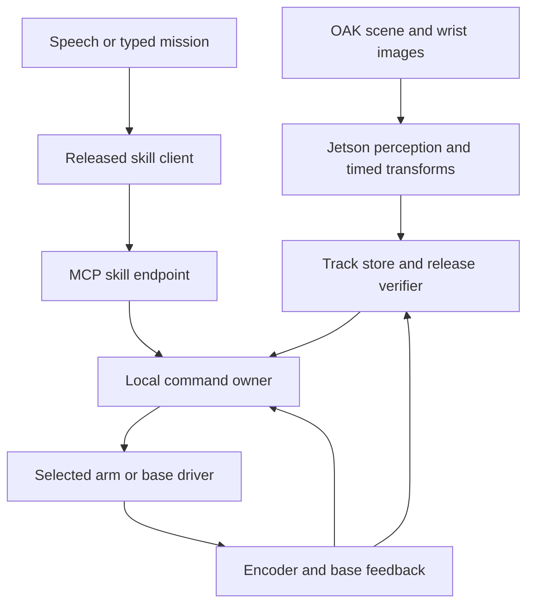
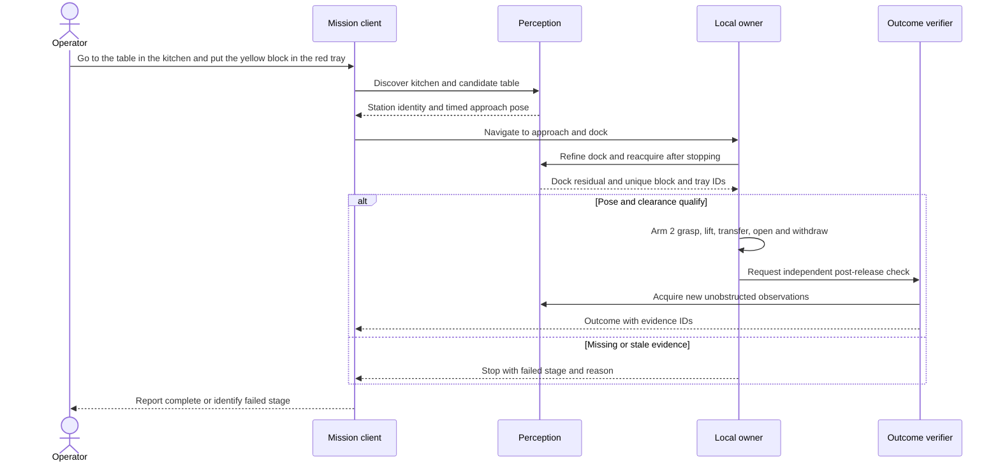

# SO-100 mobile manipulation with bounded MCP skills

## 1. Build the fixed bench first

**First release:** “Put the yellow block in the red tray.” Bolt or clamp both bases to the bench. Park arm 1 in a measured, supported pose outside the swept volume. Keep the base stationary. Use arm 2, a lit matte block, a contrasting shallow tray and a fixed scene camera that can see both props after the wrist retracts. On the Jetson, segment colour, recover metric geometry, execute bounded waypoints and independently verify the release. A typed task is enough for this release. Speech, a VLA, a driving base and workstation inference enter at later gates.

**The decision that can change this build is whether camera-to-arm accuracy leaves enough room to grasp and clear the rim.** The archived scene transform is explicitly rejected. The code also assumes angular units that the SDK configuration must confirm. Until both pass, build against recorded observations, a passive arm, and an isolated simulator. A surveyed fixture with independently measured table-relative coordinates is a useful fallback for testing the motion path. Record that as fixture-guided placement and qualify visual localization separately.

Engineer A owns integration and the released configuration. Engineer B measures the props, reserves undisclosed trial layouts and holdout poses, scores the runs, and repeats the final procedure. **Evidence vocabulary:** *reviewed* means inspected source, *reproduced* means run in this audit, *reported* means a dated project measurement, and *proposed* means a design or trial target. All operating rates, age budgets, sample counts and release thresholds below are proposed unless an existing setting or measured result is explicitly identified.

In simulation the endpoint binds to a private adapter and simulated sensors. In physical trials the endpoint sits beside the Jetson owner. Select exactly one at startup. A live visualization mirror is a third, observation-only use case.

## 2. Repository audit and evidence boundary

**Reviewed revision:** `6d63efc93aa24574b08fce2b56cf35300c38ba58` of `kamalimiquel/Jetson-SO100-OAK-ROS2`. The ZIP's commit ID and all 212 archived files matched the inspected tree. Branch of interest is `main`. The remote branch reference was unavailable during this audit, so the SHA identifies the reviewed baseline and the runbook checks the live branch before deployment. Paths in this section resolve relative to the [pinned project tree](https://github.com/kamalimiquel/Jetson-SO100-OAK-ROS2/tree/6d63efc93aa24574b08fce2b56cf35300c38ba58).

| Existing component | Repository evidence | Current role | Relevant limitation | Proposed change |
|---|---|---|---|---|
| Container launch and ROS | `docker/docker-compose.yaml`, `docker/{bashrc-cell,cams.Dockerfile,rosbridge.Dockerfile}`, `scripts/provision-jetson.sh`, ADRs 0001–0007 | Seven services: arm, arm2, cams, perception, control, web, rosbridge. Host networking and IPC, Fast DDS, domain 42. Bash entrypoints launch Python nodes and installed ROS packages. | `perception` sleeps. This snapshot supplies no application `package.xml`, colcon overlay or mobile launch package. | Introduce a Humble interface package and supervisor overlay. Keep current drivers and entrypoints. Lock images by digest and record device mappings. |
| Physical buses and legacy control | `docker/ws/arm/{lerobot_joint_server.py,arm_bridge.py,compat_bridge.py,torque_api.py,entry.sh}` | Separate SDK/ROS interpreters, two serial devices, per-arm loopback HTTP, namespaced ROS. Bare compatibility topics address arm 1. | Normalization depends on installed SDK. Legacy and UI routes can request motion or torque. One shared array gives no source identity. | Add explicit units and mode checks at boot. Route every physical command through a local owner. Restrict UI, compatibility and raw writes before autonomy. |
| Cell geometry and visualization | `docker/ws/cell_geometry.json`, `docker/ws/arm/urdf/{so100.urdf,so101.urdf,so101_cell.urdf}`, `joint_merge.py` and `deg2rad.py` under `docker/ws/arm`, `docker/web/rviz.rviz` | One merged robot model, `/cell/robot_description` and `/cell/joint_states_rad`. Geometry encodes arm 2 at (0, +0.30, 0) m relative to arm 1. RViz/VNC shows the cell. | The transform in the model and twin proves internal agreement. Physical link geometry, loaded sag and the jaw drawing need measurement. A frozen TF can remain visible. | Survey both mounts, fit TCP/jaw calibration, consume per-arm stamps. Retain model and UI for diagnosis. |
| Stereo and wrist drivers | `docker/ws/cams/{oak_ros_node.py,wrist_cam_node.py,entry.sh}`, `docs/calibration/{color_to_depth.yaml,focus/}` | DepthAI v2 custom node, scene colour/depth/cloud and two independent compressed UVC streams. | Depth is in right-camera geometry. ROS headers are assigned on the host. Arm 2 close-focus is unresolved. | Pair exposure times, calibrate optics, use registered depth and publish persistent object IDs in perception service. |
| IK and arbitration | `docker/ws/control/{ik_node.py,arbiter.py,entry.sh}`, `docker/ws/lib/command_contract.py`, ADR-0024 | Two report-only DLS IK instances, per-arm leases and latest-wins targets. Default `IK_APPLY=0`, `ARBITER_ENFORCE=0`, `ARM_WRITE_MODE=direct`. | IK solution still publishes when residual fails. No trajectory collision check or caller identity. Arbiter TTL starts on receipt. HTTP lease expiry restores unclaimed mode. | Wrap solver as a correlated request, require positive solve status, then apply swept-volume and stop gates. Enforce at the bus boundary and fail closed. |
| Historical calibration | `docs/calibration/scene_cam_extrinsic.yaml`, `datasets/2026-11-09-so101/` under that directory, `tools/{handeye_capture,handeye_bundle,depth_scale_check,color_depth_registration}.py`, README sections 12.3–12.6, 17.3 | Includes twelve images, joint poses, intrinsics and scripts. | The rejected transform, nominal wrist mount and planar registration cannot authorize a 3-D pick. | Acquire rigid, stationary, synchronized samples and independently surveyed holdouts. Version transforms with camera and mount IDs. |
| Workstation and teleoperation | `windows/{mujoco_twin.py,mujoco_check.py,check-gpu.cmd,f710_teleop_ws.py}`, `tools/{make_two_arm_scene.py,fake_rosbridge.py}`, ADRs 0019–0023 | Native client mirrors hardware state over WebSocket. Gamepad switches arms. Twin generator reuses the shared offset. | Live mirror is observation-driven. No qualified object-contact rollout, leader handoff or navigation controller in this revision. | Keep the mirror. Build isolated command-driven MuJoCo, leader adapter and source arbitration. |
| Recording and tests | `docker/ws/control/recorder.py`, `docker/ws/lib/episode_log.py`, `tools/test_*.py`, `tools/check_namespaces.py`, README section 13.6 and ADR-0024 | Recorder is gated by `RECORD_DIR`. Records per-arm timestamps, commands and frames. Headless checks cover contracts, ownership, merge and compatibility. | Reported 90.7 s teleop evidence does not qualify grasping. The project reports dark wrist images and scene aimed away from task. | Keep demonstrations off in qualification. Write a separate acceptance ledger, reference images and independent outcome scores. |
| Mobile and policy execution | Audited Compose services, `docker/ws`, `windows` and ADR-0016 | Bench drivers and training/twin design are reusable. | No commissioned wheel driver, odometry, localization/search stack, docking controller, speech mission, qualified VLA checkpoint or MCP skill endpoint found. | Implement each behind the interfaces in sections 6–8. Commission wheel geometry and sensing before assigning a base model. |

**Reproduced locally** on the archive with a non-actuating Python harness: `test_command_contract.py`, `test_arbiter.py`, `test_joint_merge.py`, `test_ik_frame.py`, `test_episode_recorder.py`, `test_compat_bridge.py` and `check_namespaces.py` each exited 0. **Historically reported** in the final verification paragraphs of ADR-0024: arm 1 enforcing-mode pad run, 535 sends, 219 superseded, zero recorded faults. An earlier status line in that ADR predates the bench result. The later test covers arm 1 teleoperation only. No arm 2 placement, paired policy result, docking or full mission was measured here. [Command-owner evidence](https://github.com/kamalimiquel/Jetson-SO100-OAK-ROS2/blob/6d63efc93aa24574b08fce2b56cf35300c38ba58/docs/adr/0024-command-contract-and-arbiter.md)

Use SO-100/SO-101 as one project family and name the model revision in every run. The latest audited README identifies physical SO-100 hardware with SO-101 URDF/MJCF geometry, while older calibration notes identify SO-101 hardware. Photograph nameplates, identify actuator IDs, measure joint axes and link lengths, and compare loaded FK to independent landmarks before accepting either model. `arm2` is a serial adapter + calibration ID + camera ID, never an inference from the camera image. The model places it to arm 1's left along +y. Verify by moving only that passive chain and covering its wrist lens. LeRobot names the SDK. LeKiwi and XLeRobot describe possible platforms, not evidence of wheels on this cell.

## 3. Deployment and dependencies

| Phase | Physical devices and compute | MCP client → server → command owner | Link loss / fallback |
|---|---|---|---|
| Fixed bench | Jetson Xavier NX, two powered followers with separate buses, OAK scene unit and two wrist UVC cameras. Manual stop, supported park and ordinary props. Windows PC runs client and optional heavy inference. F710/leader used at qualification. | Released client on PC → authenticated, allowlisted MCP streamable HTTP over wired LAN → `https://xavier-nx.local:8000/mcp` beside Jetson drivers → local supervisor → arbiter/driver. Typed local client can use same schema. | Local timer expires lease, cancels future segments, commands a tested hold at measured pose or controlled stop. With task load supported, operator decides torque state. If LAN fails qualification, use local client with same contract. |
| Isolated simulator | MuJoCo and the simulation MCP service run in WSL2 on the Windows RTX workstation. Native Windows Python/MuJoCo is the fallback with the same loopback HTTP endpoint. Synthetic RGB-D, encoders, contacts and base, no USB mappings. RTX when available for VLM/policy. | Dev/test MCP client → `http://localhost:8000/mcp` (Streamable HTTP) → simulator owner → MuJoCo adapter. Sim clock for sensors, wall-monotonic watchdog. No robot host credential, driver endpoint or network route. | Close client mid-path; simulation owner holds, trial records abort. CPU geometry and prerecorded semantic results allow continued testing when GPU is unavailable. |
| Mobile robot | Reuse Jetson, arms and sensors on identified base. Add verified wheel feedback, obstacle and localization coverage, estop, microphone and rigid camera mount. Measure power and braking with payload. Workstation optional. | Speech/mission client → the same `https://xavier-nx.local:8000/mcp` endpoint → mission supervisor → mutually exclusive base or arm owner. Onboard navigation and docking close the base loop. | Loss of supervisory link, obstacle evidence, localization or wheel feedback stops the base locally. Discard old plans and reacquire after explicit reset. If mobility is unavailable, only bench qualification remains available. |

### One Windows client, two explicit endpoint profiles

Run a small Python MCP service on the Xavier NX for physical trials. It translates JSON-RPC tool requests into bounded local ROS 2 actions and reads timestamped observations from a local cache. The Windows RTX PC runs the coding agent, LLM and heavy vision models. This keeps image streams, servo feedback and watchdog traffic on the robot. The remote tool call still incurs a network round trip; measure that separately from the time between local observation and driver dispatch. Local DDS can use loopback or shared memory when supported and configured. Check the active Fast DDS transport before attributing a latency improvement to shared memory.

| Phase | MuJoCo or drivers | MCP server | Windows client URL (proposed) |
|---|---|---|---|
| Simulation | MuJoCo in WSL2 on the RTX workstation | WSL2, bound to loopback port 8000 | `http://localhost:8000/mcp` |
| Physical bench or mobile | ROS 2 drivers on Xavier NX | Xavier NX, behind authenticated TLS on port 8000 | `https://xavier-nx.local:8000/mcp` |

Use **Streamable HTTP** for both profiles. SSE is an optional response stream within this transport. Run MCP initialization, capability discovery and `get_state` from Windows before accepting either endpoint. Bind the returned target type, robot serial, boot epoch and skill revision to the selected profile. Switching profiles must invalidate observations, pending goals and leases and require local arming on hardware. A simulator launch must never fall back to the hardware URL. Check WSL2 localhost forwarding from Windows. For hardware, verify mDNS resolution and certificate identity or use a configured DNS name. Publish only the authenticated MCP endpoint to the agent network, validate Origin, and keep DDS, rosbridge and driver ports private. Prefer wired commissioning and qualify Wi-Fi separately. [MCP transport specification](https://modelcontextprotocol.io/specification/2025-06-18/basic/transports)

**Jetson container.** Xavier NX modules have six Carmel ARM CPU cores and 8 GB or 16 GB RAM depending on SKU; the audited cell documents 16 GB. NVIDIA’s up-to-21-TOPS figure describes aggregate AI capability. Budget MCP by measuring idle/loaded CPU, RSS and request latency. Use a separate ARM64 Ubuntu 22.04/Humble service container with Python 3.10 and matching `rclpy`, pinned MCP SDK and generated skill interfaces. The project’s existing L4T Humble driver image uses Python 3.8. Verify imports, interface type hashes and a local read-only round trip before enabling actions. Keep Jazzy as a separately qualified migration. [NVIDIA Xavier NX](https://developer.nvidia.com/embedded/jetson-xavier-nx) · [Python MCP SDK requirements](https://pypi.org/project/mcp/)

**Duration and loss of Wi-Fi.** Each base-motion tool supplies a finite duration capped by the local owner. On completion, expiry, cancel or heartbeat loss, the owner flushes pending segments, commands zero velocity and checks measured wheel speed and stopping travel. Arm motion uses the validated hold for its load. Exercise the independent stop path with the workstation disconnected. The MCP service can report the outcome after reconnect; stopping must still work if that process dies.

**Runtime compatibility.** The repo documents Xavier NX 16 GB, Ubuntu 20.04, JetPack 5.1.5, `dustynv/ros:humble-ros-base-l4t-r35.4.1`, Python 3.8 `rclpy` and a mounted Python 3.12 LeRobot venv. Rosbridge uses a separate Jammy image. Keep extension processes out of those interpreters until imports and ABI checks pass. Record `/etc/nv_tegra_release`, `uname -m`, `docker version`, image digests, available memory, Python/DepthAI/LeRobot/TensorRT versions and mapped serial/camera device IDs on the *actual* Jetson. Check camera access inside the intended container and prove exactly one process owns each device. On the actual workstation record Windows build, `wsl --status`, `wsl -l -v`, `nvidia-smi`, Python, and CUDA availability from the inference environment. Here WSL reported uninstalled, `nvidia-smi` was unavailable on PATH and the attached Jetson/devices were unavailable. This work host cannot establish the target workstation GPU or WSL networking.

**Networking.** First map PC–switch–Jetson, camera uplink, device serial/MXID, interface, IP, subnet and power source. The audited “PoE” model was connected through USB-C. Keep that working path for bench commissioning. For Ethernet, verify the exact OAK SKU's PoE power requirement against the injector/switch, link and measured power budget, reserve an address by MAC or use the device-supported fixed address, verify IP/MXID by enumeration inside `so100-cams`, then stream both colour and metric depth across reconnect. Configure discovery by explicit device if automatic selection fails. Check LAN/VLAN and Wi-Fi client isolation, multicast and firewall; do not assume an example IP is deployed. Run paired timestamped echo traffic in both directions and compare loss/p95/max delay under image load. For cross-host DDS use matching domain, RMW, QoS and routable advertised interfaces. Verify listener sees numbered talker messages in both directions. If WSL NAT/multicast fails, place ROS access on Jetson and use bounded unicast MCP. Demonstrate zero stale motion on cable removal and Wi-Fi roaming.

**Bridge decision.** A workstation server using native ROS 2 DDS reduces software on Xavier but couples discovery, middleware, clocks and Windows/WSL networking to the device domain. `wise-vision/ros2_mcp` uses `rclpy`, offers read-only mode and documents Humble on Jammy/Python 3.10. That matrix does not establish the L4T/Focal ABI or ARM64 image manifest. Use it read-only on an isolated test graph after checking architecture and importing message types. `robotmcp/ros-mcp-server` uses rosbridge/WebSocket, which fits the existing bench transport without Windows DDS. Its generic mutation surface exceeds the runtime contract. Use it in isolated development, or expose only a filtered diagnostic graph. **Recommended physical path:** small task-specific MCP service alongside the owner, isolated from raw robot APIs, accessing only dedicated local skill endpoints. If its Python dependencies conflict on Xavier, host the MCP protocol process on Windows and tunnel only that same bounded local RPC to the Jetson. Keep deadlines, checks and command ownership on the robot in both variants. [robotmcp](https://github.com/robotmcp/ros-mcp-server) · [wise-vision compatibility](https://github.com/wise-vision/ros2_mcp#-supported-ros-2-distributions)

**Simulator assets.** Reuse the pinned cell geometry and URDF as comparison fixtures. Supply a licensed, hashed source MJCF and resolve meshes relative to its directory. `make_two_arm_scene.py` accepts a single-arm XML and `--check`. Verify both forward kinematics and physical dimensions before adding conservative contact meshes for table, block, tray and parked arm. XLeRobot documents URDF simulation assets and a MuJoCo demonstration; candidates for inspection are `simulation/Maniskill/assets/xlerobot/xlerobot.urdf` and `simulation/mujoco/xlerobot.xml`. The exact files could not be fetched from upstream in this review. At a pinned XLeRobot checkout, list both paths, load with a URDF parser and `mujoco.MjModel.from_xml_path`, enumerate wheel joints, actuator names, gearing, origins and meshes, then compare against the identified base. Verify one signed wheel command per wheel against predicted chassis motion. Only reuse the variant that passes. The upstream `mujoco_ros2_control` README lists Humble support. Verify a pinned compatible release, target Ubuntu, MuJoCo version, controller-manager interfaces and an isolated command → encoder round trip. Prefer the Python MuJoCo adapter in WSL2 with the same skill schema for the first release. It removes both unqualified dependencies. [XLeRobot simulation documentation](https://xlerobot.readthedocs.io/en/latest/simulation/) · [MuJoCo ROS 2 control support](https://github.com/ros-controls/mujoco_ros2_control#support-matrix)

## 4. Establish metric and control validity

### Joint and gripper measurements

In `lerobot_joint_server.py` the constructor supplies `port` and `id` to `SO100FollowerConfig` and leaves `use_degrees` implicit. The code enumerates `bus.motors.keys()`, calls `bus.read("Present_Position", name)` and sends `bus.sync_write("Goal_Position", driven)` with SDK normalization enabled by default in the call path. Verify exact method defaults in the installed SDK. The upstream follower selects angular degrees or normalized −100…100 for body joints from `use_degrees`, and assigns the gripper 0…100. A cached calibration file alone cannot distinguish these modes. `arm_bridge.py` forwards the numbers, `deg2rad.py` converts the five body values using π/180 and publishes prefixed names for the model. IK and F710 also assume degrees. Misinterpreting normalized body values can produce a plausible-looking but geometrically incorrect twin. [Follower source](https://github.com/huggingface/lerobot/blob/main/src/lerobot/robots/so_follower/so_follower.py) · [Configuration](https://github.com/huggingface/lerobot/blob/main/src/lerobot/robots/so_follower/config_so_follower.py)

| Bus ID / field in wire order | Per-arm calibration action | Required physical record |
|---|---|---|
| 1 `shoulder_pan` | Rotate only about the base axis at three or more measured angles. | Zero witness mark, positive physical sense from stated viewing direction, degrees/radian agreement and reversible range. |
| 2 `shoulder_lift` | Support the upper arm and compare each commanded increment to an inclinometer. | Joint zero, signed axis, loaded/unloaded sag and soft endpoints. |
| 3 `elbow_flex` | Measure link-to-link angle, with the elbow clear of the table. | Extension/flexion signs, backlash on reversal, restricted range near table. |
| 4 `wrist_flex` | Measure wrist pitch relative to forearm in both directions. | Offset, signed scale, usable range with mounted camera and cable. |
| 5 `wrist_roll` | Use a marked disk, track unwrapped rotation and return to index. | Roll sign, cable-limited range, TCP/mark displacement under load. |
| 6 `gripper` | Step closed→open then open→closed over the accessible range. Use gauge blocks or calipers at the grasp plane. | Separate monotonic %→mm curves, conservative inverse, deadband, grasp-force proxy if available, repeatability and holding under payload. |

Before enabling autonomous writes, pin explicit `use_degrees=True` for the five joints on **both** followers if supported by the installed SDK. Require the runtime motor map, normalization and read/write signatures to match the manifest; on mismatch refuse startup. If the installed SDK supports only normalized body values, implement a per-joint, independently fitted bidirectional conversion at the SDK boundary and rerun the entire chain. Verify signed zero and servo ticks with the same calibration ID on read and write. Capture torque-off passive raw ticks (`normalize=False` in a compatible SDK), SDK values, ROS values and external gauge values in one table for both arms. Under exclusive maintenance ownership, compare raw and normalized sequential reads while stationary; avoid a second serial connection. Perform supervised small signed increments only after unit checks, with support and stop available. Archive source path, package revision, both calibration JSON hashes and per-joint fit residuals. Proposed acceptance: maximum joint-induced TCP error, including sag and hysteresis, stays inside its allocated physical margin at every qualification pose.

The repository range ±170 degrees for each body axis and 0…100% for the jaw is an input bound. Intersect it with the measured safe range, URDF limit, cable envelope and task limits, then subtract the stop margin. Store each limit by arm serial. Separate commanded target, observed encoder and physical reference. Jaw percentage multiplied by one degree per percent in `deg2rad.py` is an uncalibrated visualization proxy. The camera is mounted on the moving jaw; changing aperture can move its optical centre. Test an independent target over the jaw stroke and model jaw-to-camera pose versus opening, or relocate the camera to a rigid wrist bracket and recalibrate.

### Camera, workspace and clearance

Use the repository's dated status carefully. The 12-view dataset reports 0.18 px intrinsic RMS and an early 29.1 mm / 8.7° closed-form spread. The YAML preserves another six-pose result of 17.54 mm / 8.61°. The later diagnosis reports about 300 mm and 25° variation in the supposedly rigid board-to-jaw relation. None is an independent placement error. The archived README's November 17 board-scale sweep reports 235/48/47 px for 13.5/18/20 mm square assumptions. Its accepted state still requires a new capture. No passing independent holdout or replacement transform was found in the reviewed revision. The old dataset was not re-solved here because the required OpenCV-contrib runtime was unavailable. [Rejected transform](https://github.com/kamalimiquel/Jetson-SO100-OAK-ROS2/blob/6d63efc93aa24574b08fce2b56cf35300c38ba58/docs/calibration/scene_cam_extrinsic.yaml) · [Dataset and calibration history](https://github.com/kamalimiquel/Jetson-SO100-OAK-ROS2/tree/6d63efc93aa24574b08fce2b56cf35300c38ba58/docs/calibration)

**Important solver correction.** In `tools/handeye_bundle.py` the omitted-view pixel residual compares predictions against observed image points. Its printed metric residual uses `T = inv(Xi) @ A @ Yi` and compares `Xi @ T` with `A @ Y`. This compares two fitted board mounts, and the full-data `Y` includes the omitted view. It does not independently measure the held-out board centre. For each fold use `Xi` (training camera→base), `Yi` (training board→jaw), `A` (held-out jaw→base FK) and the held-out image's `B` (board→camera PnP). Compare centres `Xi @ B @ c` and `A @ Yi @ c` and report rotation difference between the two poses. Use a separately surveyed point in the bench frame to test shared scale, FK or reference bias. Require a result for every planned holdout, including a counted failure for a missing detection. [Solver and leave-one-out loop](https://github.com/kamalimiquel/Jetson-SO100-OAK-ROS2/blob/6d63efc93aa24574b08fce2b56cf35300c38ba58/tools/handeye_bundle.py)

1. Use measured board square size, two rigid mechanical mounts and a fixed camera mode. Record lens, focus, camera ID, frame dimensions, target scale, jaw opening, TCP offset and table plane. For each lens fit intrinsics with diverse views, inspect edge residuals and distortion, and reserve unused views. Check optical axes with a known right/down/forward displacement. Check time offset with a visible timed event and bounded encoder motion.
2. Depth in `scene_right_optical_frame` requires its actual intrinsics. Back-project a valid raw depth sample in metres, transform by the measured depth-to-colour extrinsic, project into the colour image, and z-buffer the closest visible surface. Apply mask erosion, reject holes/foreground edges and fit the visible object top with a robust depth estimator. Do not index raw depth by RGB coordinates. The archived plane homography gave 0.69 px on its board plane. The one-distance comparison reports 340.0 vs 328.7 mm and a scale setting of 1.0 pending another distance. Measure several ranges across the usable field with a physical reference, separate scale from offset, and ensure the chosen raw depth/cloud path applies the correction exactly once.
3. Bolt the target to a rigid link or lock jaw aperture. Sample near/far, left/right, centre, heights and nonparallel rotations. Proposed minimum: 18 fit poses plus 8 reserved poses spanning the corners and 5 surveyed reference points. Before each exposure require a settled arm, bounded inter-sample encoder variation, and synchronized surrounding joint samples; save exposure sequence/time, paired state, image and quality/blur. Use source acquisition times or measured capture intervals. Interpolate within a verified gap and reject pairs that could exceed the time-error budget. Leave the board untouched throughout.
4. Fit `T_arm2_base←scene_color_optical_frame` and board mount; verify forward and inverse composition on surveyed points in metres. Publish a single authoritative static link after validation, avoiding conflicts with the camera driver's internal optical transforms. Report position residuals by axis, norms (median, p95, worst), angular errors in degrees, reprojection in pixels and spatial coverage. Holdouts stay outside fitting and parameter selection. If failed, distinguish timing bias by velocity dependence, flex by load/direction, bad axes by signed displacement, unit errors by scale and weak observability by motion diversity. Refit on a new capture and score fresh holdouts. If a validated scene-to-base transform cannot meet jaw clearance, use fixture-local fiducials and a new independent calibration, or change the fixture.
5. Survey `arm1_base → arm2_base`, table plane, rim heights, grasp TCP, jaw footprint, links, camera brackets, cables, and base-to-arm mount. Repeat loaded/unloaded at near/far reaches with both approach directions. Use slow physical stopping trials under supervision to measure worst reaction-plus-braking travel under credible speeds, payloads, supply and pose. Measure wheel diameter/track or omni geometry and direction, odometry scale, yaw/slip, stop travel and tail swing separately after assembly. Store the base footprint inflated by localization, sensing age and measured stop budget.

**Derive the tolerance from the props.** If usable open-jaw span is `J` and block width is `b`, the per-side centring margin is `(J−b)/2`. For a centred rectangular block of projected width `bφ` inside tray clear width `W`, per-side rim margin is `(W−bφ)/2`; compute both axes and check grasp height and rim separately. Allocate those margins across segmentation, hand-eye, model/sag, pose age and control. A yaw uncertainty δ contributes at most `2r sin(|δ|/2)` at lever radius `r`. Sum bounded errors unless validated dependence supports another method. Require strict positive residual margin in every direction. Model correlation conservatively.

**Worked clearance decision — illustrative values only.** A proposed path with the jaw and block attached is swept continuously, including between waypoints. Compute signed distance for every moving link and attached shape to all obstacles, including the stationary arm, and self-collision of nonadjacent links. Assume conservative lower bounds over the sweep of 31 mm (forearm to table), 21 mm (wrist housing to parked arm), 18 mm (carried block to tray rim) and 27 mm (other non-contact pairs). The limiting clearance is 18 mm. Intended jaw/block and final block/tray-floor contacts are permitted only during their named stages. Subtract 4 mm hand-eye, 3 mm load/geometry and 2 mm tracking/time uncertainty: 9 mm remain. If the measured stopping bound *in this example* is 7 mm and the reserve 3 mm, 9 < 10 mm, so reject. Raising the transfer height and recentering the descent yields a hypothetical new minimum of 24 mm, leaving 15 mm, which exceeds 10 mm by 5 mm. Release only after resweeping all pairs, bounding inter-sample motion (continuous collision detection or conservative inflation), confirming tray entry, and remeasuring stopping with that load and speed. Audit the parked arm's entire envelope even during wrist roll.

## 5. Perception, identity and independent release evidence

| Stage | Initial implementation | Measurement that justifies adding compute |
|---|---|---|
| Scene on OAK | Existing 1080p RGB JPEG plus right-camera 720p stereo; driver requests 10 fps, limits raw depth publication to 5 Hz. Pin MXID, exposure and colour balance. Use device stereo; start with host HSV masks, connected components and geometry under controlled light. | Compare surveyed 3-D error, missing depth, confused colours, occlusions and p95 acquisition-to-use age. If classes exceed colour/shape capability, benchmark MobileNet-SSD or a supported YOLO spatial detector on the identified OAK generation. |
| Jetson wrist | Each UVC driver requests MJPG 1280×720 at 15 fps and publishes JPEG at up to 10 Hz. Calibrate both, then test 640×480 MJPG for arm 2 alignment using a jaw-centred ROI and centroid/mark fit. Arm 1 stream stays live during the load test. | At 10, 12.5, 15 cm check arm 2 target pixels, repeatability and offset error. Poor focus warrants a calibrated close-up optic or replacement. Use known-direction small visual-servo corrections only within the supported depth plane. |
| Optional models | OAK model requires a device-compatible compiled representation (e.g. RVC2 blob if hardware confirms RVC2), matching input order/resize, labels, parser and stereo ROI. Validate on-device against labelled images before deployment. TensorRT is a Jetson/RTX host option; build for the actual architecture and runtime, test numerical equivalence. | Compare p95 latency, classification/metric error, memory and thermal headroom to CPU masks. Stick with the simplest passing configuration. A host engine and OAK blob are separate build products. [Luxonis conversion](https://docs.luxonis.com/software-v3/ai-inference/conversion/rvc-conversion/online/) |
| Semantic grounding and docking | Send occasional requested JPEG snapshots to workstation with observation ID. GroundingDINO can propose a text-conditioned box and SAM2 a mask. Return hypotheses tied to the original image. AprilTag of measured size/pose can identify a station and refine relative docking pose. | On distractors verify semantic label, calibrated RGB-D metric pose, tag reprojection, persistence and new view after movement. A head snapshot or text response alone never closes the motion loop. |

### Production vision split and camera commissioning

| Processor and input | Workload | Data crossing the link |
|---|---|---|
| OAK-D PoE, head/base stereo and RGB | Run stereo and a compatible spatial detector on the RVC2 (Myriad X). Supply coarse object locations and depth observations for mapping or docking. | Send detections, scores, timestamps and camera-frame XYZ over Ethernet to the Jetson. Enable selected depth/keyframes for mapping and keep full diagnostic streams available during qualification. |
| Xavier NX, OAK detections and both wrist webcams | Run the ROS driver, tf2, track association and active-wrist alignment. Use a lightweight TensorRT detector, fiducial or measured image offset for the final grasp checks. | Keep the closed-loop servo on the Jetson. Return compact results and requested JPEGs to Windows. |
| Windows RTX, selected scene/wrist snapshots | Run the VLM, GroundingDINO/SAM2 and language reasoning, for example to identify the blue mug behind a laptop. | Return a hypothesis with source exposure and track ID. Reacquire locally before movement. |

**OAK model choice.** The manufacturer rates RVC2 at 4 TOPS total, including 1.4 TOPS for AI. Compile a compatible YOLOv6n, YOLOv8n/s, YOLO11n or MobileNet-SSD variant to an RVC2 blob, or use a supported NN archive carrying the compiled model and parser metadata. Use Luxonis Hub tooling and match the runtime to the installed DepthAI version. Validate operation support, anchors/decoder, label order and depth ROI on a recorded frame; compare models on the actual device. Use spatial detection for XYZ centroids. Full object pose needs separate orientation evidence. For an AprilTag docking target, qualify tag decoding, corner localization and pose error across distance, angle and light. Feature tracking can maintain correspondences between detections. Keep VLMs and foundation segmentation on the RTX workstation. [OAK-D PoE specifications](https://docs.luxonis.com/hardware/products/OAK-D%20PoE) · [Luxonis model support](https://docs.luxonis.com/software-v3/support/faq/ai-models) · [SpatialDetectionNetwork](https://docs.luxonis.com/software-v3/depthai/depthai-components/nodes/spatial_detection_network/) · [AprilTag](https://docs.luxonis.com/software-v3/depthai/depthai-components/nodes/april_tag/)

**PoE and ROS commissioning.** Use a correctly rated PoE/PoE+ switch or injector. A direct Jetson Ethernet connection needs an injector or other supported power source unless that port supplies compatible PoE. Set a unique reserved or static camera address on the camera subnet; `169.254.1.222` is an example for a deliberately configured link-local connection. In the chosen driver version check `camera.i_ip` (device selection), `camera.i_pipeline_type=RGBD` and `camera.i_nn_type=spatial`. Selecting the IP in the driver does not assign the camera address. Confirm reachability and device ID from the driver container. The OAK performs inference; the host driver publishes ROS messages and consumes CPU and bandwidth. Discover the actual topic and type with `ros2 topic list -t` and `ros2 topic info -v <topic>`. Treat `/oak/nn/spatial_detections` as an example only. Verify output units and optical-axis conventions against a surveyed point. Convert raw DepthAI millimetres to metres once, bypassing conversion for messages already in SI. Use tf2 at exposure time to transform into `arm2_base` or the commissioned mobile `base_link`. [DepthAI ROS driver configuration](https://docs.luxonis.com/software/ros/depthai-ros/driver/)

**Dual wrist scheduling.** Test the actual 5–20 cm working range, especially the documented arm-2 focus gap. Start with active-wrist inference during approach, grasp and verification. Compare one shared YOLOv8n or YOLO11n engine at 320×320 and 416×416, FP16 first, then INT8 with representative calibration images. Build the engine for the installed JetPack/TensorRT version. If both wrists need inference, compare interleaving and batching against the worst age of the active-wrist result. Use OpenCV/AprilTag when a marked target suffices. For USB test MJPEG 640×480 at 30 fps against the existing camera modes, verify negotiated format and cadence, and inspect `lsusb -t` before moving devices to distinct root buses. Keep both Feetech interfaces active during every load test.

**Performance evidence.** Treat 15–30 spatial detections/s (including a 20 Hz closed-loop candidate), 8–15 ms for a single wrist inference and under 30 ms for local feedback as benchmark hypotheses. A 30 fps camera alone has a 33 ms nominal frame period. Record frame intervals, acquisition-to-result age, inference-only duration and observation-to-command delay separately, including worst cases and drops. Compare workstation link bytes/s, Jetson CPU/GPU/RSS and thermal state with spatial outputs versus full RGB-D. Pick the lowest-load configuration that meets section 4’s physical error budget and section 6’s deadlines.

Evaluate the official DepthAI ROS driver on a separate launch/domain with exclusive device access. Compare `CameraInfo`, optical frames, depth scale, synchronization, encoded stream performance and required DepthAI/ROS version against the existing custom driver. Retain the existing path if the migration changes frame semantics or underperforms. Send only selected compressed images to the workstation; local alignment, stale checks and stop authority continue without inference there. [DepthAI ROS driver](https://docs.luxonis.com/software/ros/depthai-ros/driver/)

Maintain a track with instance UUID, class/colour, camera serial, exposure ID/stamp, mask, centroid, supported dimensions, 6-D pose plus observed/unobservable axes, covariance, frame, calibration revision and last association. Bind source and destination separately. Associate by label plus predicted position/overlap and size; keep competing candidates explicit. Associate again after motion and docking. Cancel on ambiguous identity, packet reordering, missing calibration, moved tray, excessive skew, invalid depth, or occlusion beyond budget. During a closed grasp mark the object attached only after a lift shows object–jaw co-motion; propagate a bounded attached pose until visible. Losing the association closes the grasp attempt as inconclusive.

**Release verifier.** Save pre-grasp and pre-release source and tray observations. After jaw-open encoder acknowledgement, withdraw by a validated clearance, wait for settling and acquire at least three *distinct exposures* spanning ≥0.5 s (proposed). Require empty separated jaws, a stable block supported on the tray floor, centroid and full projected footprint inside the tray's inner polygon eroded by total uncertainty, expected top height relative to the measured tray floor, and absence of the block at its original location. Check target ID/colour against distractors in an unobstructed fresh view. For an opaque rim, use a second verified angle or an independently measured overhead reference. Full containment and rest must hold in every verification frame. If images cannot distinguish “in tray” from “on rim”, report `UNVERIFIED`, retain images and stop. Engineer B independently annotates release frames or surveys object and rim. Simulator truth is available to the evaluator only.

**Load protocol.** With both wrist streams, scene RGB/depth, both servo interfaces, TF and owner running, sample 10 minutes per topology and repeat at worst lighting/temperature. Enable one optional inference stream at a time. Log actual resolution/fourcc, `lsusb -t`, retransmissions/drop counts, sequence deltas, camera pair skew, per-arm interarrival, end-to-end p50/p95/max age, CPU/GPU, memory, throttling, `tegrastats` and annotated false IDs and pose errors. Check the decision deadline each cycle. Use newest-only queues; skip old inference, cap snapshots to one on demand per second, and wait for fresh data while stationary if scene depth is only 5 Hz. Choose rate/age from `v × age` and the allocated error. Example: 20 mm/s × 150 ms already spends 3 mm. Lower speed or reacquire while stationary if the budget is smaller.

## 6. Observable contracts and local command ownership

Proposed new names below begin with `/mission/` or `/skills/`, or are MCP tool names in monospace. Existing ROS names are literal. Time policy: use synchronized ROS acquisition time for observations, a boot/session identifier plus monotonic elapsed time for leases, watchdogs and execution deadlines, and simulation time only on the isolated target. Stamp host-received legacy data with its measured acquisition interval. Reject future stamps outside measured clock tolerance, stale transforms, clock resets or missing timestamps. Carry sequence/source stamp separately from receipt stamp. Sensor streams are latest-only, with bounded queues. Commands/results are reliable with per-goal identity and explicit terminal state. A dash means the field does not apply.

| Interface and producer → consumer | Schema; units and frame | Clock / rate | Max age / timeout | Cancellation / acknowledgement |
|---|---|---|---|---|
| `/mission/utterance`, ASR → parser | Text, language, confidence, utterance and run IDs; frame — | ROS end-of-utterance, event | 5 s / 10 s for parsing | Operator cancels run; parser returns bound intent or asks for clarification |
| `/oak/scene/color/compressed` and `/oak/scene/depth`, driver → perception | `CompressedImage` JPEG, `Image` mono16 plus camera info; depth mm if verified; scene colour/right optical respectively | Existing host publication stamp; add exposure/sequence; nominal 10/5 Hz | 300 ms for stationary scene only / 1 s | Stream —; pair reports sequence/skew/quality or invalid |
| `/armN/gripper/image/compressed`, wrist → aligner/verifier | `CompressedImage` JPEG and camera info; pixels in `armN_gripper_color_optical_frame` | Capture interval + ROS stamp, proposed ≥8 Hz working stream | 150 ms / 0.5 s | Stream —; offset service reports input IDs |
| `/mission/objects`, tracker → binder/owner | Array of track records in section 5; metres, radians, covariance in `arm2_base` when calibrated; otherwise camera frame | Source exposure, 5 Hz or on newer pair | 300 ms stationary, 150 ms near motion or tighter margin / 1 s | Invalidate on scene epoch change; binder returns candidate IDs/count |
| `/tf` and `/tf_static`, RSP/calibration/localization → perception/planner | `TFMessage` m, unit quaternion; `map→odom→base_link→arm1_base→arm2_base` (first three mobile edges as configured); wrist/scene optical frames | Source ROS time; dynamic ≥20 Hz target; static latched by revision | Dynamic bracket ≤100 ms or tighter budget / 100 ms lookup; static valid for matching mount revision | — / report source, target, time and validity |
| `/armN/joint_states`, bridge → owner; `/cell/joint_states_rad` → UI | `JointState`, five audited degree fields + jaw %, named order checked; merged drawing in rad; arm-local | ROS host poll time, per arm; proposed ≥20 Hz under load | 100 ms / 150 ms watchdog | — / require measured state for execution feedback |
| `/skills/execute`, client → local owner | Proposed ROS action: goal ID, robot/session, revision, lease epoch, deadline, skill, observation IDs, typed parameters and expected start state; canonical m, rad, jaw mm; declared frame | ROS reference time + monotonic duration; event | Old start rejected at 250 ms or earlier sensor limit / ACK 250 ms, skill-specific hard end | Cancel by ID; accepted/rejected, progress, terminal and observation-linked result |
| `/arm2/ik/target` → IK → `/arm2/ik/{solution,status}` | `PoseStamped` in `arm2_base` m/quaternion → five degrees and text; proposed correlated local service wraps solver | Source pose stamp; on request | Validated snapshot ≤150 ms / 200 ms | Discard late response; positive solve, FK and clearance checks required |
| Owner → private bus writer; legacy `/arm2/joint_targets` and `/cell/arbiter` | `Float64MultiArray` 6 mixed values at legacy boundary, then validated named HTTP write; arbiter `String` status | Owner monotonic at each bounded segment; status currently 1 Hz | Proposed queue age ≤100 ms / feedback ≤150 ms; 1 Hz status diagnostic only | Cancel/stop flushes queue; driver response then encoder residual and settle evidence |
| `/mission/base_status`, base estimator → navigator/owner | Odometry pose/covariance, twist (m/s, rad/s), slip, localization and brake state; `odom/base_link` plus stamped map transform | ROS measurement, ≥20 Hz | 150 ms / 200 ms watchdog | — / navigator acknowledges validity or aborts |
| `/skills/base_step`, owner → private drive adapter | Bounded pose delta or twist with frame `base_link`, horizon, speed caps, source epoch and swept footprint | Monotonic local dispatch, proposed 20 Hz; ≤100 ms segment horizon | 100 ms / ≤150 ms to initiate tested stop | Cancel issues local zero/brake; verify measured speed under stationary tolerance |
| `/mission/result`, independent verifier → client/ledger | Run/stage/goal IDs, evidence IDs, reason code, calibration and release hash, pass/fail/unverified | Event, source and completion ROS stamps | Result for same run/goal; persisted for audit / 2 s query target | Cancel is a distinct terminal state; caller queries by ID after timeout |

These are initial budgets for testing. Select the smaller of the table maximum, measured timing capability and the geometry-derived age budget; if the stream cannot meet it, reduce speed, change sensing or stop. A static transform remains valid only until remount, revision change or calibration expiry. Use a reliable transient-local channel for static transforms. Use measured per-arm data for the parked-arm check; graph visibility, an IK target or the merged animation cannot provide that check.

| Proposed MCP tool | Physical implementation behind endpoint | Output contract |
|---|---|---|
| `capabilities`, `get_state` | Read config manifest, `/arm1/joint_states` and `/arm2/joint_states`, `/cell/arbiter`, health/stop inputs and proposed base status. | Robot/sim identity, available skill versions, measured state, ages, owner and calibration hashes. |
| `detect_objects`, `camera_snapshot` | Fresh tracker service over the actual scene/wrist topics. Permit enumerated camera IDs and capped JPEG size/rate. | Track IDs, uncertainty, observation hashes and source time, or `AMBIGUOUS/MISSING/STALE`. |
| `wrist_target_offset` | Jetson ROI alignment on `/arm2/gripper/image/compressed` and calibrated standoff/TCP. | Signed pixel offset and covariance; supply metric lateral correction only with validated depth/plane and Jacobian. |
| `solve_ik`, `move_arm_bounded` | Call correlated report-only solver in `arm2_base`. Owner checks current named joints, reachability, speed, swept geometry, parked arm and deadline. Only the owner reaches the enforcing writer. | Solution, FK residual and clearance for plan; execution ACK, periodic measured error, terminal state and evidence. |
| `set_gripper_aperture` | Owner maps mm via opening/closing curves to SDK %, preserves measured joint targets, applies torque/force and time envelope. | Requested/measured aperture, encoder offset, independent co-motion or release result. |
| `search_station`, `navigate`, `dock`, `base_step` | Proposed actions over verified wheel adapter, odometry and obstacle/dock perception. Only local owner may apply bounded base velocities. | Coverage/target evidence, route/dock pose, covariance and measured stop. Return `UNAVAILABLE` on bench. |
| `get_goal`, `cancel_goal`, `stop` | Durable goal journal, owner, local stop path. Physical stop and operator takeover remain available without MCP. | Same goal status for retries, observed stop time, stop latch and reset requirement. |

**Public perception tools (proposed aliases of the tools above).** `get_detected_objects(frame)` returns an array of current instances, e.g. `[{"id":"track-18","label":"cup","frame":"arm2_base","x":0.34,"y":-0.12,"z":0.18,"unit":"m","observation_id":"scene-104"}]` (illustrative). Also include exposure stamp, age, uncertainty and calibration revision. A missing transform or expired observation returns a typed failure. `get_wrist_target_offset(arm, target_id)` returns signed `dx_px, dy_px` relative to the calibrated grasp centre (+right, +down), bounding-box width/height in pixels, image dimensions, confidence and source time. `get_wrist_snapshot(arm)` returns one bounded JPEG with camera ID and capture time; reuse the existing compressed message or encode once with `cv2.imencode`. Use canonical `arm1`/`arm2`. Accept `left`/`right` only through the commissioned serial-to-side mapping. The local supervisor consumes offsets directly and rechecks each correction against current limits.

**Ownership state machine.** Start DISARMED. A local operator selects robot serials, control mode and tested limits; arm 1 park must be verified. Allow one active source among AUTO, F710 and LEADER. On takeover preempt/cancel the active goal, increment the lease epoch, invalidate pending commands, stop/hold and verify measured rest. Require a fresh neutral/clutch alignment before manual ownership. Manual release enters HOLD. Return to AUTO requires explicit local rearm, fresh observation and a new goal. A latched physical stop outranks all sources. Qualify stop behavior with support and payload: a stop may require controlled hold to avoid dropping the arm or object. Provide an independently operable stop/power path and validate its mechanical effect. No automatic restart after process, clock or network recovery.

**Single-writer retrofit.** With drivers inhibited set `ARM_WRITE_MODE=arbiter` on both arms, `ARBITER_ENFORCE=1` in control, `IK_APPLY=0` and empty `RECORD_DIR`. These switches alone still accept arbitrary ROS publishers on the anonymous target topics. Move the arbiter intake onto a private path reachable only by the local supervisor; convert pad, leader, policy and IK to owner inputs. At the HTTP boundary require explicit valid local authority by default, including after lease expiry/restart; prohibit unauthenticated empty/zero-TTL claims from releasing an active lease. Gate enable-torque to the local operator; preserve independent stop privilege. Isolate raw rosbridge, torque proxy and writable shell from agent/client credentials. Test the legacy bare alias and direct writers with torque off. Require a local motor-controller or independent hardware watchdog that enters the measured stop mode if the Jetson or owner dies; measure last-goal persistence before commissioning. The current Python lease and receipt TTL cannot provide this guarantee alone.

**Request trace (illustrative).** Client reads robot `bench-02`, arm 2 serial, boot epoch 8 and observation `scene-104/wrist-79`. It submits `align_21` with a unique ID, schema/revision, a 4 mm lateral correction in `arm2_base`, valid starting pose, 80 ms-old observations and a bounded duration. Owner verifies identity, freshness, custody, both arm states, TF, workspace, IK and clearance. It durably records accepted goal with payload digest before dispatch, acknowledges the ID and permits one bounded segment. Driver ACK confirms transmission. Encoder change confirms achieved motion; fresh wrist image `wrist-80` must show decreased offset within tolerance. On timeout the caller sees `UNKNOWN_PENDING`, queries the same ID and may cancel. It must never invent a second ID to retry movement. An old duplicate with same digest/ID returns the original terminal record or `STALE_DUPLICATE` and emits zero new segments; same ID/different digest is a conflict. Crash between dispatch and journal completion enters `INDETERMINATE` after reboot, inhibits replay and requires a local state check. Keep tombstones beyond all retry windows and reject old epochs. Test late messages, duplicate deliveries, timeout after write and stale camera sequence with independent bus write counts.

**Development boundary.** The coding agent can read the manifest, edit a development checkout, compose a typed skill graph, run simulated faults and revise code against event traces. The runtime client loads a reviewed, hashed list of skills plus parameters. Tool results and pixels provide evidence, never executable source. A missing capability produces `UNAVAILABLE`, a development issue and an isolated test case. No shell, package installs, Python snippets, graph-wide publisher, torque enable, direct bus or live hot reload is exposed through the runtime endpoint.

## 7. Bench, navigation and mission scoring

The geometry baseline binds “yellow block” and “red tray” to unique current tracks in a reachable bench polygon. Estimate block centre, yaw if observable, jaw axis, rim height and floor. Plan a top approach within the five-axis arm's achievable orientations. Check pregrasp, low-speed alignment, grasp, test lift, transfer above rim, lower into the eroded tray, release and retreat as a single bounded path with stage observations. Reject failed approach orientation, loose grasp, retargeted tray, encoder stalls, occupied destination or blocked retreat. Use constrained yaw/approach candidates with explicit residuals; a five-axis chain cannot realize arbitrary six-axis poses. Recheck the parked arm, support plane and scene before each close approach.

**Mobile mission.** Permit a calibrated, surveyed environment map or build an occupancy map online. Start from an undisclosed permitted pose: do not seed the true start pose, kitchen-table goal coordinates or object locations in the test. Globally localize from current onboard observations or stop if ambiguous. If environment is unmapped, use bounded frontier exploration with local obstacle sensing and a coverage/time budget. For a known map, traverse safe search viewpoints; retain explored regions and avoid revisits. Identify the kitchen through a station label/tag or independently verified semantic cues, then associate a horizontal table, reachable approach surface and visible edge/tag. If a tag supplies room semantics, declare the trial *instrumented*. Never infer kitchen identity solely from the requested words. Two equally plausible tables require clarification or a failed autonomous attempt. A downward-looking bench camera alone gives inadequate travel coverage; survey FOV, near-field blind zones and braking distance and supply suitable range/obstacle sensors if necessary.

Follow a collision-checked approach with arms in transport poses. Use wheel odometry plus independently qualified localization with covariance and obstacle updates. Cancel on localization jump, sensor dropout or an obstacle inside the stopping envelope. At staging, switch to slow table-relative docking using fresh tag or plane/edge observations; measure longitudinal/lateral/yaw residual relative to a surveyed dock. Hold the base and verify zero measured speed for a dwell before manipulating. Size docking tolerances from the intersection of arm-2 reach, verified capture region, tray margin and uncertainty: lateral error plus reach × yaw error must fit the reserved lateral budget. Reacquire both object tracks in the new frame and reject associations originating solely before docking. If docking fails, permit only a separately bounded retry from a measured safe retreat; record retry count and elapsed time.

| Score | One attempt starts | Pass evidence | Record independently |
|---|---|---|---|
| Bench placement | Props arranged by test engineer, arm 1 parked, base fixed | Correct selection, test lift and fresh verified release by arm 2, no intervention | Trial ID, layout, geometry/policy revision, containment evidence and failures |
| Docking | Known staging envelope, transport pose | Measured dock error inside task budget, base stopped, fresh scene reachable and local checks pass | Start/end pose, residuals, retries, wheel stop and duration |
| Full spoken mission | Spoken request, unknown permitted starting pose | Same run ID through parsing, localization, destination discovery, travel, docking, reacquisition, grasp, release and independent verification | Stage timestamps, first failure, interventions and total attempts; no stitching stage successes |

Scores use all started attempts in their denominator. Operator takeover, clarification needed for an ambiguous goal, stop or timeout may be correct system behavior and still counts as an incomplete autonomous mission. Report these separately from wrong-object, collision and false-positive verification failures.

## 8. Reproducible policy comparison and task generalization

**Candidate.** The project identifies LeRobot and a training workflow but supplies no task-qualified weights for this serial-numbered bench. Evaluate LeRobot SmolVLA (`lerobot/smolvla_base`, Hub revision `5e8d12a6e2975b0e5e5fce7c8caf47c371d257b6`) as an *upstream starting point*. The published configuration declares a six-value state, three 3×256×256 image inputs, six-value action, one observation step, 50-action chunks, visual identity normalization and mean/std state/action normalization. LeRobot’s SO-100 pick/place example maps the top and wrist views to camera1 and camera2. These shapes establish a file contract; they do not establish which lens was in each slot, the sign of each joint or whether its training convention matches this cell. Pin the processor and unnormalizer artifacts, weight checksum and LeRobot version alongside any fine-tuned weights. [Exact checkpoint](https://huggingface.co/lerobot/smolvla_base/tree/5e8d12a6e2975b0e5e5fce7c8caf47c371d257b6) · [Published config](https://huggingface.co/lerobot/smolvla_base/blob/main/config.json) · [LeRobot SmolVLA](https://huggingface.co/docs/lerobot/smolvla)

| Proposed cell adapter, version 1 | Engineering and compatibility gate |
|---|---|
| Camera order | For a cell-specific fine-tune bind `camera1=scene RGB`, `camera2=arm2 wrist RGB`, `camera3=parked arm1 wrist RGB`. Fix the third lens's pose and field of view across trials. Store lens IDs and one labelled calibration image per slot. For stock weights verify expected semantics using training metadata and reference examples; if absent, record zero-shot compatibility as unresolved. Never silently duplicate an image. |
| Preprocessing | Decode JPEG, convert BGR→RGB once, apply the same fixed crop or letterbox used in training, resize to 256×256, CHW float32 [0,1]. Preserve aspect ratio with documented padding for the proposed fine-tune; keep crop, interpolation, channel order and processor JSON/hash in the manifest. Assert against a stored reference tensor and check processor internal resizing/normalization; exactly one stage performs each transform. |
| State and actions | Named order `shoulder_pan, shoulder_lift, elbow_flex, wrist_flex, wrist_roll, gripper` for arm 2 only. For the proposed cell dataset, five absolute joint positions in calibrated degrees and jaw % on the pinned calibration. Store aperture in mm and velocity as evaluator metadata. Control-plane SI representation converts once at the boundary. Check whether a candidate was trained on absolute, delta, normalized-range or angular actions, plus zero, wrapping and signs. Refuse incompatible metadata. Apply supplied or training-set-only mean/std per field, invert once, and test round trips at zero, midpoint and extrema. |
| Timing and execution | Proposed dataset/control period 100 ms (10 Hz). Align frames/state to the same observed time and bound skew by the measured motion budget. Network output has 50 candidate steps; permit at most the first validated step from a fresh chunk and replan, with no post-timeout buffering. Confirm training sample period from dataset metadata. Require p95 infer+transport+checks under one period and per-step hard deadline; if missed, hold. Changing rollout rate or executed horizon creates a new candidate that needs requalification. |
| Embodiment proof | Replay a labelled sample through original processor and candidate adapter. Check tensors, name order and angle/jaw inverse against a golden vector, then six isolated axis perturbations in simulation, left/right camera swaps, clipped/missing frame, wrong serial, old chunk and disconnect. All invalid inputs must inhibit movement. Compare FK, jaw aperture and visual viewpoints to the physical measurements. Store mapping hash and maximum round-trip error. |

**Matched trial design.** Engineer B freezes a seeded list of 30 layouts stratified over near/far reach, yaw, lighting and distractors; fixes object and tray sizes, camera calibration and visibility, friction/payload, starting arm state, time budget (proposed 60 s per placement), observation availability and verifier before comparing controllers. Randomize A/B order within each pair; in simulation restore the same complete seed/state, on hardware reset with labelled jigs and verify measured poses within a declared setup tolerance. Share the same scene, wrist data, constraints, stop logic and outcome scorer. Geometry uses the algorithm in section 7; the VLA proposes only bounded arm/jaw actions. Keep oracle poses and contact truth hidden from both controllers. Blind the independent scorer to the controller. Keep tuning and holdout layouts separate.

Report both passes, geometry-only, policy-only and neither, each controller's success fraction, paired difference with a paired bootstrap interval (resample whole pairs), time to verified release, invalid-action rate, interventions, worst clearance, pose errors and false verified releases. Log one first-failure stage plus contributing factors. Grounding failure: wrong track against labelled masks; calibration: correct track but surveyed pose outside its bound; planning: valid pose but infeasible IK/sweep; control: accepted safe trajectory but encoder/physical motion misses; policy: correct inputs/mapping and feasible geometry baseline but wrong action, unstable sequence or missed deadline. Use independently annotated post-release frames to distinguish verifier errors from real drops. Training data collection is a separate explicitly enabled operation. Recorder-off trials can retain test evidence with run IDs without becoming demonstration episodes.

**Proposed qualification gates.** Require 100% correct rejection of missing/stale data, duplicate and stop fault injections, zero unsafe contacts or false verified releases, and ≥27/30 simulated placements within the deadline before *supervised* physical trials of each controller. A missed timing or geometry bound blocks motion even on a nominally successful run. Start with one low-speed physical layout, then a 10-layout supervised gate (≥9/10, zero critical failures) before a limited bench release. Report small sample sizes and all failures. Adopt a policy over the geometry release only if it passes those gates and its paired result supports the predeclared benefit on held-out conditions; keep geometry if the comparison is inconclusive. Any missed stop, wrong-object movement, uncommanded motion or false success latches stop, invalidates the candidate and restores the last qualified release after inspection. If no matching checkpoint passes the adapter gate, record policy trials as *blocked*, run the geometry arm of the study and retain paired layouts for later replay. Never impute missing results.

**Same program, new bindings.** For “Put the blue block in the green tray” use the released `place(object,destination)` graph and exactly the same controller/version. New exposure IDs must give one blue block instance and one green tray instance. Display both masks with IDs and surveyed footprint; include a yellow block and red tray as distractors. Bind current IDs, use the new poses, pick, verify co-motion, release and reobserve. Pass only if the selected blue block is resting entirely inside the green tray and the distractors remain unchanged within their measurement tolerances. Try a missing green tray and two indistinguishable blue blocks; return `MISSING` or `AMBIGUOUS` with no arm dispatch. A fresh viewpoint may resolve ambiguity within a bounded observation budget.

**Missing skill and later reuse.** For “Turn the marked block a quarter turn before putting it in the tray”, the planner checks for `rotate_marked_object`. If absent it stops before moving and records the unmet predicate. Define positive quarter-turn as +90° viewed from above about the table normal; confirm the convention in the UI. Use a unique directional mark, e.g. an arrow, not a symmetric stripe. From camera calibration and the table plane estimate marked yaw θ₀ before grasp and θ₁ after release, in the same fixed bench frame. Score `wrap(θ₁−θ₀−90°)` near zero; proposed |error|≤10° inclusive of measured uncertainty and final containment. Track mark orientation through lift, rotation, descent and after jaw withdrawal. Fresh post-settle images must independently show both the mark and the in-tray footprint. If occluded, take a second qualified view or return unverified. Mere wrist-roll encoder change cannot prove a retained object rotation.

Build and version the new primitive in a simulation-only checkout. Try top-grasp plus wrist reorientation with the actual roll axis; if a 5-DOF arm cannot realize table-normal yaw at the pose, evaluate a measured in-workspace regrasp fixture as a separately declared skill. Test ±π wrap, reversed gripper view, block slip, tag symmetry, tray occlusion, orientation lost during release, singularities and collision with the parked arm. Match held-out conditions before supervised hardware exposure. Promote the signed skill, verifier and calibration manifest together. Reuse it in a second colour/starting-angle combination with the same hash; disable that version and rerun ordinary placement on the previous release to demonstrate rollback.

## 9. Consecutive acceptance runbook

Execute in order. **Checked command** below means it ran during this audit. **Repository command** means its path/options or configuration were inspected. **Proposed procedure/probe** identifies implementation or target-host work still required. Set placeholders from the actual inventory. Run ROS graph probes in a sourced container shell (L4T image setup at `/opt/ros/humble/install/setup.bash`). Keep evidence in one append-only qualification directory, outside the demonstration recorder. Mark missing prerequisites BLOCKED and retain the exact reason. Passing a software test grants no physical motion authority.

1. **Freeze the baseline and prove recording is off.** Workstation + Jetson, starting with supported arms and actuation inhibited. Proposed clean checkout: `git clone https://github.com/kamalimiquel/Jetson-SO100-OAK-ROS2.git`, `cd Jetson-SO100-OAK-ROS2`, `git fetch origin main`, `git rev-parse origin/main`, `git switch --detach 6d63efc93aa24574b08fce2b56cf35300c38ba58` and `git rev-parse HEAD`. Retain branch tip, SHA, diff if deploying anything newer, package inventory and container digests. Checked commands from repository root: `python tools/check_namespaces.py` and `python tools/test_command_contract.py`; then run the remaining five checks in section 2. On target inspect `docker compose -f docker/docker-compose.yaml config` before launch. Confirm `RECORD_DIR` empty, `IK_APPLY=0`, then inspect `docker top so100-control` and `docker logs so100-control`. Pass when no recorder process runs and no new episode/manifest appears over 60 s. Save resolved non-secret settings, device map, times, graph list and SDK versions. On unexpected writer, recorder or revision drift, stop and reconcile before continuing.
2. **Qualify joint units and independent arm identity.** Jetson + bench, both supported, torque off. Proposed introspection in the mounted SDK environment: `/home/maju/lerobot/.venv/bin/python -c "import inspect; from lerobot.robots.so_follower import SO100FollowerConfig as C; print(inspect.getfile(C), inspect.signature(C))"`. Inspect the installed motor normalization and read/write implementation; capture both live arm IDs and their calibration hashes. Use the six-row procedure in section 4, check `/arm1/joint_states` and `/arm2/joint_states` against `/armN/joint_states_rad`, then conduct supported signed maintenance moves with the independent stop. Pass only if signs, zeros, order, ranges and reverse jaw curves match external measurements within allocated margins for both arms. On mismatch inhibit the adapter and repeat calibration. Keep all 12 joint records and both serial IDs.
3. **Calibrate cameras, workspace and stop envelope.** Bench + workstation, correct joint mapping, fixed target and measured print. Repository command in operator-controlled passive mode: `python tools/handeye_capture.py --arm-ns arm2 --host <jetson-ip> --out <new-fit-dir> --watch --square-mm <measured-mm>`. Confirm current tool pairing uses arm 2 FK and actual image capture time; augment its stored observations before accepting any fit. Repository command `python tools/handeye_bundle.py --dir <new-fit-dir> --intrinsics <validated-intrinsics>` (omit `--out` during diagnosis). Apply the independent metric check from section 4, reserve physical reference points, validate both wrist optics at working range, and measure loaded FK, joint/jaw hysteresis and manual stop under controlled conditions. Run section 5's two-camera/two-bus stress test. Retain the negotiated camera modes, spatial topic/type/units, actual inference cadence, acquisition age, network traffic and on-target load. Pass when every holdout, age, scale and stop bound fits the measured margins, the table/park survey is current and all intended regions are observable. On failure fix mounting, focus, units or clocks, reacquire new holdouts. Retain image/state pairs, train/holdout assignment, residuals and survey.
4. **Qualify the fixed-bench geometry path in report-only mode.** Jetson, arm 1 parked and arm 2 tracked. Repository probes `ros2 topic info /arm2/ik/target -v` and `ros2 topic echo /arm2/ik/status`. Proposed: feed current block/tray tracks into the pose sequence with actuation inhibited. Check both namespaced bases, corner and unreachable targets, jaw/tray inequalities, full swept path and post-release verifier on labelled positive/negative images. Pass if every reachable plan clears the measured budget, off-plane and stale targets are rejected, rim/held-block examples cannot pass, and bus writes remain zero. On failure adjust fixture or controller and rerun steps 2–4 as affected. Save masks, expected/achieved FK, per-pair minima and verifier confusion counts.
5. **Qualify local ownership and stopping.** Jetson, local operator, supported arms, first with drive output disabled. Checked `python tools/test_arbiter.py`. Proposed: deploy private owner input and hardened lease boundary from section 6; inspect resolved enforcing/bridge modes on both arms. Inject two source requests, late/duplicate goals, one interrupted write, lease expiry, raw legacy commands, owner crash and stop during motion. Use a fixture and lowest qualified speed for physical stop measurement after zero-write tests. Pass if only the authorized source dispatches, stop time/travel stay inside the surveyed bound, arm 1 stays parked, and restart remains inhibited until reset. Capture bus counts, encoder traces, owner epochs and stop distance. On failure return to disarmed maintenance mode.
6. **Integrate the agent without physical dispatch.** Windows client and Jetson diagnostic endpoint, private RPC and goal journal available. Proposed: enumerate capabilities, select explicit robot ID, bind observed tracks, issue plan-only request, then run the section 6 example against an inhibited writer. Run the same MCP initialization and tools/list request against each profile separately, verify the returned target identity and schema, then test a deliberately wrong target. On hardware test the finite-duration base request first against an inhibited drive adapter and confirm zero on expiry and lost heartbeat. Force a response timeout after simulated dispatch and issue the same ID twice. Validate status lookup, digest conflict, stale goal and cancellation, including reconnect. Pass if no move is repeated, unsupported capabilities are explicit, and no SDK/raw ROS/torque/shell tool appears. Save request/response transcript, plan manifest and write counter; fix tool exposure or idempotency before proceeding.
7. **Prove isolated simulation and close the physics loop.** Windows, hashed MJCF/meshes, no robot credentials, no physical ports, no network route to robot; WSL2 preferred. Repository command `python tools/make_two_arm_scene.py <single-arm-scene.xml> --out <sim-scene.xml> --check`. Proposed: load command-driven MuJoCo, spawn block, tray and parked arm, simulate sensors/contacts, and connect the loopback Streamable HTTP endpoint to this process only. With external routes blocked and loopback enabled, verify positive action→state response and zero changes/writes on an independent hardware observer. Reject hardware target IDs, bogus endpoints and mixed sim/wall stamps. Stop simulator mid-action; no physical fallback or auto-reconnect. Pass only after reset reproduces the same seed and contact/release result. Save model hashes, route/port configuration, state traces, seeds and isolation evidence. Resolve any hardware visibility before resuming.
8. **Run paired geometry/policy trials.** Workstation simulator, frozen layout list, controller and adapter hashes. Proposed: reproduce the processor golden sample, six axis probes and camera-slot tests, then run A/B for all 30 shared layouts using section 8. Pass the study when every started pair has two independently scored outcomes or an explicitly blocked candidate, and gates are reported separately per controller. Only a qualifying candidate advances to hardware. On incompatibility keep geometry eligible and mark policy blocked. Preserve initial states, inference timing, contingency table, bootstrap method/seed and labelled failures.
9. **Exercise F710 and SO-100 leader with demonstrations off.** Windows F710 and local leader SDK adapter (own identified USB bus, distinct calibration ID), Jetson owner, supported arm 2. Confirm empty recorder and neutral controls. Repository `windows/f710_teleop_ws.py` is the input/mapping reference; use the proposed owner-aware adapter for live trials. Test F710 clutch release/freeze, button/axis direction, arm-selection display, receiver removal, stuck last input and operator takeover. For the leader compare six named fields, zero the relative displacement at clutch engage (`q_cmd=q_follower_at_engage + mapped(q_leader−q_leader_at_engage)`), limit rate and treat the jaw by aperture. Disconnect/reconnect leader, switch sources with large initial offset, and return to AUTO only by explicit local rearm. Pass if clutch/disconnect stops within the measured bound, arm 1 never moves, no jump occurs and no new demo exists. Save source timeline and measured maximum step; rework handoff on failure.
10. **Release supervised tabletop placement.** Physical bench, engineer B's reset jigs, calibrated supervisor, validated geometry and independently operable stop. Start with a single low-speed dry reach, then one soft-block grasp under supervision, then the 10-layout gate. Run “Put the yellow block in the red tray.” Score every attempt with fresh evidence after retraction, count interventions separately and apply the section 8 threshold. Qualify a VLA physically only if its individual gates passed. Pass permits the recorded controller, speed, props and workspace only. On lost identity, insufficient clearance or false verification, hold and roll back. Save release/config hashes, before/after frames, encoder log and score sheet labelled BENCH.
11. **Commission mobile search and navigation.** Robot + surveyed travel area, arms secured, qualified base/sensor/stop available. Proposed: identify chassis and wheel mapping, measure footprint, encoder scale/yaw, travel and stop against taped surveyed distances in both signs at qualified payload/speeds; verify blind-zone coverage. Run localization from unknown starts, bounded exploration, valid kitchen/table detection, blocked route and missing-room cases with arm motion inhibited. Pass when discovered station evidence is fresh, map error and stop travel fit corridor margins, and failure cases stop within coverage/time budget. If chassis or sensing is absent, mark mobile phases BLOCKED and retain bench release. Save map revision, start distribution, searched viewpoints, wheel traces and independent pose error.
12. **Qualify docking as a separate result.** Mobile robot and engineer B, known staging envelope and independent table-relative reference. Proposed 10 approaches across the declared lateral/yaw range, with one lost-tag/occlusion test and one inserted obstacle evaluated separately. Require every counted success to meet measured longitudinal/lateral/yaw limits, zero-speed dwell and fresh reachability of block and tray; proposed release gate ≥9/10 with zero unsafe contacts and correct stop on both faults. On failure adjust dock geometry/sensing/speed, and remeasure. Save staging/terminal poses, ground truth, residuals, retries and DOCK score.
13. **Execute the complete spoken mission.** Robot + operator microphone, bench and dock gates current. From five hidden admissible starting poses (proposed), speak the full sentence from section 7. Do not manually position the robot, identify the table for it or restage the objects during a run. Pass a mission only if the same run records speech → destination discovery → navigation → dock → reacquisition → grasp → release → verified containment. Proposed initial release gate ≥4/5 full passes, zero wrong-object moves, false positives or unsafe contacts; disclose counts and whether station tags were used. A manual intervention terminates that attempt. Save transcripts, per-stage timestamps, pose traces, fresh frames and FULL MISSION outcomes. Diagnose the first failed stage and keep every attempt in the denominator.
14. **Prove new task composition on the released program.** Bench or qualified mobile setup as declared, unchanged executable and skill hashes. Replace requested colours with blue/green, introduce the original yellow/red distractors, then repeat with missing and duplicate targets. Proposed gate: 3/3 unambiguous placements verified with the correct IDs, all ambiguity tests inhibit motion, no code or configuration edits between colours. Save the two different bindings, before/after frames, unchanged hashes and trial ledger. If a hard-coded colour appears, revise the program and repeat normal and variant qualification.
15. **Develop the missing quarter-turn skill only in simulation.** Windows isolated development environment, directional mark and signed angle definition from section 8. First run with the original registry and demonstrate a clean `UNAVAILABLE` with zero writes. Implement a versioned primitive, test alternate starting yaw and wraparound, losing the mark, dropped/slipped objects, regrasp, rim contact and loss of orientation after placement. Pass development when the paired/held-out gate, configured angle/containment checks and fault inhibitions all pass. A stopped or visually ambiguous result cannot count as success. Save failing seed, revised code/model hash, verifier tests, angular errors and simulator-only rollout evidence.
16. **Supervise physical release, demonstrate reuse and roll back.** Qualified bench, old and new signed releases available, engineer B controlling setup. Run the quarter-turn on ordinary matte blocks with an asymmetric arrow and a measured tray, at varied initial yaw within arm-2 reach. Apply the supervised 10-layout and orientation/containment gates. Reuse the same skill on a second colour and a new initial yaw. Then switch to the prior release, prove quarter-turn is unavailable without motion and repeat one ordinary placement. Fail closed on a missing mark, wrong yaw, missed stop or changed hash. To reproduce the accepted demonstration, record the *actual* released software SHA, adapter/skill/weights and calibration hashes, ordinary prop dimensions/mark, surveyed table and tray pose, both starting arm states, base/start envelope, lighting and sensor IDs. Keep fresh pre-grasp, post-turn and post-release observations with timestamps, measured yaw/containment, bus/owner ledger, independent scores and rollback result. Report the calibrated tabletop pass, isolated dock pass and continuous mobile mission pass under their own run IDs.

## 10. Implementation status — what was closed, and where it lives

Written on 2026-11-21 against `main` of this repository. Six of the chapter 2 proposals are software and are
now in the tree; the rest are measurements that this bench has not taken. Each entry names the file, the
subject and the evidence, so this section can be re-audited without reading the source.

**1. Every physical command goes through a local owner, and the legacy path can be closed.**
The arm is claimed at its own loopback port — `POST /claim` on **8002** (arm 1) and **8003** (arm 2) with
`{"owner": "<who>", "ttl_s": <seconds>}`, and every write then carries `X-Owner`. A second party gets
**423**. `SURFACE_POLICY=autonomy` closes the legacy surface as well: the compatibility bridge stops mapping
the bare `/joint_targets` onto arm 1 and counts what it refuses on `/cell/compat/status`, while still
forwarding states and the description, so a 1.0 *monitor* keeps working and a 1.0 *writer* does not. The joint
server under the same policy answers 423 to a `/write` with no claimed arm. Verified on the bench: unclaimed
423, claimed passes the gate and stops at the operator's torque switch (409), then restored to `open`.

**2. Transforms are versioned with the camera and the mount.**
A stored pose must carry `parent`, `child`, `translation`, `rotation_row0..2`, `camera_serial`,
`camera_model`, `mount_id`, `method`, `date`, `solver`, `dataset` and a residual (`residual_px` or
`residual_mm`). `tools/check_transforms.py` refuses a file that cannot be tied to hardware, skips intrinsics
honestly, and lets a retired file stay retired only if its first lines say why. `handeye_bundle.py` writes
those fields and marks its output `NOT USABLE` when `--camera-serial` or `--mount-id` are missing. Nothing is
accepted until a rigid, stationary capture exists — that capture is still pending, and
`docs/calibration/scene_cam_extrinsic.yaml` remains retired with its reason.

**3. Images are locked by digest and device mappings are recorded.**
`tools/pin_images.py` writes `docs/qualification/images.lock`: the resolved image id, the repo digests (empty
for locally built images) and the host-to-container device mapping of all seven services, with `--check` to
detect drift. First lock taken from the Jetson on 2026-11-21.

**4. Solve requests are correlated.**
`ros/so100_cell_interfaces` (ament_cmake, built in the control container and cached on the host keyed by a
hash of the sources) defines `SolveRequest`/`SolveResult`, `ClaimArm` and `SkillRequest`. The IK node — the
executable is `ik_node.py`, the **nodes are `arm1_ik` and `arm2_ik`** — now serves both carriers: the
untyped `PoseStamped`/`/ik/solution` pair unchanged, and `ik/solve → ik/result` correlated by `request_id`.
Tolerances come from the caller, **bounded by the node's own**; a request with a deleted frame is refused with
a sentence rather than solved. Verified on the bench: `base` refused with the id echoed, a 2 m target refused
at 1981 mm / 101 deg. Two requests published back-to-back arrive as one result on this DDS setup; the node log
shows both, so a client should send them one at a time (`tools/ik_typed_probe.py`).

**5. A swept-volume gate exists, and refuses to run without a surveyed volume.**
`docker/ws/lib/sweep_gate.py` samples the tool path in joint space and reports the first point outside the
box; `ik_node` applies it in 24 steps and refuses the solution with the step and the point. It is **off**:
`IK_SWEEP=1` with no `sweep_volume` in `cell_geometry.json` exits with a sentence instead of inventing a box,
because an unsurveyed box either refuses every pose or blesses the crash. The gate follows the **tool**, not
every link — a coarse box catches the table and the far arm and nothing finer.

**6. One supervisor, and a skill is written only when the solver agrees.**
`docker/ws/control/supervisor.py` (node `cell_supervisor`, service `/cell/skill`) claims both ports, renews
from a daemon thread, and executes only what `docker/ws/lib/skill_plan.py` accepted. It is a ROS *server*
toward an agent, a ROS *client and subscriber* toward IK, and an *HTTP client* toward the arms; the judgement
itself imports neither ROS nor sockets. `move_pose` validates the pose (finite, normalised quaternion, that
arm's base frame only, arm owned), dispatches it to IK with the ticket as `request_id`, and writes only when
the correlated result says `ok`; the solver never drives the jaw (`hold: ["gripper"]`). Verified on the bench
with torque off: claimed both arms, `move_joint` reached the port and stopped at 409, an unknown arm was
refused before any ticket, `open_jaw 40 mm` resolved through that arm's own curve, and stopping the node
returned `/owner` to null on both ports.

**Still open, and all of it is measurement rather than code:** the `sweep_volume` box; the mount survey (base
pose, levelling and table height per arm) and the TCP — today only arm 2's 0.300 m in y is measured, which is
why the model agrees with itself and not with the bench; a new hand-eye capture with the board clamped; the
perception service (§5); and any point under load or a repeated series, without which the quoted scales are
one series each.
