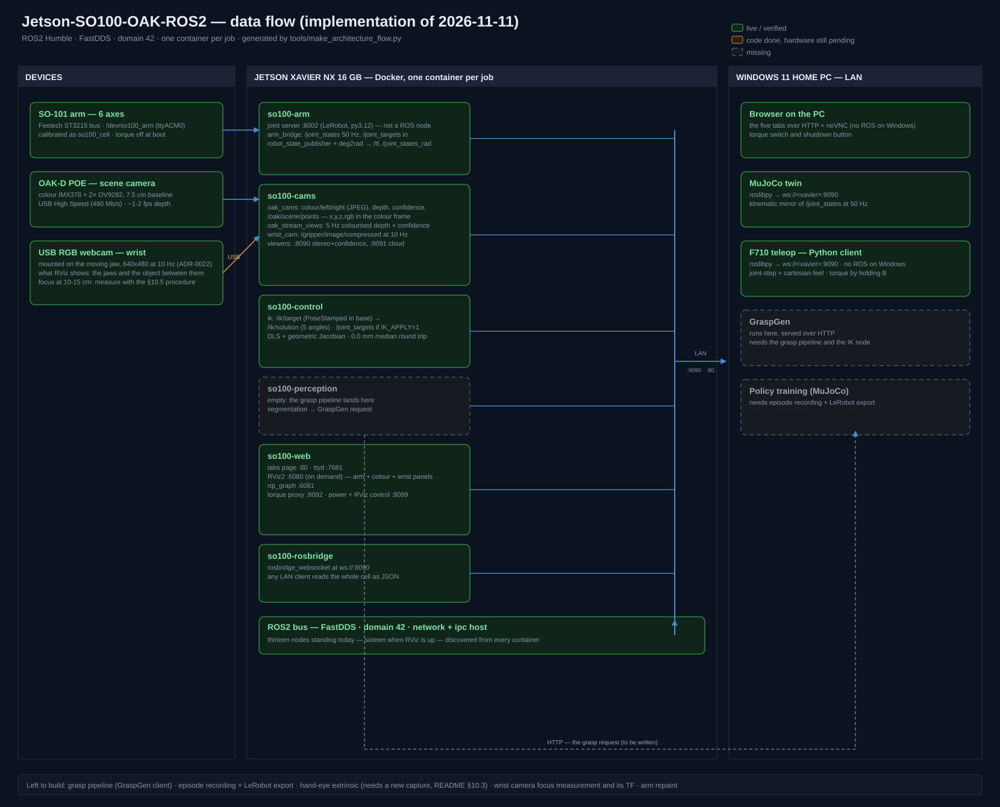

# Architecture overview

One-page view of the cell. Every decision below is tracked as an ADR in `docs/adr/`; the working plan and methodology live in `docs/PROMPT.md`. **This project starts from zero: no prior software baseline is assumed; the repo is the single source of truth.**

## Machines

- **Jetson Xavier NX 16 GB** — Ubuntu 20.04, JetPack 5.1.5, Docker + nvidia-container-toolkit. Runs the whole ROS2 stack: Humble in containers, FastDDS, domain 42. LAN address assigned at provisioning.
- **Windows 11 Home PC** — visualization (Chromium/noVNC), GraspGen server, F710 C++ client, training (MuJoCo + Isaac Sim).
- **Devices** — SO-100 arm (serial `ttyACM0`), OAK-D scene (USB3), OAK-D Lite wrist (USB3).

## Containers on the Xavier (compose, one per domain — ADR-0003, ADR-0019)

| Service | Contents | Status |
|---|---|---|
| `arm` | LeRobot SDK bridge → joint states + joint commands (ADR-0006, ADR-0009) | live — 6/6 motors, /joint_states at 50 Hz |
| `cams` | custom depthai node: scene + wrist pipelines (ADR-0007, ADR-0008) | live — scene color/depth/confidence/IMU topics |
| `perception` | segmentation → GraspGen request (ADR-0013) | planned |
| `control` | joint API, episode recording rosbag2 (ADR-0012) | planned |
| `web` | RViz2 + rqt_graph via noVNC, ttyd, tabs page (ADR-0014, ADR-0018) | tabs page + ttyd live; RViz2 image build in progress (see README "Web image build") |
| `rosbridge` | WebSocket bridge for the MuJoCo twin, ws://:9090 (ADR-0019) | live — verified 50 Hz to a LAN PC |

## Data flow

## Zero-copy (ADR-0004)

- Intra-process (LoanedMessages) inside the perception pipeline.
- FastDDS shared-memory transport between containers (`--ipc=host`, ADR-0005).
- Plain DDS/UDP only for LAN traffic (Windows links).

## Key interfaces

- ROS2 Humble / FastDDS / `ROS_DOMAIN_ID=42` (ADR-0001, ADR-0002).
- Joint-space API (ADR-0009); GraspGen SE(3) → joint conversion lives on Windows (ADR-0013).
- Episode recording: rosbag2 → LeRobot format (ADR-0012).

## ADR index

| ADR | Decision |
|---|---|
| 0001 | ROS2 Humble in Docker containers (dustynv L4T R35.x) |
| 0002 | FastDDS RMW, domain 42 |
| 0003 | One container per domain, docker compose |
| 0004 | Zero-copy: hybrid intra-process + FastDDS SHM |
| 0005 | Docker IPC: `--ipc=host` |
| 0006 | SO-100 driver: LeRobot firmware + SDK, rclpy bridge |
| 0007 | OAK-D driver: depthai-core from source + custom Python node |
| 0008 | Gripper camera: OAK-D Lite on the shared depthai node |
| 0009 | Control concept: joint-space API |
| 0010 | Camera mounting: both (fixed scene OAK-D + wrist Lite) |
| 0011 | Extrinsic calibration: easy_handeye + ChArUco |
| 0012 | Episode recording: rosbag2 + offline conversion to LeRobot |
| 0013 | GraspGen runs on the Windows PC (client-server over LAN) |
| 0014 | RViz: headless RViz2 container + noVNC on the Xavier |
| 0015 | Windows visualization: noVNC stream in Chromium |
| 0016 | Training: MuJoCo + Isaac Sim on Windows |
| 0017 | F710 teleop: native Windows C++ client (rclcpp + SDL2) |
| 0018 | Web interface: noVNC tabs + ttyd terminal |
| 0019 | MuJoCo twin transport: rosbridge WebSocket (jammy container, `ipc: host`, kinematic mirror) |
| 0020 | F710 teleop over the same rosbridge (Python client); C++ client kept as alternative |

## Open items before implementation (v0.1)

- [x] Configure the SO-100 motors (`lerobot-setup-motors`: unique IDs + baudrate in servo EEPROM) and run LeRobot calibration. (ADR-0006 amended: the CH9102 adapter has no firmware to flash. IDs already 1–6; calibrated on the Xavier as id `so100_cell`.)
- [x] Build `depthai-core` from source on the NX. (v2.33.0 installed at `~/depthai` + bindings in `~/oak/.venv`; USB3/Lite link verification pending the owner's cabling.)
- [x] Compose file + provisioning script for the six services. (docker/docker-compose.yaml + scripts/provision-jetson.sh deployed on the Xavier; six containers, verified — see README "Container stack".)
- [x] MuJoCo twin over rosbridge WebSocket (ADR-0019). (so100-rosbridge live at ws://:9090; Windows twin mirrors /joint_states — verified 2026-11-08.)
- [x] RViz2 tab live: source-built rviz2 in the web image (prebuilt workspace fast path), arm model from phosphobot's canonical SO-100 assets — see README "RViz tab".
- [ ] Print ChArUco board and run easy_handeye for both cameras.
- [ ] Windows: ROS2 Humble binary + VS Build Tools + SDL2, firewall rules for DDS.
- [ ] Check the Windows PC GPU for Isaac Sim viability.
